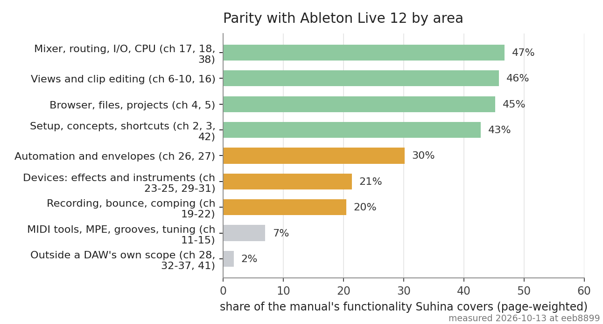

<!-- parity:begin title --># Parity with Ableton Live 12 (status check, 2026-10-13)<!-- parity:end -->

**This file is the source, not a rendering of one.** Everything in it is editable markdown. The
parts between the `parity:begin` and `parity:end` comment markers are written by
[`scripts/parity/update_report.py`](../../scripts/parity/update_report.py) from
[`score.py`](../../scripts/parity/score.py) and [`devices.json`](../../scripts/parity/devices.json);
everything outside those markers is prose, and it is edited here. The rule that keeps the two apart:

> **A number lives in a marked part. Prose does not quote a number the marks already carry.** If a
> sentence needs one, the sentence goes inside a marker.

The marked parts are regenerated on `main` after every merge, by the same workflow that writes
[`docs/INDEX.md`](../INDEX.md) and [`docs/commands.md`](../commands.md)
([`docs-generated.yml`](../../.github/workflows/docs-generated.yml)), so a pull request changes only
the inputs and two pull requests never conflict on the numbers. The command count comes from the
command registry, through `docs/commands.md`. CI checks that the inputs render and the markers are
whole, not that the marked parts are current:

```sh
python scripts/parity/update_report.py --check-inputs  # what CI runs on a pull request
python scripts/parity/update_report.py                 # rewrite the marked parts, to look; not committed
```

| To change | Edit |
|---|---|
| a sentence, a judgement, a heading, a link | this file, outside the markers |
| a coverage estimate, a status, a chapter's note | `CHAPTERS` in [`score.py`](../../scripts/parity/score.py) |
| which device has a counterpart, or its kind | [`devices.json`](../../scripts/parity/devices.json) |
| a **new measurement**: the page counts, the section counts, the date, the commit | run `scripts/parity/run.py --pdf <a manual you own>`, then `MEASURED_AT`, `MEASURED_COMMIT`, `MANUAL_CHAPTERS`, `MANUAL_PDF_PAGES` and `SECTIONS` in `score.py` |

The measurement's date and commit appear in the title and on both figures, so a stale measurement is
visible rather than implied. `last_verified` in the front matter is stamped on `main` when a pull
request changes this text (`scripts/docs.py stamp`; the docs bot's regenerations do not count), and
set by hand by someone who checks the text against the code without changing it.

This is an internal status measurement, not product text: it names Live and its devices only to
say what Suhina does and does not have yet (AGENTS.md rule 9 keeps those names out of Suhina's own
documentation and UI). The scope decision it leads to is
[ADR 0016](../decisions/0016-parity-target.md).

## Sources and IP

- The measurement was read from *Ableton Reference Manual Version 12*, the Live 12 manual, which is
  public documentation and an allowed clean-room source (CONTRIBUTING.md › Clean-room › Allowed
  sources). Its size is in the headline table above.
- **No content from the manual is in this repository.** No page of its text, no table, no
  screenshot and no device parameter list is copied, and the manual PDF is never committed:
  `scripts/parity/extract.py` reads a copy **you** own, from a path you give it, and writes to
  `target/parity/`, which git is told to ignore.
- What is here is ours: the coverage judgements, the roll-ups, the prose, and the chapter titles
  and device names used as references. The device tables say what a device *is* in two or three
  words of our own choosing (a category), never how the manual describes it.
- If any of this still looks like too much taken from a proprietary product, report it the way
  [`IP.md`](../../IP.md) describes; the material is removed first and discussed after.

## 1. Headline

<!-- parity:begin headline-table -->
| Measure | Value |
|---|---|
| The manual it was measured from | 43 chapters, 1039 PDF pages, 999 pages of feature text |
| Page-weighted coverage of everything the manual documents | **about 26 %** |
| Same, without Push 1 and 2, Max for Live (+ its devices) and video | **about 30 %** |
| Same, over the scope the roadmap aims at (also without accessibility) | **about 30 %** |
| Weighting each chapter by its numbered sections instead of its pages | **17 %** (the two weightings agree) |
| Numbered manual sections | **344**, of which **111 (32 %)** sit in chapters Suhina has not started at all |
| Built-in devices | **11** (9 effects, 1 MIDI effect, 1 instrument) against Live's 63 (42 audio effects, 8 MIDI effects, 13 instruments) |
| Commands | **243**, every one reachable from the UI, the CLI and MCP |
| Still absent as whole features | MPE, Grooves, Tuning, Comping, Racks, Clip Envelopes, Push, Link, video, accessibility |
<!-- parity:end -->

"Page-weighted coverage" is the chapter table below aggregated: each chapter gets a coverage
estimate, weighted by how many pages of the manual it fills. Section 9 says what that estimate
can and cannot mean.



## 2. Where the project stands

Suhina is pre-alpha with milestones M0-M2, M5 done and M3, M4, M6, M8 in progress
([ROADMAP.md](../../ROADMAP.md)). Against the manual's functional surface that reads as:

- **Working end to end:** reading Live Sets, offline render and real-time playback, audio clips
  with real-time time-stretching, clip launching with quantisation, out-of-process CLAP and VST3
  hosting, commands with undo, the CLI and MCP, the Session and Arrangement views, the browser with
  an index on disk and the sample map.
- **Not started at all:** recording (audio or MIDI), automation of any kind, clip envelopes, racks
  (macros, parallel chains, zones, drum pads), MIDI note editing and MIDI tools,
  grooves, tuning systems, MPE, comping, take lanes, video, Link and MIDI-clock sync, MIDI remote
  mapping, Push, and any control-surface support.
- **Started but narrow:** the device catalogue (section 5), the clip view, arrangement editing
  beyond moving and fading clips, and the browser's non-core parts (packs, collections, cloud, the
  tag editor).

### Three places the repository's own docs read better than the code

Checked while writing this, from the code rather than from `ROADMAP.md`:

- **The warp mode names are labels, not algorithms.** The model declares Re-pitch, Rhythmic, Tonal,
  Texture, Smooth and High Quality (`crates/model/src/lib.rs`), but the engine special-cases only
  Re-pitch and runs every other mode through the same Signalsmith port
  (`crates/engine/src/stretch.rs`), falling back to Re-pitch outside 0.25x-4x. Six mode names, one
  algorithm.
- **Return tracks are silent.** `Channel::sends` is filled by the `.als` importer and stored, but no
  command sets a send and the engine never reads one (`crates/engine/src/buses.rs` handles the
  master and groups only). An imported set with return tracks shows them and plays nothing through
  them.
- **The presets folder holds only a README.** [ADR 0014](../decisions/0014-stock-presets.md)
  proposes the preset format; no preset ships yet, so DX7 voice files are the only presets.

## 3. Chapter by chapter

Pages are pages of the manual body; "Suhina covers" is the estimated share of that chapter's
documented behaviour that exists today.

<!-- parity:begin chapter-table -->
| # | Chapter | Manual pages | Suhina covers | Status | What exists / what is missing |
|---|---|---|---|---|---|
| 1 | Welcome to Live | 1 | — | n/a | Front matter. |
| 2 | First Steps (installation, Learn/Info view, Settings) | 11 | 52 % | partial | Release and nightly packages for Windows, macOS and Linux; Help > About names the build (version, nightly date and commit, platform). Settings pages, grouped by task in headed sections, scrolling and searchable: General, Export (MCP write folders), Arrangement, Session and mixer, Clip editor, Transport, Detail area, Browser, Appearance (zoom, theme, graphics), MIDI, Audio (driver/device/rate/buffer/exclusive/cue; a change or a device back after unplugging keeps playback and launched clips going; input device, MIDI inputs on/off), Shortcuts, Plug-ins; the detail area beside the browser or across the full width. Missing Link, Tempo & MIDI, File & Folder, Library, Record/Warp/Launch, Learn view, Info view. |
| 3 | Live Concepts | 27 | 50 % | partial | Control bar, browser, sets, arrangement/session, tracks, audio/MIDI clips, devices, mixer concepts exist. Routing, recording, racks, clip/device view and presets are missing or thin. |
| 4 | Working with the Browser | 60 | 49 % | partial | Search, categories, folders watched on disk, pins, recent, colour tags, preview through the engine, sample map by sound similarity (smooth with 200 000 items, also while its window is resized) with kinds recognised from the sound and set by hand; samples and MIDI files dragged from the system's file manager land like a browser drag; dropping one sample on an empty MIDI track adds Sampler (exact placement waits for pointer positions from the windowing layer); installed plug-ins grouped by vendor in the tree, and in the Plug-ins category as the instruments or the effects by name and format, with pins and tags on them. Missing collections/tag editor depth, packs, Splice, Cloud, Push transfer, filter groups, browser history. |
| 5 | Managing Files and Sets | 43 | 40 % | partial | .suhina save/open, File > Open recent, .als import, templates, several projects in tabs, missing-file locate and relink, backups on an interval or before critical operations with the offer after a crash. Export renders the mix to wav (32f, 24 or 16 with dither), flac, ogg or mp3 (through the vendored LAME 3.100 encoder, at 128/192/256/320 kbps or VBR V0/V2, at 32/44.1/48 kHz), at a sample rate, with normalise and overwrite refused until asked: File > Export… (format, rate, depth, mp3 rate, normalise, dither, overwrite) and the shared project.export (a range and tail, a source, or the whole mix), one export at a time, the state the running plug-ins have now (what their editors changed), and the write rules held again where the bytes land. Settings > Export grants and revokes MCP write folders, including the project-folder default; attached MCP exports prepare over frames and render off the window thread. Missing project folders/collect, unused files, packing, .asd, decoding cache, set merging, file-reference view, the export dialog's source and range rows. |
| 6 | Arrangement View | 22 | 60 % | partial | Layout, zoom, transport, track headers with a band of the track colour that opens the colour palette, ruler/play start, play from the selected clip, clip drag+move, overlap replace/stack, fades and fade shapes, the control bar's grid value (bars to triplets, or none) drawn as lines that adapt to the zoom and snapping moves, drops, fades and ruler clicks (Alt for off the grid), nested groups folded and unfolded, tracks dragged into and out of groups, markers (locators: add, move, rename, delete, jump; imported from Live Sets), the arrangement loop brace (draw, resize, move, on/off with Ctrl+L; playback wraps sample-accurately; imported from Live Sets), split at the playhead or a clicked beat, consolidate (MIDI joined, audio rendered to a file), time-signature changes (commands; the ruler counts bars through them and marks them), time selections painted over clips, one row of stacked clips consolidated on its own, a waveform zoom that draws audio clips larger without changing their sound (a slider by the ruler, Ctrl+Alt+Up/Down, a setting). Missing previous/next marker, punch in/out, editing signature changes on the ruler, crop, crossfades, linked-track editing, the time commands. |
| 7 | Session View | 13 | 67 % | partial | Slots, scenes, scene launch, stop buttons, track status, column headers filled with the track colour and a colour palette opened from the channel strip (one palette shared with the track menu and colour tags), quantised launching, a mixer resized from its top edge with a channel strip per track that shows more as it grows (volume fader with meter and dB, pan, sends, name, device list), on audio tracks an input block above the toggles (Audio From with the source's dropdown and In/Auto/Off), a double-click that makes a clip of the track's kind (a setting), selecting a slot, copying clips between the arrangement and slots (keys, menus, a drag over the view switch); scenes inserted, duplicated, deleted and renamed from a menu, with a tempo and time signature each. A launched clip is selected and the detail area shows its follow-action controls. Missing capture-and-insert scene, moving clips between slots, select-on-launch options. |
| 8 | Clip View | 34 | 22 % | started | Detail area shows clip properties and, for a MIDI clip in the Arrangement, a first piano roll (docs/spec/ui-clip-editor.md): keys, ruler, note grid, velocity lane, zoom and scroll, a toolbar of tool icons with the note clipboard and a toolbar size, a MIDI tools column beside the notes, and the selection described in the clip column (count, span, pitch and velocity range); the editor keeps a least height with its notes in view and closes by its splitter, an x or View > Hide editor, opening again when a clip is selected. The clip column edits the clip: loop on or off, an audio clip's loop start and end, gain, warp on or off, warp mode and transpose. No clip panels, no sample editor, no groove/scale panels. |
| 9 | Audio Clips, Tempo, and Warping | 18 | 42 % | partial | Real-time time-stretching along warp markers read from Live Sets, clip gain, transpose, six warp modes in the model, warp on or off, the mode and transpose set from the clip column (clip.setAudio; warp turned on gives unwarped audio markers at its start and end), tempo detect for the browser. One stretch algorithm serves every mode except Re-pitch, so the mode names are not yet different algorithms, and rates outside 0.25x-4x fall back to Re-pitch. Tempo changes over the song (steps and ramps, a tempo map every clip follows, read from a set's tempo envelope; a scene tempo overrides it until transport.followTempoMap or the next start). Missing tap tempo, tempo follower/leader, auto-warp of long samples, warp-marker editing, quantise audio, drawing the tempo as an automation envelope. |
| 10 | Editing MIDI | 41 | 44 % | started | A first piano roll draws, selects (click, rectangle, Ctrl+A), moves, resizes and deletes notes on the grid (Alt off-grid), by mouse or by arrow keys, with Select, Draw, Paint, Erase, Slice and Mute tools (keys 1 to 6, the wheel with the right button held steps through them) and its own grid value (one grid menu: snap on or off, adaptive widths that follow the zoom, fixed values, finer and coarser, triplets, Ctrl+1 to Ctrl+4), pulled up to the full height, copies, cuts, pastes and duplicates them, splits them at a drawn cut line (note.split splits every note the line crosses), plays keys through the track's instrument, mutes and unmutes notes (a muted note keeps its place and is never played, in the model, the project file and an imported Live Set), quantises them (Ctrl+U, and grid, amount and ends in the MIDI tools column) and edits velocity in a lane, through note.* commands with undo; a duplicated clip's notes are its own once edited. A workflow menu in its toolbar switches between three presets and a Custom mix of the click, right-click, double-click and duplicate behaviours. The ruler shows the clip's loop and its start and end markers, dragged on the grid (clip.setLoop, clip.setStart, clip.setLength), zooms and scrolls time when dragged, and Z and Shift+Z zoom to the selection or the clip. A note's left edge moves its start, Ctrl+drag copies, Alt+drag sets velocity, a line drawn in the velocity lane sets many stems, the lane's height is dragged and an Audition button sounds drawn and moved notes. Ghost notes of the clips playing together, of the same track or of one picked clip are drawn faintly behind the notes. An empty clip of the track's kind (MIDI or audio, the audio one with no file yet) is made with a double-click on a slot or a lane (clip.create). A clip has a scale (clip.setScale, a project default new clips take) whose keys the rows mark, and Fold and Fold to scale show only the keys with notes or in the scale. No chords, probability or MPE lanes. |
| 11 | MIDI Tools | 37 | 12 % | started | A MIDI tools column runs quantise, transpose, humanise, fit to scale, invert, reverse, legato, x2 and /2 and the velocity randomise and ramp over the selection or the whole clip, each one note.* command with undo and a seed for the random ones. No chord/strum/arpeggiate tools, no generative or shape-based tools. |
| 12 | Editing MPE | 10 | 0 % | absent | No MPE data, editing or MPE-aware devices. |
| 13 | Converting Audio to MIDI | 5 | 5 % | planned | Spec written (docs/spec/audio-to-midi.md); Sampler slicing, dynamic manual boundaries and waveform zoom/pan are available; audio-to-MIDI detectors remain roadmap. |
| 14 | Using Grooves | 6 | 0 % | absent | No groove pool, extraction or commit. |
| 15 | Using Tuning Systems | 9 | 0 % | absent | No .scl/.ascl tuning systems. |
| 16 | Launching Clips | 12 | 77 % | partial | Launch quantisation (none, 8 bars..1/32, triplets), scenes (with their tempo and time signature), stop, loop, back to arrangement (the arrangement's dimmed lanes and the ruler's button), warped launched clips, follow actions (A/B by chance, linked or timed, jump to a slot; by command and in the detail area), samples looping in slots with or without a known tempo, a slot clip's loop switched on or off (clip.setLoop), launch modes (trigger, gate, toggle, repeat) with press and release, legato, per-clip launch quantisation, slots and scenes launched from computer keys. Missing velocity amount, clip offset/nudge, launching from live MIDI notes, follow-action multiplier and scene follow actions. |
| 17 | Routing and I/O | 22 | 39 % | partial | Track output to main or a group (track.setOutput); MIDI controllers play the armed tracks and, with auto-arm on, the selected one as well (while a take records, arming does not follow the selection, Settings > MIDI, #834), with MIDI monitoring Auto / In / Off per track, each track choosing its MIDI port and channel (track.setMidiInput), with the mod wheel, pitch bend and aftertouch reaching the instrument alongside notes (#812); an audio input device with a channel or pair per track and monitoring Auto / In / Off (track.setAudioInput). No MIDI out, external instrument, resampling, sidechain, multi-timbral. |
| 18 | Mixing | 18 | 59 % | partial | Faders (vertical in the Session view's channel strips), pan, mute, solo (exclusive/Ctrl), groups as buses nested up to 16 deep (solo and mute through the levels), master, latency compensation, sends pre or post fader into return tracks that run their device chains (track.setSend, track.setSendMode, return.add/remove/rename, send knobs in the Session mixer), level meters (peak, RMS, clip) per track, group, return and main, also over MCP, and a cue output on a second pair of the device (previews, per-track cue, cue volume); return tracks imported and drawn. Missing crossfader, track delay, send fields in the Arrangement headers. |
| 19 | Recording New Clips | 13 | 45 % | partial | Independent record arm and Auto / In / Off input monitoring (MIDI controllers, audio inputs); MIDI and audio recording into an empty slot from the next launch boundary (ended on the next one, then played looped) or into the arrangement, several armed tracks at once, a count-in of 1, 2 or 4 bars, takes lined up with what was heard, audio written to WAV files off the audio thread, one undo step per take. Missing overdub, punch in/out, recording automation, capture MIDI, session record button. |
| 20 | Bounce to Audio | 6 | 15 % | partial | Whole-project offline render to 32-bit float WAV (CLI/MCP), from an open project with its running plug-ins' state as heard; no per-track or group bounce, no paste. |
| 21 | Comping | 6 | 0 % | absent | No take lanes, no comping. |
| 22 | Stem Separation | 8 | 0 % | planned | Roadmap item (Demucs candidate, weights unaudited). The pipeline around a model (chunking, resampling) exists in crates/separation with a test backend; no model and nothing a user can run yet. |
| 23 | Working with Instruments and Effects (Device View) | 34 | 40 % | partial | Device chains per track and bus, parameters through device.* commands and the detail area, the devices one click from a MIDI clip's editor (a Clip / Devices switch, Ctrl+Shift+D) and a double-click on a track header or channel strip that shows its devices, DX7 voices, stock-preset ADR, latency compensation, plug-in state in the panel. Every built-in device, .sd device and running plug-in has editable controls in its panel (a layout, or a generated parameter list), and a device may open a larger expanded panel over the main area. SDK-authored .sd effects and instruments load onto tracks, embed in projects, expose parameters, graphs and custom panels, and support explicit revision updates. Missing A/B, hot-swap, preset browser depth, defaults, device delay review. |
| 24 | Using Plug-Ins | 12 | 74 % | partial | CLAP and VST3 hosted out of process, sandboxed, VST3 bundles on Windows, macOS and Linux, editors (Windows/X11), scans that try failures again and settle files built for another processor, a plug-in manager (plug-ins switched off, several picked with Ctrl, Cmd or Shift and turned off or on from the right-click menu, folders per format and switched off), latency compensation (followed when a plug-in changes its latency while it plays), saved state (a change in an editor counts as unsaved), VST2 read and matched to VST3, parameters set and automated from the engine and shown as a generated list in the device panel, the song's tempo, transport, position, bar, time signature and loop given to every plug-in, ARA plug-ins on audio tracks (arrangement clips, edits saved, clip changes followed live, the editor in the clip's place, one document a plug-in and project so its editor shows every track; warped and looped clips not yet). Missing AU, VST2 hosting, configure mode, VST preset banks, sidechain parameters. |
| 25 | Instrument, Drum and Effect Racks | 20 | 25 % | partial | Device groups: Ctrl+G groups picked devices, parallel branches with volume, pan, mute and solo in the group's panel, a mix against the dry signal and an output gain, instruments layered on the same notes, plug-ins inside, latency compensated, groups nested four deep, moved and duplicated by command. No macros, key/velocity/chain zones, drum pads or group presets. |
| 26 | Automation and Editing Envelopes | 22 | 48 % | partial | Envelopes for track volume, pan and mute, built-in, .sd and plug-in device parameters: breakpoints with curved segments and jumps, saved, played in playback and renders (64-frame steps, ramped mixer gains), a manual change turning a lane off until re-enabled. Lanes under each track in the Arrangement: a parameter chooser with a search, the automated parameters first, devices and parameter groups folded under headings, points added, moved on the grid, selected and moved or deleted together, curves bent by dragging, re-enabled from the lane, a click near the line adding a point on it, a faint line at the value of a lane without points. Missing recording, drawing with a pencil, plug-in lanes in the view, send, master and tempo automation, locking, simplifying envelopes. |
| 27 | Clip Envelopes | 13 | 0 % | absent | No clip envelopes. |
| 28 | Working with Video | 6 | 0 % | absent | No video import or window. |
| 29 | Live Audio Effect Reference | 139 | 21 % | partial | Suhina has 10 effects (utility, auto-pan, eight-band EQ, three-band DJ EQ, vinyl distortion, overdrive, compressor, limiter, delay, reverb) against 42 documented audio effects; the EQ, delay and reverb take every parameter of their counterparts, several others are close in kind but far narrower in parameters and modes. |
| 30 | Live MIDI Effect Reference | 13 | 10 % | started | One built-in MIDI effect, pitch: semitones or scale degrees with the clip's scale, and a key window that blocks, folds or limits notes; its step buttons are planned. SDK MIDI-effect graphs run before the instrument too. The other 7 documented MIDI effects are missing. |
| 31 | Live Instrument Reference | 120 | 12 % | started | FM synth and single-source sample/granular instrument against 13 instruments; graphical envelope stages with cumulative timing and directly draggable points, persistent waveform with grouped granular controls and a shared six-shape pitch/filter/volume/pan LFO with Random, Hz/time/beat-synced rates, independent source and loop-edge fades and tempo-synchronised sample Warp using editable original BPM; five pitch-preserving modes currently share one stretcher; no multisample zones, drum sampler, wavetable, subtractive or physical modelling yet. |
| 32 | Max for Live | 6 | 5 % | planned | ADR 0021 defines data-only .sd graphs with a Rust SDK, DSP runtime and custom UI nodes; typed sample resources, polyphonic voice/grain subgraphs, slicing, stretch and versioned components are executable through the Rust host API; visual graph editing is planned. Imported Max devices remain placeholders; no Max runtime. |
| 33 | Max for Live Devices | 35 | 0 % | absent | Not applicable until Max for Live exists. |
| 34 | MIDI and Key Remote Control | 9 | 25 % | partial | Every command can be bound to a key (keymap.json, Settings > Shortcuts); a key mapping mode (Ctrl+M) maps keys to clip slots, scenes and stop buttons, saved in the project, and launcher.addMapping takes MIDI notes too. No live MIDI remote input, CC mapping, takeover modes or mapping browser. |
| 35 | Using Push 1 | 40 | 0 % | absent | No control-surface support. |
| 36 | Using Push 2 | 59 | 0 % | absent | No control-surface support. |
| 37 | Synchronizing with Link, Tempo Follower, and MIDI | 9 | 0 % | absent | No Link, no Tempo Follower, no MIDI clock sync. |
| 38 | Computer Audio Resources and Strategies | 7 | 40 % | partial | CPU-load meter, the program's RAM in the control bar, buffer-size choice, render-ahead engine, plug-in deadline reporting, real-time scheduling without setup (MMCSS Pro Audio, SCHED_FIFO or rtkit), an 80 s / 58-warped-clip set opens in 0.4 s. Missing track freeze, disk-load meter. |
| 39 | Audio Fact Sheet | 8 | — | n/a | Not a feature list. Suhina renders 32-bit float and does not dither; no neutrality test suite. |
| 40 | MIDI Fact Sheet | 6 | — | n/a | Not a feature list; MIDI timing and quantisation behaviour. Suhina has no MIDI timing tests yet. |
| 41 | Accessibility and Keyboard Navigation | 11 | 5 % | absent | No screen-reader or keyboard-navigation story beyond the shortcut system. |
| 42 | Live Keyboard Shortcuts | 23 | 30 % | partial | Keymap covers command binding, selection actions and window actions; many editing shortcuts have no command behind them yet. |
| 43 | Credits | 3 | — | n/a | Front matter. |
<!-- parity:end -->

## 4. By area

<!-- parity:begin area-table -->
| Area | Manual pages | Covered |
|---|---|---|
| Views and editing (ch 6-10, 16) | 140 | 46 % |
| Browser, files, project (ch 4, 5) | 103 | 45 % |
| Devices (ch 23-25, 29-31) | 338 | 21 % |
| Mixing, routing, I/O (ch 17, 18, 38) | 47 | 47 % |
| Automation, envelopes (ch 26, 27) | 35 | 30 % |
| Generative/transform (ch 11-15) | 67 | 7 % |
| Recording, bounce, comp (ch 19-22) | 33 | 20 % |
| Outside scope (ch 28, 32-37, 41) | 175 | 2 % |
| Setup, shortcuts (ch 2, 3, 42) | 61 | 43 % |
<!-- parity:end -->

## 5. Devices

Where the manual gives one device several modes (Auto Pan-Tremolo, Chorus-Ensemble,
Phaser-Flanger) it is counted once, as the manual's own section does. Suhina's own devices are the
last table in this section.

<!-- parity:begin device-counts -->
| | Live 12 | Suhina equivalent exists | Suhina plans one (ROADMAP) | No counterpart named |
|---|---|---|---|---|
| Audio effects | 42 | 12 | 7 | 23 |
| MIDI effects | 8 | 1 | 0 | 7 |
| Instruments | 13 | 2 | 8 | 3 |
| **All** | **63** | **15** | **15** | **33** |
<!-- parity:end -->

<!-- parity:begin device-none -->
Read the last two columns together: **even if every device the ROADMAP names is built, 33 of Live's 63 devices (52 %)
still have no counterpart** - 7 of the 8 MIDI effects, the amp and cabinet models, the modulated-delay
family (chorus, ensemble, vibrato, phaser, flanger, doubler), the spectral pair, the analysers
(Spectrum, Tuner), the gate, the grain and beat repeaters, the vocoder, and the synths the roadmap
does not name (Meld, Electric, Impulse, External Instrument).
<!-- parity:end -->

### Live audio effects (manual chapter 29)

<!-- parity:begin device-audio -->
| Device | Manual | Kind | Suhina | Note |
|---|---|---|---|---|
| Amp | 29.1 | neural amp capture | equivalent | Suhina NAM Amp Modeler runs a .nam model with trims, its own EQ and a trim delay (docs/spec/nam-amp-and-cab.md) |
| Auto Filter | 29.2 | multimode filter | planned | ROADMAP: EQ, filter (own dsp filters); only biquads and crossovers exist today |
| Auto Pan-Tremolo | 29.3 | pan and tremolo | equivalent | Suhina auto-pan does both modes |
| Auto Shift | 29.4 | pitch correction | none |  |
| Beat Repeat | 29.5 | buffer repeat | none |  |
| Cabinet | 29.6 | cab impulse response | equivalent | Suhina NAM Cab Loader convolves a .wav IR with a phase invert, a high pass, tone cuts, a trim delay and a volume |
| Channel EQ | 29.7 | console EQ | none | the DJ EQ is a kill-style DJ EQ, a different kind |
| Chorus-Ensemble | 29.8 | chorus and ensemble | none |  |
| Compressor | 29.9 | compressor | equivalent | Suhina compressor (stereo-linked, soft knee, side-chain high-pass, dry/wet) |
| Corpus | 29.10 | resonant body | none |  |
| Delay | 29.11 | delay | equivalent | Suhina delay takes every panel parameter (sync, offsets, filter in the loop, LFO, Repitch/Fade/Jump, ping-pong, freeze) |
| Drum Buss | 29.12 | drum bus processor | none | the compressor is a plain compressor; ROADMAP's bus compressor is a different device |
| Dynamic Tube | 29.13 | tube saturation | none |  |
| Echo | 29.14 | modulation delay | planned | ROADMAP: delays |
| EQ Eight | 29.15 | parametric EQ | equivalent | Suhina EQ takes every band parameter of both curves (eight types, Stereo/Left-Right/Mid-Side, Scale, Adaptive Q); no analyser, Audition or oversampling option yet |
| EQ Three | 29.16 | DJ EQ | equivalent | Suhina three-band DJ EQ: gains from silence to +6 dB with kills, Linkwitz-Riley crossovers at 24 or 48 dB/octave; its 0 dB sum keeps the measured dip at the low crossover |
| Erosion | 29.17 | modulation destruction | none |  |
| External Audio Effect | 29.18 | external send and return | none | needs external audio I/O, which Suhina does not have |
| Filter Delay | 29.19 | filtered delay | none | the planned delay device is not documented as filtered or three-line |
| Gate | 29.20 | noise gate | none |  |
| Glue Compressor | 29.21 | bus compressor | planned | ROADMAP: bus compressor; docs/spec/device-import.md maps it there |
| Grain Delay | 29.22 | granular delay | none |  |
| Hybrid Reverb | 29.23 | convolution and algorithmic reverb | planned | ROADMAP: algorithmic and convolution reverb |
| Limiter | 29.24 | brickwall limiter | equivalent | Suhina limiter (1.5 ms lookahead) |
| Looper | 29.25 | live looping | none |  |
| Multiband Dynamics | 29.26 | multiband dynamics | planned | ROADMAP: multiband dynamics |
| Overdrive | 29.27 | overdrive pedal | equivalent | Suhina overdrive |
| Pedal | 29.28 | distortion pedal | none |  |
| Phaser-Flanger | 29.29 | phaser and flanger | none |  |
| Redux | 29.30 | bit reduction | none |  |
| Resonators | 29.31 | tuned resonators | none | the planned physical-modelling work is an instrument, not this effect |
| Reverb | 29.32 | algorithmic reverb | equivalent | Suhina reverb takes every panel parameter (input band, early reflections, damped network, chorus, freeze, stereo) |
| Roar | 29.33 | multistage saturation | planned | ROADMAP: multi-stage saturation |
| Saturator | 29.34 | waveshaping saturation | planned | ROADMAP: multi-stage saturation; Suhina's overdrive is a single stage |
| Shifter | 29.35 | pitch and frequency shifter | none |  |
| Spectral Resonator | 29.36 | spectral resonator | none |  |
| Spectral Time | 29.37 | spectral delay | none |  |
| Spectrum | 29.38 | spectrum analyser | none |  |
| Tuner | 29.39 | tuner | none |  |
| Utility | 29.40 | gain, width, mono, DC | equivalent | Suhina utility is a superset |
| Vinyl Distortion | 29.41 | vinyl and crackle | equivalent | Suhina vinyl distortion |
| Vocoder | 29.42 | vocoder | none |  |
<!-- parity:end -->

### Live MIDI effects (manual chapter 30)

<!-- parity:begin device-midi -->
| Device | Manual | Kind | Suhina | Note |
|---|---|---|---|---|
| Arpeggiator | 30.1 | arpeggiator | none |  |
| CC Control | 30.2 | MIDI CC out | none |  |
| Chord | 30.3 | chord from one note | none |  |
| Note Length | 30.4 | note length | none |  |
| Pitch | 30.5 | pitch transpose | close | Suhina pitch: semitones or scale degrees with the clip's scale, Block, Fold or Limit to a key window; the step buttons are planned |
| Random | 30.6 | random pitch | none |  |
| Scale | 30.7 | scale remap | none |  |
| Velocity | 30.8 | velocity remap | none |  |
<!-- parity:end -->

### Live instruments (manual chapter 31)

<!-- parity:begin device-instruments -->
| Device | Manual | Kind | Suhina | Note |
|---|---|---|---|---|
| Analog | 31.1 | subtractive synth | planned | ROADMAP: subtractive synth |
| Collision | 31.2 | physical modelling | planned | ROADMAP: physical-modelling synth (Rings/Elements) |
| Drift | 31.3 | subtractive synth | planned | ROADMAP: subtractive synth |
| Drum Sampler | 31.4 | drum sampler | planned | ROADMAP: drum sampler |
| Electric | 31.5 | electric piano | planned | ROADMAP: physical-modelling synth |
| External Instrument | 31.6 | external MIDI and audio | none | needs external MIDI and audio I/O |
| Impulse | 31.7 | drum sampler | none | the planned drum sampler is for drum pads, not this |
| Meld | 31.8 | macro oscillator synth | none | no planned device matches it |
| Operator | 31.9 | FM synth | close | Suhina FM synth: DX7-style engine (MSFA port), six operators, 32 algorithms; Operator's filter, waveforms and envelopes are planned |
| Sampler | 31.10 | multisample sampler | planned | ROADMAP: sampler |
| Simpler | 31.11 | single-sample sampler | close | Sampler: single source, looping, simultaneous amplitude/filter/pitch envelope graphs with cumulative timing and directly draggable stage points, persistent full-width waveform in sample/grain modes, shared six-shape pitch/filter/volume/pan LFO with Random and Hz/time/beat/triplet/dotted/16th rate modes and independent source and loop-edge fades without a separate loop-fade control, context-sensitive source/loop S/E markers, compact filter dials and themed control groups, mono/glide, smooth voice replacement, retrigger, independent voice heads, four filter types with 12/24 slopes and ADSR/velocity/key modulation, granular mode; transient, beat, equal-region and dynamic manual slicing with draggable boundaries and waveform zoom/pan; tempo-synchronised Sample Warp with Repitch and five pitch-preserving modes sharing Signalsmith, automatic source BPM from metadata/name/detection with safe project-tempo fallback, editable original BPM and uninterrupted live warp-mode switching |
| Tension | 31.12 | physical modelling | planned | ROADMAP: physical-modelling synth |
| Wavetable | 31.13 | wavetable synth | planned | ROADMAP: wavetable synth (from Vital, under its own name) |
<!-- parity:end -->

### Max for Live devices (manual chapter 33)

Eighteen more devices (the DS drum series, LFO, Shaper, Envelope Follower, Note Echo, MPE
Control...) belong to Max for Live; [ADR 0008](../decisions/0008-patch-devices.md) proposes
Pure Data patch devices as the community route to the same end, and keeps imported Max devices as
placeholders. None of them run today.

### Suhina's own devices

<!-- parity:begin suhina-devices -->
| Device | Kind | What it does |
|---|---|---|
| utility | effect | gain, balance, width, mono, bass mono, phase, channels, DC filter (13 parameters) |
| auto-pan | effect | LFO panning and tremolo, free Hz or synced (9 parameters) |
| eq | effect | eight bands, two curves for Stereo, Left/Right or Mid/Side, Scale, Adaptive Q (84 parameters) |
| vinyl-distortion | effect | tracing, pinch, crackle, oversampled (12 parameters) |
| overdrive | effect | pedal-style: band, drive, tone, dynamics, dry/wet (7 parameters) |
| compressor | effect | stereo-linked, soft knee, side-chain high-pass, dry/wet (9 parameters) |
| limiter | effect | brickwall, 1.5 ms lookahead (3 parameters) |
| delay | effect | stereo, synced or free, filter in the loop, LFO, Repitch/Fade/Jump, ping-pong, freeze (27 parameters) |
| reverb | effect | algorithmic: input band, early reflections, feedback delay network with damping, chorus, freeze (32 parameters) |
| pitch | MIDI effect | transposes by semitones or scale degrees, keeps notes in a key window: Block, Fold, Limit (6 parameters) |
| fm-synth | instrument | six operators, 32 algorithms, DX7 voice files (173 parameters) |
<!-- parity:end -->

## 6. Where Suhina is at parity or ahead

Parity is not only about matching Live. These are places where Suhina already does what Live does,
or does something Live does not:

- **Plug-ins cannot take the project down.** CLAP and VST3 plug-ins run in their own processes with
  a per-block deadline; a crash or a hang costs that plug-in's sound, not the session
  ([ADR 0006](../decisions/0006-plug-in-hosting.md)). Live hosts plug-ins in its own process.
- **Everything is a command, and everything is headless.** Every command has typed parameters and
  one undo step, and all of them are reachable from the UI, `suhina-cli` and the MCP server
  ([ADR 0002](../decisions/0002-commands.md), [docs/mcp.md](../mcp.md)); agents can open projects,
  edit them and render them.
- **Real-time time-stretching** along the warp markers of an imported set, with transients within
  2 ms of the markers and an 80 s set with 58 warped clips opening in 0.4 s
  ([ADR 0003](../decisions/0003-time-stretching.md)) - one algorithm, and the honest reading
  of the six mode names is section 2.
- **The project file is open.** `.suhina` is versioned JSON
  ([ADR 0010](../decisions/0010-project-files.md)); the browser indexes folders on disk and
  watches them, with pins, recent items, colour tags and a sample map laid out by sound
  ([ADR 0012](../decisions/0012-file-library.md), [ADR 0013](../decisions/0013-sample-map-analysis.md)).
- **Stems files** (`.stem.mp4`, `.stem.m4a`) become a group of tracks with the mastering devices
  ([docs/spec/stems-format.md](../spec/stems-format.md)); the manual has no equivalent.
- **Reading Live Sets** covers tempo, time signature, tracks, scenes, slots, arrangement clips,
  MIDI notes, warp markers, clip gain and transpose, VST2 and VST3 device state and Live's Utility
  ([docs/spec/als-format.md](../spec/als-format.md)) - the manual's own file chapter is written for
  Live's own projects, not for a reader.

## 7. The largest gaps, by manual pages

<!-- parity:begin gap-table -->
| Gap | Manual pages | Today | What closing it means |
|---|---|---|---|
| Devices: effects and instruments | 338 (ch 23-25, 29-31) | 21 % | 35 more audio effects and 12 more instruments, or a decision to cover the common ones only |
| Browser and file management depth | 103 (ch 4, 5) | 45 % | collections, tag editor, project folders, collect files, unused files, packs, cloud |
| Views and clip editing | 140 (ch 6-10, 16) | 46 % | MIDI note editor, clip view panels, time selections |
| MIDI tools, MPE, grooves, tuning | 67 (ch 11-15) | 7 % | transformation and generative tools, MPE editing, groove pool, tuning systems |
| Automation and clip envelopes | 35 (ch 26, 27) | 30 % | drawing and recording automation lanes, send and tempo automation, clip envelopes |
| Recording, bounce, comping | 33 (ch 19-22) | 20 % | overdub, punch in and out, take lanes, comping, per-track bounce |
| Mixing, routing, I/O | 47 (ch 17, 18, 38) | 47 % | crossfader, inputs and monitoring, resampling |
| Outside a DAW's own scope | 175 (ch 28, 32-37, 41) | 2 % | video, Max for Live, Push 1 and 2, Link, accessibility - ADR 0016 leaves most of this out |
<!-- parity:end -->

Two observations the numbers make plain:

1. **The device catalogue is the single largest lever.** The device reference chapters are the
   biggest block of the manual and Suhina covers the smallest share of them. Nothing else moves the
   headline number as much.
2. **Whole features, not thin features, dominate the rest.** Racks and comping are each absent,
   not partial, and MIDI effects have only begun, with the pitch effect. They are also the areas
   where a DAW is judged by people coming from Live, because a missing channel is felt at once.

## 8. What the roadmap covers, and what nothing covers

| Manual area | Roadmap milestone that owns it |
|---|---|
| Reading Live Sets, `.suhina`, project files | M1, M3 |
| Playback, audio clips, time-stretching | M2, M5 |
| Commands, CLI, MCP, undo | M3 |
| Clip launching, scenes, quantisation, follow actions | M4 (launch modes still to do) |
| CLAP and VST3 hosting, latency, editors | M6 |
| Other formats (DAWproject, `.flp`) | M7 |
| Session and Arrangement views, browser, sample map, settings, installers | M8 |
| Sends and returns, automation, MIDI controllers and Push, patch devices, ARA | "Later, not ordered" |
| Audio to MIDI, stem separation | own section of the roadmap |
| **Recording (ch 19), comping (ch 21), bounce (ch 20), racks (ch 25), automation (ch 26), clip envelopes (ch 27), MIDI effects other than pitch (ch 30), MIDI tools (ch 11), MPE (ch 12), grooves (ch 14), tuning (ch 15), MIDI remote (ch 34), Link and sync (ch 37), video (ch 28), accessibility (ch 41)** | **nothing, or "later, not ordered" at best** |

Two areas are named in the roadmap only as devices ("a sampler and drum sampler", "delays,
reverbs"): the mixer work that would carry sends, and the editing work that would carry a MIDI
note editor, have no milestone. If the goal is "a Live user can move over and not lose their
workflow", those two join the device catalogue as the next epics.

### If the goal is that a Live user does not lose their workflow

Ranked by manual pages - this is the measurement's ranking. The order to *build* in is different,
and is [ADR 0016](../decisions/0016-parity-target.md) › The build order: MIDI note editing,
automation and recording first, because pages measure how much a feature is documented, not
whether a DAW is usable without it.

1. **Recording and inputs** (ch 19-21): audio and MIDI recording, arming,
   monitoring, count-in, take lanes and comping. Nothing else unlocks as much, and three later
   features (resampling, capture MIDI, bouncing a take) hang off it.
2. **MIDI editing and the cheap MIDI effects** (ch 10-11 and 30): the note editor,
   quantise, and the eight MIDI effects, of which Scale, Chord, Arpeggiator and Velocity are small
   and immediately felt.
3. **Devices, breadth first** (ch 29): bus compressor, EQ and filter, delays,
   reverb - the four the roadmap already names - then a decision about the rest.
4. **Automation** (ch 26-27): device and mixer parameters first (the command layer
   and the model make this cheap), then tempo.
5. **Sends and returns into the engine** (part of ch 18): the model already holds the
   sends, so this is engine and command work, and it makes imported sets sound like their author
   meant them. Meters belong here too.
6. **Arrangement editing: locators, the loop brace, split, consolidate** (ch 6):
   small commands, large workflow gain, and two of them are already open issues (#98, #99).

None of the six has a milestone today; the board's open items are dominated by the plug-in epic
(M6) and UI polish. [ADR 0016](../decisions/0016-parity-target.md) turns the scope, the exclusions
and the build order into a decision; the milestone assignment itself is still open.

## 9. Method, and what this is not

- The manual was printed to PDF from its web version; its table of contents and every chapter and
  section heading were located in the extracted text, so the page counts are the manual's own.
- Coverage per chapter is a judgement, made from Suhina's documented and coded state, not a
  measurement: "half of chapter 18" means half of what the chapter describes, weighted by how much
  of the chapter is about each part. The headline figure is therefore a reading of the gap, not a
  score. It should be re-run when a milestone closes.
- Page count is a proxy for scope, not for importance, and it favours the manual's reference
  chapters (device parameters) over the small chapters that decide whether a DAW is usable at all
  (recording, automation).
- Parity with Live is not Suhina's stated goal: README says "comparable in workflow", and the
  ADR 0016 deliberately leaves out video, Max for Live and both Push chapters. Accessibility is in
  scope but has no work planned, so the headline table's last coverage row leaves it out as well.
  The headline table is the measurement's reading of the gap; the area table is the useful part.

## 10. Reproducing this

The manual is not in the repository, and neither are the numbers it was read for. Two ways to get
this document and its figures:

**From the numbers already recorded** (no manual needed; this is what the workflow on `main` runs
after every merge, and what a contributor who changed `score.py` or `devices.json` may run to look
at the result before leaving it out of the commit):

```sh
python scripts/parity/score.py          # the roll-ups, printed
python scripts/parity/update_report.py  # the marked parts of this document
```

**Measure again from scratch**, which is what updates the recorded date, commit and page counts. It
needs a copy of the manual you own:

```sh
python scripts/parity/run.py --pdf "C:/path/to/your/live12-manual.pdf"
```

Step by step, all of it writing to `target/parity/` (gitignored) except this document and the
figures:

| Script | Does |
|---|---|
| `scripts/parity/extract.py --pdf <file>` | the manual PDF to text plus page markers, and its table of contents |
| `scripts/parity/headings.py` | chapter and section headings, with their pages |
| `scripts/parity/score.py` | the coverage estimates, the page weighting and the roll-ups |
| `scripts/parity/charts.py` | the two figures, into `docs/research/` |
| `scripts/parity/update_report.py` | the marked parts of this document, from `score.py` and `devices.json` |
| `scripts/parity/run.py --pdf <file>` | all five in order |

**Keeping it current.** Every pull request that adds, changes or removes something a user can do
updates the coverage it moves in `score.py` (and `devices.json` for a built-in effect or
instrument), in the same pull request, and leaves the marked parts to `main`; one that moves no
coverage says `Parity: no change` and why in its description
([AGENTS.md › Before you finish a task](../../AGENTS.md#4-before-you-finish-a-task)).
`scripts/parity/pr_notice.py`, run by
[`.github/workflows/parity-notice.yml`](../../.github/workflows/parity-notice.yml), warns on a pull
request that changes `crates/`, `devices/` or `apps/` and does neither. It is a warning, not a
failure.
