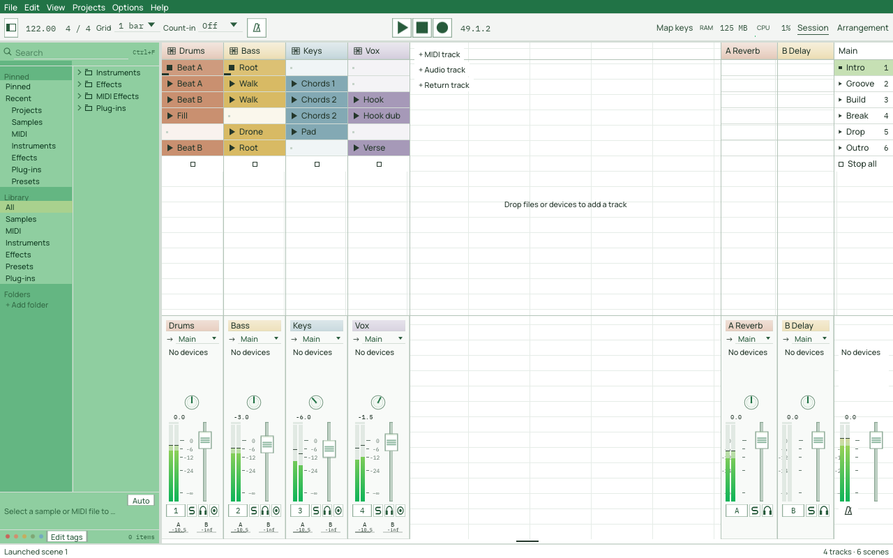
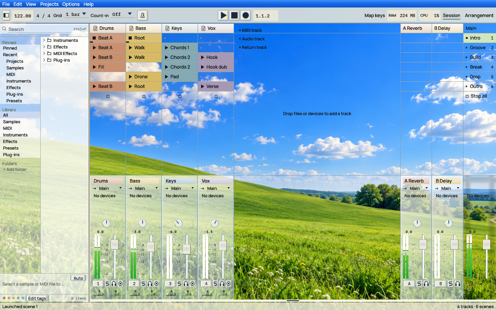
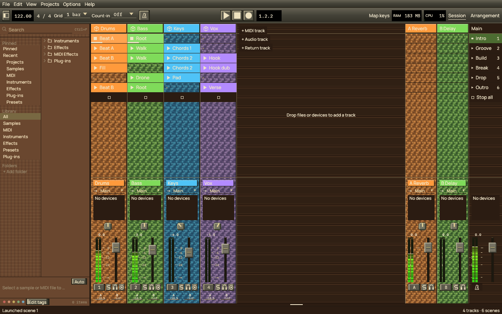

Toolbar editing keeps the real native controls and their layout visible. Entering or
leaving the editor without a change must not create a toolbar layout or change the
theme. An overlay outlines draggable modules over an 8-point snap grid; dragging
changes a horizontal offset from the existing native or CSS anchor. Native centre
and right anchors therefore keep responding to window resizing. Done commits the
draft to the theme; Cancel or Escape discards it. The controls cannot issue commands
while the overlay is active. `skin.toolbar-offsets` stores bounded integer offsets
by module id independently of the optional ordered toolbar layout.

The interaction reference requested by the user is World of Warcraft's Edit Mode:
edit the visible interface through selection outlines and alignment guides rather
than replacing it with abstract layout blocks. This is an independent Suhina
interaction specification based on the supplied screenshots and the public
[EditModeExpanded description](https://github.com/teelolws/EditModeExpanded/blob/main/README.md)
(read 2026-10-22), which describes moving visible frames and saving their positions.
That description is an add-on author's account, not official documentation of
Blizzard's grid implementation. No third-party source or artwork is reused.
A sheet of an earlier version mirrors offsets as `toolbar { offset-transport: 80px; }`; a current `theme.css` does not (see below).

SVG inheritance resolves each control role in this order: theme state artwork,
theme base artwork, shared default state artwork, shared default base artwork.
Suhina ships original default SVG files under `assets/themes/default/` and builds them into
the app, where the user-agent sheet names them (*The user-agent sheet*); there is no copy of them in the themes folder to edit (the `_defaults` folder of
earlier versions is no longer made or read). Themes store only their explicit artwork
overrides. Portable
exports include inherited artwork so they keep their appearance on another machine.
The colour of the element that draws the artwork supplies `currentColor`; inheritance does not
force the default theme's colours. Deleting an override restores inheritance.

The guide for human and AI-assisted theme authors is
[`docs/guide/theme-authoring.md`](../guide/theme-authoring.md): what/why/how/when, current
possibilities, file ownership, SVG inheritance and recovery, supported CSS integration, explicit
limits and every colour token (a test keeps its table in step with the token registry). Suhina
writes no guide or example files into theme folders, packages or backups; a `README.md` an
author put in a theme's folder is kept and travels with it.

# Theme skins

## Launcher density and meter materials

The original **Suhina Sheet** built-in theme demonstrates a light spreadsheet-like
Launcher, green application chrome, compact cells and square controls. Its own
self-contained SVG artwork lives under `crates/ui/themes/suhina-sheet/assets/` and is embedded with
the palette and CSS, so duplication/export includes the effective artwork without
depending on installed files. It uses existing native controls, commands and views;
it does not add spreadsheet functions or bundle third-party application artwork.
The menu, toolbar and native Windows application bar enter their style scopes
before painting their backgrounds, so their solid colours and CSS materials agree
with the scoped foregrounds without changing layout or menu/transport actions.
Its only settings are *Accent* and *Accent, light* (the browser's panels): every colour of its
rules and artwork mixes those two with black and white, and its swatch is the accent. The white
paper, the track and clip colours, the meters and the recording red stay as they are.



This is an actual native Linux/OpenGL capture with the detail area hidden and demo
playback providing the meter levels. The empty-space worksheet grid is decorative;
clip launch, faders, pan, scenes and routing retain their native behavior.

**Suhina Meadow** adds classic blue chrome, cream beveled controls and paper-like
browser/device surfaces over a green-hill wallpaper. The landscape is an original
AI-generated image, not a bundled operating-system photograph. Its PNG is embedded
once and shared across theme instances; export writes it as editable `background.png`.
The theme leaves the empty workspace transparent over this private image, with
translucent blue/cream glass panels and theme-owned liquid strengths (panels 48,
tracks 24, clips 12). The liquid renderer requires GPU rendering, animations enabled
and encoded/linear texture-view support; older GL adapters retain ordinary alpha
materials without installing unsupported captures. Effective SVG roles include shared original Sheet
glyphs plus Meadow's own faders, knobs, button, paper icon and mixer body.
While a private background image is active, the lines over and under the views
(`#views-top`, `#views-bottom`) stay transparent. Panel surfaces and individual splitter controls still paint
their own fills; without an image the native separator backdrop remains unchanged.



This native Vulkan capture uses the original generated wallpaper, actual theme
liquid settings and measured demo levels. It was rendered with the software Vulkan
adapter in an isolated X11 session; it does not establish physical-GPU timing.

**Suhina Blocks** uses original brown plank/grain CSS, stone-like beveled controls
and colour-keyed pixel SVG textures. It has no landscape or background PNG. Native
`track-column { track-artwork: on; }` opts Launcher slot columns into the
existing `track.body` artwork (including raw colour/state variants). The body stays
behind clip cells; empty cells preserve it while hover/stop marks remain native.
`off` or omission retains the original slot fills. `track-artwork` is a property of the
style engine, inherited (a clip inside the column can turn it `off`), and it does not change
launch/drop geometry or commands.



This native Vulkan Launcher capture uses original SVG pixel textures and CSS brown
planks. No landscape wallpaper or game artwork is used. Native replacement-alpha
surfaces leave textured empty slots untouched; hover paints as an ordinary overlay
so it cannot erase the underlying artwork.

Launcher and Arrangement remain separate views. Theme customization does not introduce
a combined view or the separately planned mixer view.

Optional `skin.session` dimensions change the native Launcher layout: `track-width`
and `return-width` (64–512 points), `scene-width` (64–512), `slot-height` (16–64),
`header-height` (20–64). Omitted values use native
geometry/preferences. A theme sets them as properties of `session` (`session { track-width:
80px; }` and the other named properties); `auto` removes an override. Mixer height continues
to use its existing native preference and divider.
Column widths affect scrolling, rendering, file/clip drop targets and hit testing
together.
`pan { appearance: knob; }` is a portable pan-face override for both Launcher and
Arrangement, read from the pan's own computed style. `field` forces a value field;
`native` or no override retains the existing global preference. The compact example
includes the knob override; themes do not need to change the user's preference.
The fader's dB labels/ticks expose `mixer-volume-scale` separately from the rail/cap
and readout, with `fader-scale` paint styling (the clip gain fader's scale too). Moving/hiding this scale does not
change the parameter or gesture. Horizontal faders retain a horizontal scale.

Meter material scopes include `meter-vertical` and `meter-horizontal`, containing
`meter-level`. An authored level gradient is anchored to the full meter range,
then clipped to each measured peak/RMS extent (and each segment). It must not stretch
or change its signal thresholds as the measured level changes. Peak/RMS opacity
remains native. Outset shadows form the glow around the lit extent, preserving
empty rails, segment gaps and native clip/reset handling.

Mixer bodies and strip-name surfaces consume their `mixer` and `track-name`
background fills, gradients and shadows above fallback/SVG artwork. A solid CSS
background replaces the native colour tint; an alpha gradient may retain underlying
track artwork. Missing rules preserve the ordinary native colours.
An original [metallic cap SVG](../../assets/themes/examples/metal-fader.svg) is supplied
as optional authoring artwork; it does not replace the protected default. Reference it
as `fader.cap` in a user theme to combine it with the gloss material example.

## Native acceptance captures

The [compact gloss follow-up](../design/reference/theme-dark-gloss-compact.png) uses
86-point track columns, 80-point returns, 18-point slots, the existing 320-point
mixer height, a centred narrow pan knob, a separately positioned dB scale and the
optional original metallic cap SVG. The meter sits left of the fader. It demonstrates
the Launcher view alone; neither a combined Arrangement view nor a standalone mixer
view is introduced. The screenshot is from actual demo playback on the same isolated
Linux OpenGL/virtual-ALSA setup described below.

Its additional mixer layout rules (› The strips) are:

```css
mixer meter { order: -1; margin: 0 8px 0 0; }
mixer fader-scale { margin: 0 6px 0 0; }
#mixer-volume-readout { width: 30px; }
#mixer-pan { width: 24px; height: 24px; margin-left: 25px; align-self: flex-start; }
mixer > track-colour { width: 2px; }
```

The capture used two example sheets of an earlier version (a compact Launcher geometry, which
carried its pan style, and a dark gloss; Suhina no longer ships them, and the gloss is kept as a
test fixture, `crates/ui/tests/fixtures/dark-gloss.css`) with these rules and the cap override.
The capture keeps the global preference at Field and verifies the theme-owned Knob
override, so that presentation does not depend on another user's settings.
The images below retain the earlier, wider geometry and colour-keyed texture example.

These are unretouched captures of the native Linux application (Mesa/OpenGL on an
isolated test display), using original dark-gloss CSS and a small original colour-keyed
name texture. The detail panel is hidden and the existing native mixer/track resizing
is used to expose controls. They demonstrate implemented adapters, not complete
browser CSS support or a finished appearance for every theme.

- [Launcher, tall mixer and live vertical meters](../design/reference/theme-dark-gloss.png).
- [Horizontal faders/meters, names at the bottom and top-only colour stripes](../design/reference/theme-dark-gloss-horizontal.png).
- [Edit interface (removed for now, issue #995): actual controls beneath outlines and an 8-point grid](../design/reference/theme-interface-editor.png).
- [Arrangement, large native track rows and replaceable note glyphs](../design/reference/theme-dark-gloss-arrangement.png).

The Launcher meter captures use actual demo playback through a paced virtual ALSA
sink. They do not verify physical audio latency or supported desktop transparency;
the native GPU transparency regression has separate automated coverage. Theme
changes were made through external JSON/CSS files while the app remained open.
Colour-dependent texture contrast is authored with named scopes, e.g.
`track-name[data-object=track-1] { color: #edf6e9; }`; arbitrary named track scopes
use `data-object`, while the toolbar's and the window's ids have their documented literal ids.

## The strips: track headers, mixer strips and the transport

A track header, a mixer strip (Main's too) and the toolbar's transport lay their parts out as a
box tree (#1453), through the helper the bars use (› The bars' rows): Flexbox and Grid on Taffy,
under the theme's sheets or the user-agent sheet alone when their layout fails. The parts are the
elements that paint them; the `group`s around them lay them out and paint nothing. A strip's
parts are laid out by `order` (a bar's items keep the app's order). The user-agent sheet holds the
layout Suhina had, so with no rule nothing moves.

The app says which parts a strip has room for and how big each is (its content box): the mixer's
height steps (`docs/design/components.md` › Height steps), a header's lines by its width and
height, a fader's length, a meter's width, a toggle's width from the strip's width. An `auto` size
is that size plus the part's padding and border; a `width` or `height` the sheet gives wins. What
the app knows is an attribute on the strip: `mixer[narrow]` at 96 points or less, Main's
`mixer[kind="main"]`; `track-header[layout]` (`short`: one line; `narrow`: the name, then the
buttons and the volume; `side`: the buttons with the volume and pan beside them, then the name and
the sends; `stacked`: the buttons and the name, then the volume, the sends and the pan),
`[name-first]` when the name's line comes first, and `[size]` (`tiny`, `small`, `normal`,
`spacious`) for the room around and between the lines. Every part with an id in the tree has a
`kind` equal to it, as the bars' items do, which the user-agent sheet selects.

The app reads the strip's own border and padding before it chooses these attributes, so they
are the strip's without them: a `padding` or `border` on `track-header[layout]`, `[size]`,
`[name-first]` or `mixer[narrow]` moves the parts once the attribute is chosen but does not
change which parts the strip has room for or which attribute it gets (choosing them again from
it could go round in a loop).

| Strip | Its parts |
|---|---|
| Mixer strip (`mixer`) | `track-colour`, `group#mixer-body` with `track-name`, `group#mixer-output`, `device-list`, `divider#mixer-divider`, `pan#mixer-pan`, `value#mixer-volume-readout`, `group#mixer-level` (`fader-scale`, `fader#mixer-volume`, `meter`), `value#mixer-volume` (low strips), `group#mixer-input` (its caption `label`, the source `dropdown`, `group#mixer-monitor` of `#control-mixer-monitor-in`, `-auto`, `-off`), `group#mixer-buttons` (`#control-track-on`, `mixer-toggles` of `#control-solo`, `#control-cue`, `#control-arm`; Main's `#control-main-metronome`), `group#mixer-sends` |
| Track header (`track-header`) | `group#header-indent` (the groups' bands), `track-colour`, `group#header-body` with `group#header-first` and `#header-second` (`fold`, `#control-automation`, the take lanes' `button[kind="takes"]`, `#control-track-on`, `#control-solo`, `#control-cue`, `#control-arm`, `#control-monitor`, `track-name`, `#arrangement-volume`, `#arrangement-pan`, `send`s, `button[kind="sends-previous"]` and `[kind="sends-next"]`), the routing `dropdown[kind="arrangement-output"]` and `[kind="arrangement-input"]`; `meter` |
| Transport (`toolbar-module#transport`) | `#control-play`, `#control-stop`, `#control-record` |

Painting, hit testing and the value and scroll areas read the rectangle the layout gives. A part
the sheet hides with `display: none` has none: it is neither drawn nor takes the pointer, and the
parts after it close up. A fader laid out wider than tall lies down and drags across; knobs turn
with an up or down drag. Every strip of one kind under the same elements shares one layout, laid
out without what tells one track from another (its id, its project object, its `color`), so a
settled frame lays nothing out and a resize or a new sheet lays out each kind once.

Examples (#995): `mixer-toggles { flex-direction: column; }` stands solo, cue and arm one above the
other, beside the track-on switch, which is a part of its own; `mixer meter { order: -1; }` puts
the meter before the fader; `mixer track-colour { display: none; }` hides the colour band.

Control placements are gone: `.control-NAME` rules with `left`, `top`, `right`, `bottom`,
`width`, `height`, `direction` and `anchor-*`, a JSON skin's `controls`, `compact-below` and the
toolbar modules' `toolbar-NAME` placements. The toolbar's order and offsets in `theme.json` stay.
A device panel's controls keep the SDK's layout until
[#1009](https://github.com/suhina-daw/suhina-daw/issues/1009).

Artwork can choose an interaction state: `track.name.hover` overrides the default
`track.name`. The own state variant wins, then the own default, then the embedded fallback.
Artwork is not chosen by a track's colour. In track artwork (`track.name`, `track.body`)
`currentColor` is the fill Suhina draws there (the track's colour, dimmed while muted; a muted
track's arrangement header is the `arrangement track-header[muted]` grey instead), or the element's own
`color` where the sheet gives one, which a rule may take from its `[color]`. A sheet
that reads `--track-colour`, `--track-fill` or `--clip-colour`, or gives artwork for one colour
(`track.body.color-ff9a3c`), is told they are no longer used.
`track.body` covers the strip background. A contiguous sequence of `.frame-0` through
`.frame-31` asset keys animates that variant at `skin.artwork-fps` (1–30, default 12).
Native animation-off freezes it at frame zero without a repaint loop. Assets allow the
base roles plus 64 variants; SVG parse, cache and package budgets still apply. MIDI/audio type glyphs have
their own SVG roles (`track.midi` and `track.audio`); MIDI defaults to a note symbol.

SVG background roles blend over what is under them, as every background does: artwork never
clears the window's pixels, so round artwork on a see-through toolbar leaves the toolbar
showing at its corners. Scoped authored foregrounds also cover the independent `text.inverse`
role; selected fills use `control.selectedBackground`.

Artwork roles and frames also accept package-relative PNGs or embedded PNG data URLs.
PNG decoding is off the audio callback and bounded to 8 MiB per file, 4096 pixels per
dimension, four million pixels and 16 MiB of decoded allocation. The combined inline
artwork payload is bounded to 16 MiB, checked progressively as package resources resolve.
SVG remains strictly self-contained vector markup. Portable packages retain each image's
format; missing roles still inherit the original SVG. A revision/role source-hash cache
avoids hashing large PNG data on every repaint; rendered textures retain the existing
64-entry/1024-square budget and invalidate when a live resource changes.

A theme owns its control artwork, level-meter appearance and control-bar layout.
Changing a bundled theme creates an editable copy. Duplicating, renaming, resetting,
exporting and importing preserve the complete theme. Old colour-only themes retain
Suhina's existing layout and controls.

A theme's artwork is named in its `theme.css` (`play { image: url("assets/play.svg"); }`)
with relative `.svg`/`.png` paths inside the theme's folder. Portable ZIPs put each theme
and its artwork in a separate folder.
Artwork changes presentation only: command dispatch, keyboard access, value ranges,
gestures and undo remain owned by the application. Missing or invalid artwork uses
Suhina's normal drawing. Network resources, embedded SVG images and SVG scripts are not
loaded. SVGs are parsed and rasterized once per asset, scale and set of colours, never on
the audio thread; texture cache size and raster dimensions are bounded.

Typed SDK device-panel knobs/dials and buttons consume the same SVG roles. Their
labels, readouts, parameter angles and native response/command paths remain in the
SDK host. Named `device-panel` and `device-control` scopes expose semantic widget
classes and scoped colour and text styling; see [custom panels](sdk-custom-ui.md#host-theme-css-and-svg-controls).

Asset roles include fader cap and rail, knob body and pointer, button surface and
play/stop/record/solo/arm/cue icons. State suffixes `.hover`, `.active`, `.disabled`
optionally override a base role. `currentColor` uses the control's foreground.
The fader cap moves along the rail; the knob pointer rotates with its value.

Meter intensity is an integer percentage (`meter { meter-intensity: 65; }`, default 100);
a theme may offer it as a quick control of its own through `var()`.
It dims measured ink, hold marks, needles, frames and glow without changing audio,
geometry, native bar rails or clip warnings. Frame artwork dims as a whole, including
any background baked into the image. See [level meters](level-meters.md).

Meter styles are continuous, segmented, needle and frames. The `frames` style selects
contiguous `meter.frame-0` through `meter.frame-31` SVG/PNG artwork by the louder
channel's normalized dBFS peak, from silence to the top of the existing meter range.
It is signal-driven, independent of animation settings and artwork fps. Missing or
invalid frame sequences fall back to the continuous stereo meter. The native clip
indicator, click-to-reset command and accessible measurement remain intact. Interaction-state
sequences follow normal artwork precedence.
Other styles use the existing stereo
peak/RMS monitor; presentation never changes measurement or sound. The clip light
and click-to-reset work with every style. Segment count is bounded. Needle displays
use peak for the thin pointer and RMS for the heavier pointer. These are dBFS level
displays, not calibrated analogue VU or loudness measurements.

Toolbar modules have stable names and a saved order/visibility. The default arrangement
(› The bars' rows) is used when no toolbar is supplied. Editing exposes labelled drag handles
rather than stealing normal control gestures; a module's offset moves it from where the row puts
it. Escape cancels a drag. Resetting the layout restores the default. A toolbar too narrow for its
modules is clipped at its end.

Theme ZIP import validates the entire input before writing. Paths must be relative,
remain within the theme folder, contain no parent traversal or symlinks, and name
supported assets. Reads, file counts, SVG sizes and total expanded data are bounded.
Imports choose unused theme ids rather than overwriting existing themes.

## The user-agent sheet

Suhina has a user-agent style sheet, as a browser does: `crates/theme-package/src/user-agent.css`
(`suhina_theme_package::USER_AGENT_SHEET`), built into the app. It is the bare floor every
element stands on: what keeps it usable, with no design of Suhina's. Its only colours are a
plain readable floor on `window`, fixed light text on an opaque dark background, and the same
opaque background on `menu`, `popup` and `dialog`, so what floats over the window never shows
what is behind it; the base sheet replaces them with Suhina's colours.

- **It selects elements by name, state and attribute only:** no classes (but the standard toolbar
  group classes, `group.transport` and `group.display`, once the toolbar has groups), no ids, no
  variables, no colours but the window's two fixed ones and that background on what floats over it, and no at-rules. Tests in
  `suhina-theme-package` check this, and that every element it names is in the registry.
- **The cascade** is: the user-agent sheet, the base tier (*The base sheet*), the theme's
  `theme.css`, the chosen variant, device panel sheets (each inside its panel), and the user's
  `user.css` (`suhina_style::cascade::Layer`). A rule of the user-agent or the base tier on an
  element replaces what the element inherited from a theme's rule on an element around it, and
  what it gives is not the theme's (`authored`).
- **What it holds:** `overflow: hidden` on every region (the registry's `Region` kind); a 1 px
  `border-bottom-width` on the bars over the views (`application-bar`, `menu-bar`,
  `project-tabs`, `toolbar`) and a 1 px `border-top-width` on `status-bar`, in `--border` from
  the base sheet (the lines over and under the views are `separator#views-top` and
  `#views-bottom`); the window's grid (*The window grid*);
  `backdrop-filter: blur(20px)` on `popup`, `menu`, `dialog` and `tooltip`; the default
  artwork; the theme swatch's rounded square, in the colour its element carries.
- **Default artwork** belongs to it: `knob-body { image: url("suhina:knob.body.svg"); }`. A
  `suhina:` URL names an SVG built into Suhina (`assets/themes/default/`), and a theme may use one
  too. Every theme gets the defaults for the controls it does not replace. The defaults take their
  colour only from `currentColor`, the `color` of the element that draws them: there is no
  `data-suhina-ink` attribute any more, so a copy of the default artwork works in any theme. A
  control with two colours is two elements: `knob-body` and `knob-pointer`, `fader-cap` and
  `fader-rail`. Until a theme gives one of these elements a `color` of its own, each takes the
  colour the base sheet gives it: `--control-background` for a knob's body, the control
  colour darkened for a fader's rail, lit a little by the values' text for its cap
  (`--control-hoverBackground` instead while the pointer is on it or drags it), each a rule of the
  base sheet on the part itself, so a `color` a theme gives an element around it (`knob`,
  `mixer`) does not reach it. A knob's pointer has no such rule: it takes the knob's colour. The
  parts are entered with their control's pointer states, so `knob-body:hover` and
  `fader-rail:active` apply.
- **The elements of the default artwork:**

  | Element | Role | File |
  |---|---|---|
  | `button` | every button's face | `button.svg` |
  | `icon[kind="play"]`, `stop`, `record`, `solo`, `arm`, `cue` | a button's symbol | `play.svg`, … |
  | `icon[kind="midi"]`, `icon[kind="audio"]` | a track header's type symbol | `track.midi.svg`, `track.audio.svg` |
  | `track-header`, `track-name` | a track header's and name's surface | `track.body.svg`, `track.name.svg` |
  | `knob-body`, `knob-pointer` | a knob | `knob.body.svg`, `knob.pointer.svg` |
  | `fader-cap`, `fader-rail` | a fader | `fader.cap.svg`, `fader.rail.svg` |
  | `meter` | a meter's frame | `meter.svg` |

  A state follows the element as a pseudo-class or an attribute: `knob-body:hover`,
  `fader-cap:active`, `button:disabled`, `button[checked]` (a toggle that is on). The earlier role
  form (`knob.body:hover`, `solo:on`) still reads; Suhina writes the element form. Roles without
  default artwork (`piano.draw`, `meter.frame-3`) are written as roles.
- **Sample-map colours are not settings.** The base sheet colours each sound by its kind from a
  core variable of its own, `sample-point[kind="kick"] { color: var(--sample-kick); }` (`#D06E5E`)
  and so on for `snare`, `clap`, `closedHat`, `openHat`, `hat`, `rim`, `tom`, `crash`, `ride`,
  `cymbal`, `percussion`, `bass`, `tonal`, `vocal`, `effect` and `other`. A theme recolours them
  by setting those variables or with rules of its own, and may offer its own quick controls for
  them. The `kind.*` palette tokens (`--kind-kick`, …) are gone.
- **A theme says whether it is light or dark.** `"color-scheme": "light"` or `"dark"` in
  `theme.json` is the scheme of the theme's own values, and a variant file may say its own
  (otherwise it has its theme's); a theme that says nothing is dark. The variant editor's
  *Colour scheme* control sets it. Every sheet (a theme's, a device panel's, `user.css`) asks for
  it with `@media (prefers-color-scheme: light | dark)` and `light-dark(<light>, <dark>)`, and the
  native window's title bar follows it. It is an input, never worked out from the theme's colours,
  so a rule that asks for it cannot change it (a window text colour from `light-dark()` does not
  flip the scheme). A theme with light and dark looks still ships them as variants, each
  declaring its scheme. A `light-dark()` value is checked as both schemes see it.
- **What changes for a theme of an earlier version** (breaking changes, #1019):
  - *Artwork of the theme's own that uses `currentColor` for a knob's body or a fader's rail or
    cap changes colour.* Without `data-suhina-ink`, `currentColor` was the knob's pointer colour
    (its `color`, else the accent) for `knob.body` and `--text-value` for `fader.rail` and
    `fader.cap`; it is now the `color` of `knob-body`, `fader-rail` or `fader-cap`, the palette
    colours above until the theme gives one. A theme keeps its look with a rule for the part
    (`knob-body { color: var(--accent); }`, `fader-cap, fader-rail { color: var(--text-value); }`).
    Other artwork keeps its colour, and `data-suhina-ink` in an SVG is no longer read (the default
    artwork's copies had it, and keep the colour it gave them). Nothing in a theme tells the two
    apart, so there is no notice.
  - *The `kind.*` palette tokens are not read.* A sheet's `--kind-kick` or a theme file's
    `"kind.kick"` gets a notice that names the rule to write instead,
    `sample-point[kind="kick"] { color: … }` (`theme::former_kind_token`); the sample map shows
    the base sheet's colour for the kind until the theme has that rule.

## The base sheet

Suhina's own design is a style sheet too, `crates/theme-package/src/base.css`
(`suhina_theme_package::BASE_SHEET`), under every theme, as a browser's own look sits under a
page's (ADR 0031, amendment of 2026-11-15).

- **A tier of its own.** The base sheet is in the cascade's base tier (`Layer::Base`), between the
  user-agent sheet and the theme. Every rule of a theme, its variant, a device panel's sheet and
  `user.css` beats every base rule, whatever its specificity or `@layer`: nothing about the base
  sheet's selectors matters to a theme author. The cascade goes property by property: a theme's
  `button { background-color: … }` overrides the background of the base sheet's
  `button[checked]` too, while a property the theme does not set keeps the base sheet's value. A
  theme that restyles an element states the states it wants for each property it sets
  (`button[checked] { background-color: … }`). A theme that sets only colour variables keeps every
  state.
- **Not the theme's.** What a base rule gives an element is not authored, as the user agent's is
  not: the code that asks whether a theme styled something sees only the theme's rules.
- **No fixed colour.** Every colour in the base sheet reads a variable (it may mix one with
  `black` to shade it), so a theme's variables reach everything it styles and an element added in
  a later version matches a theme that never heard of it. A test checks it.
- **What else is in the tier.** First the core variables' registrations (`core.css`, with Suhina
  Studio's values), so `var(--accent)` always resolves; then the base sheet; then the theme's
  colour map (`Theme.colors`, the colours a JSON theme or the theme editor sets) as a `:root`
  rule, so a `:root` in the theme's own sheet beats it; then, over a backdrop image, the window's
  faded colours as a rule for `window` (*Window opacity*).
- **What it holds now:** the text colour and size of `html, body`; the bars' border colour; the
  colours of `knob-body`, `fader-rail` and `fader-cap`; the progress bar's (`progress`,
  `progress-fill`); the drop targets' lines (`drop-target[kind="insert"]`,
  `drop-target[kind="area"]`) and the slot after a chain's last device (`drop-target[kind="append"]`,
  a + on a control's fill); the browser's icons by kind (`--browser-icon-midi`,
  `--browser-icon-sample`, `--browser-icon-instrument`, `--browser-icon-effect`); the sample
  map's kinds; the grey of a muted Arrangement clip and track header (#1393),
  `arrangement clip[muted] { background-color: var(--clip-mutedBackground); }` (`#A9A6A0`, and
  `--clip-mutedSelectedBackground`, `#BDBAB4`, with `[selected]`) and `arrangement
  track-header[muted]` (`--track-headerMutedBackground`, `#A9A6A0`, and
  `--track-headerMutedSelectedBackground`, `#B5B2AC`), scoped to the Arrangement so a
  deactivated Launcher clip keeps its own look; the shared controls' section (#1449): the label kinds' inks (`label[kind="hint"]`,
  `"caption"`, `"value"`, `"error"`) and the rows' line (`separator[kind="row"]`); `button` (fill,
  text, edge, ring, `:hover`) and the toggles, `button[kind="toggle"]` and `toggle` with their `[checked]` look
  (solo, `button[kind="solo"]`, in the accent; arm, `button[kind="arm"]`, in the recording colours);
  `knob` and `knob-ring`; the level bars' tracks (`value[kind="bar"]`, `pan[kind="bar"]`) with
  `value-fill`, `value-handle`, the pan field (`pan`, `pan-centre`) and `send`; the fields'
  lines (`text-input`, `value`, `dropdown`, with `:hover`), a drop-down's text and
  `dropdown-arrow`, a typed number (`text-input[kind="typed"]`), a routing field's `:hover`
  (`dropdown[kind="subtle"]`); a slider's rail, fill and handle; a fader cap's fill; a meter's
  levels and clip light; a dialog's edge; the rows of a floating list (`list-row`,
  `list-row[selected]`); the section of the Launcher, the mixer and the Arrangement (#1450): a
  scene's button (`scene`, `:hover`, `[playing]`; `scene[kind="stop-all"]`), a track's stop button
  (`slot[kind="stop"]`, `:hover`, `[queued]`), an empty slot (`session slot`, `[selected]`) and
  `slot-mark`, the Launcher's clips by state (`session clip[muted]`, `[queued]`, `[selected]`),
  `slot-record` (`:hover`, `[recording]`), `mapping-overlay`, Main's headers, the
  Launcher's lines (`separator[kind="band"]`, `"column"`, `"slot"`), a splitter's `divider`, the
  switches `button[kind="record"]`, `"metronome"`, `"monitor"`, `"lanes"`, `"envelope"` and
  `"shape"` (lit with `[checked]`), a strip's `mixer`, `device-list` and its rows (`:hover`,
  `[selected]`, `[muted]`), `fader`, `fader-scale`, `fader-rail`, `send` (`:hover`), `scroll-bar`
  and the metronome's level popup (`popup[kind="level"]`, its slider's parts); and in the Arrangement `arrangement`
  and `arrangement[kind="panel"]` (the colours under the grid and under the panels), `ruler`, the
  grid lines, `tempo-mark`, `start-marker`, `playhead`, `loop-line`, `loop-region`, `marker`,
  `arrangement-tool`, `time-selection` by kind (`ruler`, `draw`, `take`, `automation`, `editor`),
  `marquee`, `clip[recording]`, `track-lane[checked]`, the track headers (`[selected]`; Main's),
  `clip-gain`, `clip-fade-handle`, and the automation lanes' parts; the detail panels' and the browser's section (#1451): the browser's own
  text and its words in it (`browser label[kind]`, from the `--browser-text-*` variables), its rows
  and places (`browser-row`, `browser-place`: `:hover`, `[selected]`, `[kind="drop"]`), its chips,
  tag boxes, preview and "…" buttons (`button[kind="chip"]`, `"tag-check"`, `"preview"`, `"more"`)
  and the fills it paints for itself (`browser-fill`); the detail area's fills (`detail-fill`), a
  device panel's header, nodes, outline, lines and parameters (`device-header`, `device-section`,
  `device[selected]`, `separator[kind="column"]`, `label`/`value[kind="parameter"]`,
  `device-control[kind]`, `slider[kind="parameter"]`), a device canvas's colours
  (`device-canvas` and its kinds), a device group's branches (`device-row[kind="branch"]`), the
  panels' fields, buttons, switches and lists (`value[kind="field"]`, `button[kind="panel"]`,
  `"panel-toggle"`, `"entry"`, `dropdown[kind="panel"]`, `editor-tab[kind]`); the piano roll's grid,
  rows, notes, velocities, slices, markers, ruler, loop bar, keys, strips, ranges and tools
  (`piano-grid`, `piano-row`, `piano-note[kind]`, `velocity`, `piano-slice`, `start-marker`,
  `playhead`, `ruler-number`, `loop-region[kind="clip"]`, `piano-key`, `piano-scale-strip`,
  `piano-clip-strip`, `piano-tool` with `[checked]`, `:hover` and `:disabled`, `bar-item[kind="menu"]`
  and the Focus switch, `button[kind="focus"]`); the app's bars', Settings' and the dialogs' section
  (#1452): the window's own background (`window`), the fills the bars, Settings, the dialogs and
  menus paint for themselves (`app-fill` by kind: `window`, `panel`, `panel-hover`, `control`,
  `control-hover`, `control-active`, `knob`), the lines over and under the views
  (`separator[kind="views-top"]`, `"views-bottom"`), words in the accent and the two inks of text
  on a colour (`label[kind="accent"]`, `"on-light"`, `"on-dark"`), a menu's title on the menu bar
  (`bar-item[kind="menu"]`), the status bar's counts, a project tab's edge, the toolbar's time
  signature and launch quantisation (`toolbar-module[kind]`), the CPU meter's track
  (`meter[kind="cpu"]`), the start page's notice line, the detail area's splitter
  (`divider[kind="detail-splitter"]`), the toolbar's switches (`button[kind="map"]`, `"agent"`, `"play"`,
  `"browser"`), Settings' edge and its pages' list (`settings`, `settings-nav[checked]`), the start
  page's tabs (`editor-tab[kind="start"]`), a dialog's title row, the rows of a dialog's list, the
  Plug-in manager's table, the missing files panel's table and the colour picker
  (`list-row[kind="dialog"]`, `"plugin"`, `"missing-file"`, `"picker"`),
  the swatches, the theme picker's cards, the drag pill (`tooltip`), the buttons that add a track
  (`add-track`), the buttons of Settings and the dialogs (`button[kind="secondary"]`, `"check"`,
  `"option"`, `"preset"`, `"switch"`, lit with `[checked]`) and egui's own widgets (`widget`, below).
  The views move onto it area by
  area (#1449 – #1452), each in a section of its own. Worked-out colours stay worked out from the
  element's own: the grid lines faded into the view, a send's value over its hover, a header's
  tint of its track's colour, and what a view draws over a region around it that has a
  background of its own (`arrangement`, `arrangement[kind="panel"]`). Two things are worked out from the colours around them and not given by a rule: the
  subtle drop-down's line and ink (from the surface it is on) and the readable ink on a lit
  toggle's fill, where no rule gives it one.
- **Opting out.** `"base": "none"` in `theme.json` leaves the base sheet out: the theme stands on
  the user-agent sheet's bare look, plain light text on an opaque dark window, under its own rules. The core registrations and its colour map
  still apply.
- **Colouring a region goes through its variables.** `mixer { --text-value: gold; }` reaches every
  part inside the mixer the base sheet colours with `--text-value`. A plain `mixer { color: gold }`
  reaches only what has no rule of its own: it no longer reaches buttons, value fields,
  drop-downs, knobs, list rows and the label kinds (`hint`, `caption`, `value`, `error`), which
  the base sheet colours with a rule of their own (#1449). A theme colours a region through its
  variables, or states a rule for the part; a theme's rule for a whole kind of element (every
  `button`) hides the base sheet's lit and hovered looks of it, so it states those it wants.
- **No palette.** Every part reads its colours from its element's computed style; nothing in Rust
  names a theme colour (#1452). A variable's value is Suhina Studio's (the core sheet's
  `@property` initial value) with the colour map, the theme's sheet, its variant and `user.css`
  over it, so a `user.css` that sets `--accent` reaches everything, Suhina Studio included.
  Whether the theme is light (the native title bar follows it) is the window's computed text
  colour; whether the desktop shows through, the window's or its panels' computed background.
- **Window opacity.** Over a backdrop image the window's own colours are faded to the theme's
  backdrop opacity (or the Settings tint): the host writes `--window-background`,
  `--panel-background` and `--border`, each `Color32::gamma_multiply`'d, in a rule for `window` in
  the base tier (`native_css::set_window_opacity`), so every rule that reads them takes the
  faded colours. A theme's own rule on `window` for one of them beats it.
- **Suhina Studio runs the style engine** like every theme: its sheet sets only `:root` colours.

**Including the default artwork.** *New theme…* has an **Include the default artwork** checkbox
(off by default). With it, the new theme gets a copy of every default SVG in its `assets/`
(`assets/knob.body.svg`) and a rule for each in its `theme.css`
(`knob-body { image: url("assets/knob.body.svg"); }`): without the rules the copies would do
nothing, since the built-in images would still apply. A theme card's *Add default artwork* does the
same for a theme of the user's, adding only the roles it has no artwork for in any state (the
artwork goes to the theme and each of its variants, since artwork is the theme's; a built-in
theme's item is greyed); when nothing is missing it says so and changes nothing. A new theme
started from *Suhina's defaults* has a `theme.css` that holds only a comment, so the user-agent
sheet styles everything; one started from another theme carries that theme's sheet and the values
of its variant in use.

## Native CSS: controls and the toolbar

The toolbar's modules are `toolbar-module` elements by id, laid out in one CSS row whatever the
theme (› The bars' rows). Module scopes are siblings rather than nested controls; their
style changes are restored before another module paints. Each module paints its box
(`background`, border, shadows) and draws its controls in it; its ids and commands are the same in
every arrangement.

**Control surfaces.** A control paints its own surface through its element
(`kit::element`, `Entered::paint`): `background-color`, `background-image`, `border-radius`,
`border-width` with `border-color` (no border without a width), `box-shadow` and
`opacity` from its element, the native values where the sheet sets none. A transparent
background paints nothing, never a see-through hole in the window. A button the sheet
shapes (background, radius or border width) is not covered by the artwork Suhina ships;
a theme's own `button` artwork still wins. The toolbar's tempo, position and RAM/CPU
fields paint the same way.

**Paint order.** Every element `Entered::paint` draws paints in CSS's order, whatever its kind:
its outer `box-shadow`, its `background-color`, its `background-image` (or the artwork its caller
draws), its inset shadows and its border, then its contents, then, when the element leaves scope,
its `outline` (`outline-width`, `outline-style: solid`, `outline-color`, `outline-offset`, or the
`outline` shorthand) outside its border, over its contents. A row or highlight that reaches a
region's edge is therefore drawn over the region's inset shadows, as in a browser, and over its
border only where the element's `overflow` is `visible`: a region's is `hidden`, which cuts its
children at the padding box (› Overflow), so its border stays whole.

**The content box.** An element's contents go in `Boxed::content`: its box less its border
widths and its `padding`. Padding in points and in `em` (of the element's own font size) is
resolved as the CSS layout resolves it. A percentage, which CSS takes of the width of the box
around the element, is read only on the elements whose children the CSS layout places
(`window`, `toolbar`), each laid out in its own box: there it is a percentage of that box's
width, for the layout and for the sizes Suhina works out (the toolbar's height grows by it, and
its content box keeps it), so they agree. Anywhere else Suhina paints the content box without that box, so the
sheet refuses the declaration with a notice instead of reading it as no padding. Every view lays its children out there, not in the rectangle it
painted; a view that draws to its edge on purpose (a grid line, a selection band) says so in its
code. A size the app works out from what an element holds is its content box's size, and the
element adds its border and padding around it, as a CSS box with `height: auto` does: the detail
area's heights (a device row, an embedded editor, the piano roll's least height), each bar's
height and each dialog's size. The detail area opens taller by the most border and padding a
shown device panel has, as painted (`device[selected]` or `#device-<id>` may pad more), from the
frame after the panel shows; a panel whose contents are taller than a compact one's (a group with
many branches) does not change the area's height. A size the user drags
(the detail splitter, the browser's width) is the whole box, and so is a `width` or `height` the sheet gives (`border-box`); when a theme
changes the detail area's border or padding, the area grows or shrinks by that change, so what it
shows keeps its height. A box whose
border and padding leave no room has an empty content box at its centre.

**Overflow.** `overflow: hidden` (or `clip`) clips everything an element's children paint to its
padding box (its box less its border), as in CSS; `overflow: visible`, the default for every
element but a region, lets them pass. Regions are `hidden` by the user-agent sheet. The clip is
rectangular: a rounded region does not round its children's corners (pad the region and give the
children their own `border-radius`). It clips painting only: a child cut off still takes the
pointer where it is, so a view keeps its children inside its content box. Menus, popups,
tooltips and dragged items are drawn above the window's views, as CSS's top layer, and no region
clips them; egui lays a menu's and a popup's contents out in its own margins, so their `padding`
is not used yet. The outer shadows and the outline of an element pass the painter's own clip (a
toolbar section's edge) as far as they reach and up to the nearest element around them that hides
its overflow, so a toolbar control's glow passes its section's edge and stops at the toolbar's;
only on a side where the element is whole inside that clip, though: a side that cuts the element
is a viewport's edge (a scroll area scrolled part of it out of view), which they do not pass.
A Launcher `track-column` stays while its slots scroll under it, as a CSS scroll container: they
are cut at its padding box whatever its `overflow`, so they never cover its border. Its top and
bottom border and padding are those of a plain `track-column` rule, because every column and the
scene column share the rows: a track's or a state's rule (`#track-3`, `track-column[selected]`)
that changes them draws its border but does not move the rows, and the rows are cut at a plain
column's top and bottom border, so a thicker one shows under the ends of the rows rather than
cutting a slot.

**Floating surfaces (#1234).** What floats over the window is styled by four elements: `menu`
(an open menu of the menu bar), `popup` (every other menu: right-click menus, dropdown lists, a
control's popup, the project switcher), `tooltip` and `dialog`. Settings, docked over the views,
reads `backdrop-filter` too (#1487 F4), from any rule for `settings`; with none it stays sharp.

- **`backdrop-filter`** on these four takes `none` or `blur(<length>)` (a length in `px`, or 0).
  A radius above 0 puts the window's own layers, blurred, under the surface; `none` and
  `blur(0)` leave it sharp. The radius is not used yet beyond that: the blur is on or off. `menu`,
  `popup` and `tooltip` read it from a rule on the element alone (`popup { … }`); a dialog reads
  it as its other properties (`dialog[…]`, `window dialog`). Any other rule that sets it gets a
  warning, including `menu-bar menu` or `popup#metronome-level`: what sits in the window is over
  the window's own background, which the system already blurs behind a see-through window. The
  user-agent sheet blurs all four. The blur needs the GPU renderer, and is off with animations
  off (Settings) and in the high-contrast theme.
- **Frames.** A `popup`'s and a `tooltip`'s `background`, border, `border-radius`, `box-shadow`
  and `outline` (from a rule on the element alone) replace the frame egui draws, egui's own fill,
  border, corners and shadow standing where the sheet sets none; the outline is drawn over the
  contents, the rest under them, and the blur (and, in a see-through window, the cut under it)
  takes the frame's corners. Their `padding` is not used yet: the contents keep
  egui's margins. `menu` paints its own background, as before.
- **Captures.** The window's own layers are captured once a frame however many surfaces float
  over them, and not at all when none does. A menu or tooltip over a dialog or Settings (a
  dropdown in Export audio, Settings › Themes › More) has that dialog behind it, so while one is
  open a second capture holds the window and the dialog, its own blur in it. Neither holds
  another floating surface: a tooltip over a menu blurs what is under the menu, not the menu.
- **Which layers float.** Every area egui shows at its popup or tooltip order is a surface,
  unless the app made it: the dialogs, Settings, the splash and the editors laid over a view are
  made through `kit::floating` (the only caller of `egui::Area::new` and `egui::Modal::new`,
  which clippy bans elsewhere), so a new menu or tooltip is blurred and framed without code of its
  own. What the app only paints on (a drag's preview) is not an area and never a surface. A
  submenu of the menu bar is `menu`, as its menu is.

**Borders.** `border-width` is a shorthand of `border-top-width`, `border-right-width`,
`border-bottom-width` and `border-left-width` (one to four lengths, as `padding`), each 0 to
16 px; `border-color` is one colour for all four sides. Sides of one width follow the element's
`border-radius`; sides of different widths are drawn straight. egui's ordinary widgets (in
Settings, dialogs and the browser, styled by the generic `button` rules) draw one outline all round: a rule whose sides differ gives them its
`border-color` and leaves their outline's width as it was, rather than a box of its widest side.

**egui's own widgets at the root (#1442, #1452).** egui draws its buttons, check boxes, drop-downs, text
fields, scroll bars, menus and pop-ups from `egui::Visuals`. The window builds them from the
sheet. Under every theme's rules they take the computed style of `widget`, looked up inside the
`window` (so a backdrop's fading reaches them): `widget` at rest, `:hover` and `:active` (fill
and words), `widget[kind="static"]` what egui draws that takes no input (egui's non-interactive
look: the fill and edge of its separators and group frames in its `background-color`,
`border-color` and `border-width`, a hairline unless a width all round is given, and its labels'
words in its `color`; no `button` rule reaches it, since egui draws a disabled widget faded in its
own state's look, #1487), `widget[checked]` the
selection (fill, and its `accent-color` the outline), `widget[kind="window"]` the fill and edge of
egui's windows and menus and of the panels, `widget[kind="field"]` the fill behind a text field;
the base sheet gives them Suhina's colours. `widget`'s words at rest are `--text-value`, where a
`button`'s are `--text-primary`: egui's widgets and Suhina's own push buttons are two elements,
so one `button` rule need not give both. Whether the theme is light or dark, which egui passes to
the native window (its title bar), is whether the window's computed `color` is dark: a background
can be see-through, so its colour alone does not tell. Over `widget`, the rules a theme gives
egui's widgets are written as before: `button` (plain, `:hover`, `:active`; an open button is
a pressed one) for the widget states, `button[checked]` for the
selection (only what it says unlike the plain `button`), `text-input` for text fields (`text-input:focus`'s border for a focused field's
outline), `menu` for every menu and pop-up that egui frames (`background-color`, border,
`border-radius`, outer `box-shadow`; egui's own windows share these), and `scroll-bar` (plain,
`:hover`, `:active`) for a scroll handle's fill, which egui also uses for its sliders' and check
marks' fills. egui has no separate value for a tooltip: `tooltip` styles the frame painted over
it. A rule that gives a border colour and no width keeps the outline's width; only a width (0
too) changes it. egui's lines (`widget[kind="static"]`) and its windows' and menus' edge, once every rule is
written over them, are width 0 where their colour is fully transparent, since egui keeps a line's
room whether or not it is seen (a panel's separator). A rule with no ancestor reaches them everywhere; one scoped to a view (`settings button`)
reaches them in that view only, over the root's values. The values are rebuilt when the styles
reset (theme, variant, `user.css`, a width `@media`, contrast, the window's opacity), not every
frame, and show from the next frame.

**One paint model (#1233).** Every background blends with what is under it. The window clears
once (to nothing in a see-through window), `window` paints its background once over the whole
window (its `background-color`, else `--window-background`), and each view, bar, panel and
control paints only its own background over that: a view without one of its own shows the
window's. Nothing paints over content to hide it: what scrolls is clipped to the area beside a
header that stays (the Launcher's track headers, scene column and returns, the Arrangement
view's rulers, header column and fixed rows, the piano roll's keys), never painted under it. So
a translucent panel composites over the window: a `window` at 50% under a `browser` at 50%
shows the desktop through 25%; a theme that wants a panel's own alpha at the desktop makes
`window` transparent, as Suhina Glass does.

**Views and controls.** A background on a view or bar (`window`, `toolbar`, `session`,
`arrangement`, `browser`, `mixer`, `detail` and the other regions and containers of the element
registry, `suhina_theme_package::elements`) is that view's own, painted once; it writes no
token. A part drawn in it that takes its region's colour (the launcher's stop buttons, the
Arrangement's ruler rows, the toolbar's fields) reads it with `style_class::surface_or`, and
the controls on it keep their own fill. The add-track buttons under the last track keep their
own fill.

**Level bars.** Volume and pan fields of the track headers and the mixer are one level
bar (`mixer_controls::level_bar`): the field's element is the track and `value-fill` the
lit part; `height` sets the thickness of either. `#arrangement-volume`,
`#arrangement-pan`, `#main-volume` (Main's row in the Arrangement view), `#mixer-volume` and
`#mixer-pan` select them, and `volume.track`,
`volume.fill`, `pan.track` and `pan.fill` are artwork roles. Without any of these the
volume field is the native capsule and the pan field the native flat field.

**Theme-given presentation.** `arrangement { track-headers: left | right; }` is
the side of the Arrangement view's track headers while the user's Track headers setting
is *Theme* (the default); Left and Right are the user's own and win.

**Host states and colours.** The host marks elements with states the sheet matches, on the
element's builder before it is entered (`kit::element`, `.attr(Checked, on)`): `[checked]` on a toggle that is on, `[playing]` and `[recording]` on the
transport's buttons, `[selected]` on the selected track's header, column, strip and name,
`[armed]` and `[muted]`. It sets no custom properties: variables are the theme's. A track's or
clip's colour is its own data, the RGB the user chose, which the theme draws but never chooses.
The host gives it as a `color` attribute (`#rrggbb`, lowercase; a selector for one
colour takes the `i` flag) on every element that stands for a track or a clip: `track-header`
in both views, the Launcher's `track-column`, a `mixer` strip, the Arrangement's `track-lane`,
each `clip` (in the Arrangement and in a Launcher slot) and the `piano-roll` of the clip it edits.
A clip without a colour of its own gives its track's. `attr(color type(<color>))` reads the
element's own attribute only, so a theme passes it to the parts inside with a variable of its own:
`track-header { --track: attr(color type(<color>)); } track-name { border-color: var(--track); }`.
A theme should keep track colours recognisable, since people tell tracks apart by them: tint
them, mix them with the background, use them for borders; nothing enforces it. Mixing in oklab
keeps a colour's hue; oklch moves it towards the hue of a background that is nearly grey
(dark blue `#1F3A93` 40 % of the way to `#1D1C1A` comes out maroon in oklch, a darker blue in
oklab), and a pale colour mixed far towards a light background (yellow 60 % towards `#F4F2EE`)
is hard to tell from it. The colour picker's eight colours and the colours new tracks and clips get
are Suhina's own, the same in every theme (`suhina_session::colours`); a theme that still sets
`--track-1` to `--track-8`, `--clip-midiDefault` or `--clip-audioDefault` is told they are no
longer read. A `track-lane`'s background is painted over the grid lines, so a theme gives it a
translucent one. A track name's text takes the sheet's `color` when one applies. Artwork has an
`.on` state (`solo:on`), falling back to `.active`, and per-view track roles
(`track.name.mixer` and the others) over `track.name` and `track.body`.

**Elements for menus and popups.** An open menu of the menu bar is `menu`; every other menu,
dropdown list and popup is `popup`, and a tooltip `tooltip` (see *Floating surfaces*); the
metronome's level slider is `popup#metronome-level`, outside the toggle's scope.

**Bar lines.** The separator under a bar uses that bar's `border-color`, and the lines over and
under the views `#views-top`'s and `#views-bottom`'s; `--border` stays every other line.

**Header width.** `arrangement { header-min-width }` (160 to 520 points) is the least
width of the Arrangement header column, so the header's narrower layouts do not break a theme's
layout.

**Theme folders.** A folder is a theme when it holds `theme.css`; one without it is named in the
warnings. Renaming a theme keeps its folder (its id). Two themes with one name are named in the
warnings and show their folder names. Placement rules accept selector lists.

**Panel overlays.** A browser or detail panel that the window's grid places in the same
cells as `#panel-main` is drawn on a layer above the view, so it shows and takes the pointer
there.

Connected native text helpers support computed CSS `text-shadow`, including lists,
inherited/currentColor colours and animated offsets/colours. Up to four layers
paint behind the original galley without changing its layout, wrapping, labels or
hit geometry. Offset shadows use one draw; blurred shadows use a fixed nine-tap
weighted approximation on the cached native glyphs, bounded to 32 points of blur
and offsets of ±256 points. This is not a full image convolution. Native clipping
still applies. Ordinary egui text that bypasses the shared/native helper is not
covered yet. The editor includes an original dark gloss CSS example demonstrating
gradients, rounded buttons and bounded text/box shadows without changing the native
toolbar or window layout.

Host rules the app reads itself, beside the engine: `meter` accepts `style`, `segments`
and `intensity`; `image` declarations name package-relative SVG/PNG artwork or Suhina's own
(`url("suhina:knob.body.svg")`), on the element that draws it with its state (*The user-agent
sheet*) or on a role. The engine also cascades `image` (`none` or one `url()`), and an element
whose cascaded `image` is `none` draws no artwork at all, only its CSS look, whatever the roles
hold: a device panel's own sheet uses it to keep a theme's artwork off its buttons. Taking
artwork from the cascade alone, with `image-slice` and filmstrip frames, is #1533; `window` accepts a relative PNG, JPEG or WebP `background-image`, `background-opacity` and
`background-blur` (0–100). The toolbar's `order`, `hidden` and offsets are
read only from a sheet of an earlier version, when it is migrated (`order` and `hidden` as
comma-separated module lists), and Suhina writes them to `theme.json`. In a current `theme.css`
such a rule is ignored, with a warning.

### Theme folders: theme.json, theme.css, thumbnail and variants

A theme is a folder `<id>/` in the themes folder ([ADR 0031](../decisions/0031-style-sheets.md),
amendment *Theme settings and variants*):

```text
my-theme/
  theme.json      metadata
  theme.css       style and layout
  thumbnail.svg   optional
  assets/         artwork
  variants/       other variants, for example light.json
```

- `theme.json`: the theme's metadata (`crates/theme-package/src/meta.rs`):

  ```json
  {
    "format": 1,
    "name": "Night",
    "author": "Someone",
    "description": "Dark blue with an orange accent",
    "default-variant": "Dark",
    "swatch": "color-mix(in oklab, var(--panel-background), var(--accent) 35%)",
    "color-scheme": "dark",
    "toolbar": { "items": ["browser", "tempo", "transport"], "hidden": [] }
  }
  ```

  `format`, `name` and `swatch` are required; a newer `format` is refused with a message to
  update Suhina, and keys it does not know are warnings. The theme's name comes only from
  here: a `theme { name }` rule in the sheet is no longer read. `default-variant` names the
  theme's own values (*Default* when it says none). `color-scheme` (`"light"` or `"dark"`, dark
  when left out; Suhina always writes it) says whether those values are a light look. `toolbar` is the suggested toolbar
  arrangement (#1021 defines it); Suhina's toolbar editor writes `items`, `hidden` and the
  `offsets` of items moved by hand, and leaves an arrangement with groups or spaces as written.
  Suhina writes `theme.json` when the theme is renamed or its toolbar changes, and only then.
- `theme.css`: the theme's style and layout, as its author wrote it (rules, variables,
  `@media`, gradients, artwork `image` rules). There is no
  `layout.css`: a folder that still has one gets a warning on import and the file is not read.
  What Suhina's editors set beyond settings (artwork chosen in the app) is written into `theme.css` through the source-preserving editor
  (`suhina_style::edit`): only the declarations that changed are edited or appended, and
  comments, `@media` rules and the rest of the author's text stay as they are.
- `thumbnail.svg` (optional): see *Swatches and thumbnails*.
- `variants/<variant>.json`: values for the theme's declared controls,
  `{ "name": "Frost", "color-scheme": "light", "values": { "--accent": "#88C0D0" } }`. The file's name is the variant's
  id; `name` is its label; values are CSS text checked against each property's syntax (`var()`
  may refer to the theme's own variables). A variant holds only values: a value for a property
  the theme does not register with `@property` (or that is not one of Suhina's core properties)
  is left out with a warning; `color-scheme` is the variant's scheme, its theme's when left out;
  any other key (such as the `appearance` of earlier versions) is a warning. At most 64 variants of 64 KiB each, 256 values of 1 KiB
  each. The default variant is the theme's own values and is never a file.
- `assets/`, `background.png`, and optionally a `README.md` of the author's.

A folder with a `theme.css` but no `theme.json` is not a theme; the status bar says so. Themes
written for the format before `theme.json` need adding one by hand: the format is experimental
and has no migration. Only a sheet of the much earlier form (below) is still migrated.

**Built-in themes** have exactly this structure, in `crates/ui/themes/<id>/`, built into the app
(`theme::built_in_themes`, which reads each folder as a folder on disk is read). They cannot be
edited, only used as the start of a new theme; *Export theme…* writes a built-in theme's folder
as it is. A built-in folder may hold `variants/`, which come with
the theme as its swatches (`theme::built_in_variants`). Suhina Studio's sheet sets only colours and
settings, and runs on the style engine like every theme's (*The base sheet*).

**Swatches and thumbnails.** The picker shows a swatch for each theme and variant, and a card for
each theme.

- The swatch is any CSS `<color>` value: a literal, `var(--accent)` or an expression. It is
  resolved for each variant without applying the sheet: each `var()` takes the theme's resolved
  `:root` value (the variant's where it sets one), from its `@property` rules and `:root`
  declarations and Suhina's core properties (`theme_vars::swatch`). `@media` rules that change
  `:root` are read at 1280 by 800. There is no element, so `currentColor`, `attr()` and units
  relative to an element are refused. Importing or validating a theme checks the swatch against
  the default variant and every file in `variants/`, from the theme's own sheet and the core
  properties (a copy of `theme_vars::core_sheet()` in `suhina-theme-package`, so
  `suhina-cli theme validate` agrees with the app), and refuses the theme with a message naming
  the variant when it does not resolve to a colour.
- The swatch is drawn as a `theme-swatch` element with a `color` attribute, styled by the
  theme in use, never by the theme it shows. The user-agent sheet's is
  `theme-swatch { background-color: attr(color type(<color>)); border-radius: 6px; }`; a theme
  may restyle it (`theme-swatch { border-radius: 50%; }`). Without a theme sheet it is a rounded
  square of the colour.
- `thumbnail.svg` is designed by the author, at 16:9 (its `viewBox`, or else its `width` and
  `height`; within 1%), on both the large and the small card. It may use the theme's properties
  through `var()`, resolved per variant as for the swatch; values that are colours go in as
  computed colours, since the SVG renderer has no `color-mix()`. The artwork checks apply: no
  scripts, embedded images, foreign objects or links. A theme without a thumbnail shows a blank
  card filled with its swatch colour. The built-in themes share one thumbnail, a small
  arrangement drawn from their palette properties.

**Colours are custom properties; settings are properties of their elements.** The core set
every theme has is each palette token (`--accent`, `--track-headerBackground`), registered with
`@property` and Suhina Studio's values (`crates/ui/src/kit/theme_vars.rs`); a theme sets them in
`:root`. A theme holds only the colours it sets: any other is Suhina Studio's, and a
theme Suhina saves (its `theme.css`, a copy, a variant, an export) writes only those, with no
`:root` colour block for a theme that sets none. The names Suhina used before the current tokens
(`--surface-0`, `--line`, …) are no longer read; a sheet or theme file that has one is told it is
not a colour token. Its settings are registered properties of the style engine (`suhina_style::property`),
set on the element they belong to and read from its computed style (`SETTINGS` in
`theme_vars.rs`): `meter { meter-style; meter-segments; meter-intensity; }`, `window {
artwork-fps; liquid; panel-gradient; track-gradient; clip-gradient; backdrop-image;
backdrop-opacity; backdrop-blur; }` (`liquid` is `auto` or three strengths, a gradient `none` or
`<angle>deg, <colour> <position>%, ...`, `backdrop-image` `none` or `url("<file>.png")`, `.jpg`, `.jpeg` or `.webp`) and
`session { track-width; return-width; scene-width; slot-height; header-height; }` (`auto` or a
length). The custom properties that held them before (`--meter-style`, `--session-track-width`,
…) are not read; a sheet that sets one gets a notice naming the rule that replaces it. A theme
may declare properties of its own with `@property`
(`syntax`, `initial-value`, and Suhina's `label`, `group`, `range`, `step`); a declared property
with a label is one of the theme's **quick controls**, listed under *Theme settings* with a
control for its type. The variant editor (*Edit current variant*) shows only those: the core
palette colours, liquid strengths and surface gradients are no longer listed there, and a theme
that declares none says so. The theme's values
are read at the root of a 1280 by 800 window (the settings on `window`, `session` and
`meter` under it). A variant holds values for declared properties and for settings
(`"meter-style": "needle"`, written as a rule of the setting's element); they apply in the Variant tier,
above the theme's rules, including its conditional ones.

**Editing.** The variant editor changes a draft held in memory: the app draws with it at once,
and nothing is written until *Save* writes it to the variant's file or *Save as new variant*
writes a new one ([Settings](ui-settings.md#theme-gallery-and-variant-editor)). The default
variant (the theme's own values) and the variants a built-in theme ships are never written by
it; only *Save as new variant* keeps their edits. A variant added to a built-in theme is kept in
a folder of the theme's id holding only `variants/`, without a copy of its CSS. A file there with
the id of a variant the theme ships (an edit made by an earlier version) wins over it, can be
saved, and *Revert to built-in* moves it to the Trash. Deleting a variant or a theme moves its
file or folder to the system's Trash. Moving controls or changing artwork (the toolbar editor)
edits the theme's `theme.css` in place; artwork the sheet names keeps its file. A built-in theme
is copied first. *Theme info…* writes `theme.json` (name, author, description, the default
variant's name). The picker shows one card per theme and a swatch per variant, the default
variant first.

Changes to any file of the folder are noticed within the one-second poll, and only files whose
bytes changed are written. A save over an edit of a variant file made outside Suhina since it was
last read is refused and leaves the file as it is; reading the themes again makes the edit the
variant. A malformed sheet or missing resource does not replace the loaded theme.

**Migration of earlier themes.** A theme of an earlier version, `<id>.json` beside
`<id>/style.css`, or a `theme.css` of the earlier form (rules such as `meter { style: ... }` and
an `@import "advanced.css";`), is read as before and migrated once. The new `theme.css` (the
comments at the top of the old sheet, the values as custom properties, then the free-form CSS it
carried, then what its editors set) and a `theme.json` are read back and must give the same
theme with no warnings; only then
are the old files kept in `<id>/legacy/` (never deleted; a later copy gets a numbered name). A
theme that does not read without warnings stays as it is, with a warning, so no rule is lost.
ZIP packages and dropped files from earlier versions are read the same way.
File operations and live-reload polling run on one background worker. While a save
is in flight, later samples of the same slider replace queued saves; rename,
reload, import and export retain their order. Preview changes remain immediate,
errors return to the status bar, and normal exit drains the final queued edits.
Native CSS caches depend on the colour variables the stylesheet references:
an unrelated opacity edit does not rebuild its computed contexts.
Referenced colour changes, including `text.primary`, restyle the retained scope
document instead of discarding it and rebuilding a fallback document per control.
Viewport changes also retain the scope tree while updating media conditions and
viewport-dependent values. The next repaint consumes the refreshed style snapshot.

A backup holds each theme folder as it is, `theme.json`, the thumbnail and variants included; a
package exported from a theme's values holds its `theme.json`, `theme.css`, thumbnail, SVG/PNG
artwork and background under its theme id. Import validates resources before writing any theme,
copies a theme folder's files as they are, and gives colliding ids a suffix. A style sheet
dropped on its own becomes a theme named after the file, with a `theme.json` whose swatch is the
colour it resolves to. The in-app *Native CSS* box accepts settings and layout in the earlier
form (they go to the variant and `theme.css`);
package-relative image URLs are resolved when importing or reloading theme files. The SVG editor
accepts vector markup.

## Advanced CSS adapter (experimental)

Advanced CSS runs on `suhina-style` alone ([ADR 0031](../decisions/0031-style-sheets.md));
the Stylo/Blitz compatibility engine and its generated HTML are gone. The native engine
implements what the bundled themes and the editor's examples use:

- **Syntax and cascade:** `@layer` (named, anonymous, nested, order statements; later
  layers win, unlayered rules win over layers, `!important` reverses), `@media` with
  `min-`/`max-` and range forms (`(400px <= width <= 800px)`), `orientation` and
  `prefers-reduced-motion`, `prefers-color-scheme` (the variant's declared scheme), `light-dark()`, custom properties with fallbacks,
  `inherit`/`initial`/`unset`, specificity and source order.
- **Selectors:** type (the element's name, from the registry `suhina_theme_package::elements`;
  the host's elements have no classes), `#id`, `.class` (toolbar group classes), `*`, descendant, `>`, `+`, `~`, `:is()`, `:not()`,
  `:where()`, structural pseudo-classes, the pointer and focus states (`:hover`, `:active`,
  `:focus`, `:focus-visible`, `:disabled`), and attribute selectors on the attributes the host
  gives an element, among them the app's states `[checked]`, `[selected]`, `[playing]`,
  `[recording]`, `[armed]` and `[muted]` (as pseudo-classes they do not parse): `[name]`, `[name=value]`, `~=`, `|=`, `^=`, `$=`,
  `*=` and the `i` flag. `[data-object]` / `[data-object=name]` select named project objects.
- **Values:** hex, `rgb()`, `hsl()`, named colours, `color-mix()` in srgb, srgb-linear,
  oklab, hsl and oklch (shorter hue arc); `contrast-color()` (white or black, whichever
  contrasts more); `attr(name type(<color>), fallback)` reading the element's own attribute,
  which a custom property passes on to its children (`--track: attr(color type(<color>))`);
  `calc()`, `min()`, `max()`, `clamp()` of one
  unit; `px`, `em`, `%`, `fr` and viewport units (`vw`, `vh`, `vmin`, `vmax`).
- **Paint:** colours, opacity, radii (the top-left radius is drawn), the `background`
  shorthand, linear/radial/conic and repeating gradients in sRGB, up to 32 parsed and 4
  drawn box/text shadow layers.
- **Layout:** `display` (flex, grid, block, none), flex direction/wrap/grow/shrink/basis,
  justify/align, `grid-template-columns`/`-rows` with `minmax()` and `repeat()`,
  `grid-column`/`grid-row` lines and spans, sizes with min/max, margins (auto, negative),
  padding, gaps and `visibility`; `gap`, `padding`, `margin` and `flex` are shorthands.
- **At-rules:** `@group-class lcd { label: "LCD display"; }` declares a toolbar group class;
  a declared class that no `group.<class>` rule styles is reported.
- **Motion:** `transition` (colours, opacity, radius and font size; durations, easing
  keywords, `cubic-bezier()`, `steps()`, delays) and `@keyframes` with `animation`
  (count, direction, fill, play state), interpolating colours, numbers, lengths and
  shadow lists.

A declaration the engine does not know is skipped with a notice giving its line and
column, and the rest of the sheet applies, as in CSS. A variable that does not produce a
valid value makes the property unset. A sheet that does not parse at all (too large, too
deeply nested, unbalanced) keeps the last working styles. Not implemented: transforms,
filters, other gradient interpolation spaces and hints, font families and weights,
container queries and geometry animation.

**Tiers.** Every style resolves through six tiers: the user-agent sheet, the base tier (*The base
sheet*), the theme's sheet, the variant, device panel sheets (`.sd` version 6 `style`, bounded to
their panel; `#id` selects a control by its id) and the user's own `user.css` in the themes folder. A higher tier wins even over
`!important` in a lower one. `user.css` is read like a theme file (watched, at most 128 KiB, a
sheet that does not parse is reported and the last working one stays) and stays when the theme
changes. The engine always runs, also for a theme without a sheet of its own.
See [sd-device-format.md](sd-device-format.md) › Panel style sheets.

Trace spans `style paint parse` and `style paint resolve` mark the engine's UI-thread
work; no audio callback is instrumented.

### The window grid

The window is one CSS grid on `window` (#1370), laid out under the custom title bar (and, on
Windows, the application bar, which holds the system's window buttons and the region that drags
the window, so it stays outside the grid). The user-agent sheet states the default grid, so a
window with no theme, or with a theme sheet whose layout fails, is laid out by it alone: there is
no other layout path.

Its children, by element, id and `kind`:

| Element | Id | Area | What it is |
|---|---|---|---|
| `menu-bar` | — | `menu` | the window's own menu bar, while Settings shows it |
| `project-tabs` | — | `tabs` | the tabs, while two or more projects are open |
| `toolbar` | — | `toolbar` | the toolbar |
| `separator[kind="views-top"]` | `#views-top` | `top` | the 1 px line over the views |
| `notice-bar` | — | `notice` | the strip asking about an opened project or naming missing files |
| `workspace-panel[kind="browser"]` | `#panel-browser` | `left` (`right` with the browser on the right) | the browser |
| `workspace-panel[kind="main"]` | `#panel-main` | `main` | the Launcher or the Arrangement |
| `workspace-panel[kind="detail"]` | `#panel-detail` | `detail` | the detail area |
| `separator[kind="views-bottom"]` | `#views-bottom` | `bottom` | the 1 px line under the views |
| `status-bar` | — | `status` | the status bar |

The default grid has four columns (the browser on the left, the views, the detail area stacked
beside them, the browser on the right) and nine rows, one per area:

```css
window {
  display: grid;
  grid-template-columns: auto minmax(0, 1fr) auto auto;
  grid-template-rows: auto auto auto auto auto minmax(0, 1fr) auto auto auto;
  grid-template-areas:
    "menu menu menu menu" "tabs tabs tabs tabs" "toolbar toolbar toolbar toolbar"
    "top top top top" "notice notice notice notice"
    "left main side right" "left detail detail right"
    "bottom bottom bottom bottom" "status status status status";
}
```

**What the app knows is an attribute on `window`:** `[detail="below"]` (the detail area under the
view, beside the browser), `[detail="full-width"]` (under the view and the browser, Settings ›
Devices › Detail area width) and `[detail="beside"]` (the devices stacked beside the view; a clip's
editor still lies along the bottom, so a stacked area showing one is `below`); `[browser="left"]`
or `[browser="right"]` while the browser shows; `[menu-bar]` while the window has its own menu
bar. The user-agent sheet's grid reads them, and a theme's rules can too
(`window[detail="beside"] #panel-detail { … }`). The closed detail area is
`#panel-detail[closed]`.

A closed detail area whose size the sheet sets is left out of the grid instead, since it would
leave an empty hole: it then has no splitter, and opens again with its key or menu item. Its
padding and border are not such a size: a closed area with them keeps its place, a box of its
padding round an empty content box, and its splitter. A
`grid-area` of `auto`, or one under an element without a template, places nothing.

**A region that is not there has no element** (the menu bar turned off, the tabs of a single
project, the hidden browser, the browser and the detail area on the start page), so its `auto`
track is empty. A theme hides one with `display: none`, or with a template that lacks its area:
an element whose `grid-area` names an area its parent's template does not is left out of the
layout, with no implicit track.

**Sizes.** A bar's height, a line's 1 px, the browser's saved width and the detail area's size
are content sizes the app gives the elements: an `auto` size is the content size plus the
element's padding and border, and a `width` or `height` in the sheet replaces it. The detail
area's content size is the one its own rules give it: the height the user dragged, a track's
devices at one height, the piano roll pulled to the top under the Arrangement view.

**Splitters.** The panels' margins leave the gaps the splitters lie in (4 points beside the
browser, 6 over the detail area or beside it). A panel whose size the sheet sets has no
splitter; one the grid leaves to its content size keeps a `divider` in the gap beside it, and its
drag sets the saved size. Which panels follow is found by laying the grid out again, one panel at
a time, with no content size and with the window's whole room as its content size, not by a list
of properties (#1240): a panel that grows between the two follows, so one the sheet only caps
(`max-height`) keeps its splitter at its maximum and past it, and one whose size it sets does
not. The answer depends on which regions are there and the window's size, not on the sizes of
the frame. The closed
detail area keeps its place with no size, so its splitter stays in the gap, to drag it open. The
splitters are `divider` elements, `#browser-splitter` and `#detail-splitter`, with `:hover` and
`:active`; every divider (a mixer strip's `#mixer-divider` too) drags and paints through one
helper (`kit::divider`). The strip takes `background-color` and the detail splitter's grip
`color`; without them the detail splitter keeps the control background and a hint-coloured grip,
and the browser's the border colour, stronger under the pointer.

**One set of rectangles.** Drawing, input clipping and drop targets use the rectangles the grid
gives. A region the grid gives none draws nothing and takes no input. What a bar lays out past
its rectangle (tabs past a narrowed `project-tabs`) is neither drawn nor takes the pointer. The
Settings dialog keeps clear of the status bar wherever the grid puts it, and leaves it undimmed;
a hidden status bar takes no room from it. A panel the grid lays over
`#panel-main` (in the same cells) is drawn on a layer above the view, so it shows and takes the
pointer there.

Example: the status bar at the top, the toolbar under the views, no tabs:

```css
window {
  grid-template-rows: auto auto auto auto minmax(0, 1fr) auto auto auto auto;
  grid-template-areas:
    "status status status status" "menu menu menu menu" "top top top top"
    "notice notice notice notice" "left main side right" "left detail detail right"
    "bottom bottom bottom bottom" "toolbar toolbar toolbar toolbar" "tabs tabs tabs tabs";
}
project-tabs { display: none; }
```

### The bars' rows

The toolbar, the status bar, the project tabs, the application bar, the piano roll's toolbar and
the MIDI tools' tab row each lay their items out in one CSS row (#1372), through one helper
(`kit::native_css::row`). The app gives the items in its order, each with the size it measured
(its content box, as for the window's regions), and the sheet sets the geometry: `gap`, `padding`,
alignment, sizes, margins and `flex-grow`. CSS does not reorder them (no `order`). An item the
sheet hides (`display: none`) is gone from input as well as painting. A sheet whose layout fails
is laid out by the user-agent sheet alone, as the window's grid is. The items are laid out under
the same elements around the bar as they paint under (the window, a view), so a rule such as
`clip-editor piano-roll-toolbar { gap: 8px; }` or `window[menu-bar] #app-name { display: none; }`
lays out as it paints; the window's regions are laid out under `body` too, as they paint
(`body toolbar { … }`). The bar's own box is the one
the window's grid gave it: a `width` or `height` on the bar here changes nothing (set it in the
grid's tracks).

| Bar | Its element | Its items |
|---|---|---|
| Toolbar | `toolbar` | `group#toolbar-start` and `group#toolbar-end` around `toolbar-module#transport` and `#position`; the modules by id (`#browser`, `#tempo`, `#signature`, `#keys`, `#grid`, `#count-in`, `#metronome`, `#mapping`, `#performance`, `#views`, `#agents`) |
| Status bar | `status-bar` | `bar-item#status-message`, `bar-item#status-counts` |
| Project tabs | `project-tabs` | a `project-tab` per open project, `[selected]` on the one shown; its close button is inside it |
| Application bar | `application-bar` | `group#app-bar-start`, `#app-bar-centre`, `#app-bar-end`; `bar-item#app-name`, `#project-name`, `#project-timing` |
| Piano roll's toolbar | `piano-roll-toolbar[size]` | `piano-tool` buttons by id (`#piano-select` … `#piano-hide`, `#piano-edit` for the folded clipboard), `separator[kind="bar"]`, `#piano-fold`, `#piano-scale` and `#piano-highlight`, a `flexible-space`, `bar-item#piano-roll-workflow`, `#piano-roll-ghosts`, `#piano-roll-grid` |
| MIDI tools' tabs | `tab-row` | `editor-tab#tab-notes`, `#tab-transform`, `[checked]` on the one shown |

Every item that has an id has a `kind` attribute equal to it, as it lays out and as it paints,
which the user-agent sheet selects (it uses no ids); the project tabs, one per project, have no
id and so no `kind` (select `project-tab` and `[selected]`). An item's text keeps the colour the app gives it by
state (an error in the status bar, the tab shown) unless a rule gives the item a `color` of its
own, even one equal to the bar's (`status-bar, #status-message { color: white; }`) or one a
keyframe animation gives it; the bar's `color`, which the items inherit, does not replace it. The
piano roll's Rows toggles (Fold, Scale, Highlight) draw with the selection colours of the
palette, not an item `color`. The items of a group are drawn in the
group's scope, so a rule through the group (`#app-bar-start > bar-item { … }`) reaches them and a
group that hides its overflow cuts them. What a bar, a group, a module or a tab hides by
`overflow` takes no input either, and a tab or button taller than its bar takes input only inside
it. A button's `[checked]` state (the chosen tool) is part of its layout, as of its painting.
The user-agent sheet lays each bar out as Suhina's own layout did: `display: flex` and
`align-items: center` on the bars and groups, `flex-shrink: 0` on items (an item keeps its width),
`flex: 1` on a `flexible-space`. The toolbar's start and end groups share the room left over
(`flex: 1`, the end `justify-content: flex-end`), so the transport and the position stay in the
middle; the application bar's start and end groups do the same round its centre. The settings
that put the app's name or the project's information in the centre of the application bar move
those items to `#app-bar-centre`. `piano-roll-toolbar[size]` is `normal`, `large` or `larger`
(the *Toolbar size* setting), and its gap grows with it.

**Giving way.** A bar too narrow for its items takes a sparser set of them, in the app's order,
until one fits: an item fits when it has the width the app measured and lies inside its group or
the bar's content box; a `width` the sheet gives an item is its own, not a lack of room. The
toolbar takes away the captions of Quantize and Count-in, then the
count-in and the metronome, then the agents, the mapping button, the RAM and the CPU; its start
may run under the middle once it has left out all it can. The piano roll's toolbar gives way as
`docs/spec/ui-clip-editor.md` › Layout says. When nothing fits, the sparsest set is drawn and
clipped. A theme's `toolbar` order (`theme.json`) is laid out as it is, flat, with no giving way.

**What is not an item.** The window's buttons on Windows (minimize, maximize, close) keep their
own 96 points at the application bar's right end, outside its row, as the title bar is outside the
window's grid: a theme cannot move, shrink or hide them. The row lies in the rest of the bar.

**Not a row.** The MIDI tools' body is a column of fields, not a row of items: it keeps its own
layout, styled through `midi-tools` (› the element reference).

### Readable values

Check `text.value` and `text.inverse` against `control.selectedBackground`, aiming
for at least 4:1 contrast, as well as against unlit/panel backgrounds. Bright text
that reads on a dark panel can disappear on a bright volume/pan field fill:

```css
/* Wrong: value text and lit fill have the same colour. */
:root { --control-selectedBackground:#7CF0C4;
        --text-value:#7CF0C4; --text-inverse:#7CF0C4; }
/* Right: dark ink contrasts with the bright fill. */
:root { --control-selectedBackground:#7CF0C4;
        --text-value:#14212C; --text-inverse:#14212C; }
```

The theme's `theme.css` is kept as written, except for the declarations Suhina's editors change
in it; Suhina's own settings live in its variants. The same byte limit and package path restrictions apply to every
stylesheet. A theme whose sheet has notices shows a warning badge on its card in Settings ›
Themes that lists them.

The native engine
computes variables, layers, inheritance, colours, value expressions and viewport
media conditions for class scopes. Taffy lays out the window's grid and the bars' rows
(› The bars' rows); the same rectangles bound their native input targets. The bounded retained scope tree
exposes actual ancestry and siblings. Launcher mixer and track-header scopes carry stable
`[data-object="track-N"]` identities. Clip, scene and slot roles also expose their native
project identities. Controls
connected through native responses expose hover, active, disabled and focus states.
Styles are computed after collecting a changed scope tree and repaint on the next pass.
Only authored values override native defaults. Scoped colour, font size and radius also
reach ordinary egui controls in connected panels; the style guard preserves widget ids
and restores the caller's style. Remaining raw controls still need integration.
Colour scopes track real theme revisions: a theme switch or live colour/opacity edit
made during rendering survives enclosing scope cleanup instead of restoring stale colours.

Connected native surfaces paint linear, radial and conic gradients, including repeating
forms, using the native computed stops, sRGB interpolation and premultiplied
transparency. Radial geometry resolves circle/ellipse radii, extent keywords and the
authored centre against the real surface; conic geometry resolves the authored centre
and start angle. Up to four layers with 64 items each use bounded cached 1024-pixel
colour ramps. Radial/conic images use cached 256-by-256 textures; at most 64 gradient
textures are retained per egui context. Connected surfaces paint up to four inset/outset
`box-shadow` layers with resolved `currentColor`, offsets, spread and blur. Native blur
uses a Gaussian distance-field approximation on cached textures capped at 256-by-256 (32 retained
per context), with blur capped at 256 px, offset at ±2048 px and spread at ±512 px.
Shadows respect the host's existing paint clipping and uniform corner radius.
Transforms and filters are not painted.

Box shadows retain a bounded distance-field template for their edge regions.
A nine-slice mesh stretches only the constant straight-edge centres, preserving
corners, spread, offsets, blur width and exclusion of the caster. Changing a live
meter's lit extent or resizing a long surface reuses that template rather than
rasterizing another 256-by-256 image for each new height/width. Short surfaces keep
their actual dimensions when opposite edge regions can interact. Their raster size follows
the template bounds at four samples per physical pixel, capped at 256 per axis,
rather than regenerating a full-size texture for every short meter level. Display
scale is part of the texture key; geometry and blur distances remain in logical points.

Computed targets persist while native scope structure stays unchanged. A native state
change that changes a transitioned property starts a transition from the value being
painted; keyframe animations run from when an element's animation list first applies.
Both advance with egui's monotonic frame clock. Connected paint properties (colours,
opacity, font sizes, radii, and shadow lists in keyframes) consume these samples. Active
motion schedules repainting at 16 ms; the final sample also triggers a repaint. Disabling
animations or selecting high contrast suppresses CSS motion and makes
`prefers-reduced-motion: reduce` match. Geometry animation is not connected to native
layout.

The editor
reports source-line notices for known unsupported effect/font declarations while
preserving them in the source. These notices are not a complete CSS validator.
Token-level validation bounds input to 128 KiB and 64 nested blocks/functions, without
treating quoted strings or comments as nesting. This integration is experimental, not
a claim of universal CSS conformance.

SVG symbol roles (`play`, `stop`, `record`, `solo`, `arm`, `cue`, `track.midi`,
`track.audio`, `knob.body`, `knob.pointer`) fit and centre their intrinsic aspect ratio
inside the destination rectangle. Surface artwork continues stretching to its rectangle.

## Theme packages

A theme package is one file, `<id>.theme.suhina`: a zip of the theme's folder with
`manifest.json` at its root. The manifest says `"format": "suhina-theme"`, `"version": 1`,
the theme's `id` and `name`, and under `files` every other entry's path and SHA-256 sum
(lowercase hex). `crates/theme-package` packs a folder and reads a package; the app's
**Export theme…** (Settings › Appearance › Themes › More), its import and `suhina-cli theme pack` and
`suhina-cli theme validate` all use it, so they accept and refuse the same packages.

**Seeing a theme without the app.** `suhina-cli theme render <theme-folder | built-in-theme-id> [--backdrop <image.png>]
[--out <folder>] [--scale <n>] [--scene <name>] [--budget]` (or `cargo run -p suhina-theme-render -- …` from the source) draws the theme in
a fixed set of scenes of the demo project: the Launcher and Arrangement views, the piano roll,
the browser (its places, a search, the plug-ins and the sample map), a MIDI clip's and an audio
clip's panels, a device group's panel, every device in a row and each expanded panel, a menu,
Settings, a tooltip, and hover and selected states. Each scene is `<scene>.raw.png`, the window's own pixels with their alpha, and
`<scene>.png`, those over the backdrop (bright bands by default), blurred where the system blurs
behind a see-through window. It renders as a window that composites alpha does, so a hole a see-through theme leaves
shows. `launcher-scrolled` and `arrangement-scrolled` draw both views scrolled down and along on
a project with more tracks and scenes than fit, so whatever shows through a header that stays
shows there. A scene wider than the GPU's textures allow is drawn at a smaller `--scale`, with a warning. A built-in theme's id works in place of a folder. It warns when the window would keep
repainting every frame in a scene. `--budget` prints the style engine's counts instead.

**Every built-in theme keeps its look unless a change means to change it.** A test of
`suhina-theme-render` draws each scene in every built-in theme and variant without a GPU, and Suhina
Studio once more with the style engine on, and lists what the last frame paints: each shape's
place and size to a quarter point, its colours, its text and its texture by name. Each listing's
digest is held in `apps/theme-render/tests/painted/<system>.txt`, one for macOS and one for Linux
(some text, such as shortcuts, differs between them; a run that differs prints its whole file, so
one system's file can be taken from its CI run). Each drawing runs on a thread of its own, so none
depends on the one before. A change that differs fails the test, naming the scenes and
themes; one that means to change a look records the new digests with `SUHINA_BLESS=1` and says why,
and `SUHINA_PAINTED_DUMP=<folder>` writes the listings to compare before and after. The About
dialog, which shows the build's commit, is left out.

**Every scene starts from a state that is the same on every machine** (#1438). A scene's window
is `suhina_theme_render::fixed_app()`, not `App::new()`: its plug-in library is a committed
catalogue of three made-up plug-ins (`apps/theme-render/fixtures/plugin-catalog.json`: Test Synth,
Test Sampler, Test Delay) with no scan and no standard plug-in folders, and its browser library is
kept nowhere, so no folder, place or recent project of the person's shows. Settings, themes and
the keymap are the defaults (only the desktop app loads them from the settings folder). A new
scene builds its app with `fixed_app()`; a scene that draws something else the machine decides
fixes that too.

Reading refuses a package, before anything is written, when:

- it is not a zip, has no manifest, or its manifest is not a Suhina theme or names no id;
- its version is newer than this build reads (the message says to update Suhina);
- an entry's path is absolute, has `..`, a drive or a backslash, or is a link;
- an entry is missing from the manifest, a manifest entry is missing from the zip, or a sum
  differs;
- a file is larger than its kind allows (style sheets and SVGs 128 KiB, PNGs 8 MiB, others
  1 MiB; 512 files and 32 MiB together);
- `theme.css` is missing or does not parse, an SVG is not well-formed SVG or holds a script,
  an image, a foreign object or a link, a PNG lacks the PNG signature, or a `.json` is not
  JSON;
- `theme.json` is missing, of a newer format, or has no name or swatch; the swatch does not
  resolve to a colour for the default variant and every variant; or `thumbnail.svg` is not 16:9.

A style sheet's notices (an unknown property, a value that does not read), keys `theme.json`
does not know and a leftover `layout.css` are warnings, not refusals. The same checks run on every import of theme files, a zip of them included. A
package is not signed by Suhina; whoever shares one signs the file with a key of their own.
A dropped file or one Suhina is asked to open whose name ends in `.theme.suhina` is brought in
as a theme, never opened as a project, and the drop overlay draws above every window.

Theme backups (`suhina-themes-<local date and time>.zip`) leave Suhina's own folders (those
starting with `_`) and the template out. A package's name in its manifest, and the name
`suhina-cli theme pack` gives it, come from its `theme.json`.

## Artwork: variables, text, nine-slice and clearing

Before an SVG is rasterised, `var(--name)` and `var(--name, fallback)` are replaced by the
theme's resolved root variables (its `:root` with the chosen variant above it); an unknown
name without a fallback is left as written. A fallback may hold brackets and further `var()`
(`var(--x, rgb(0 0 0))`), and a value that is a colour (`color-mix()`, `contrast-color()`, a
name) goes in as its computed `#rrggbb` or `#rrggbbaa`, since the renderer reads plain colours.
A theme's swatch colour is resolved the same way for each variant, from the `:root` rules and
registered initial values (the core properties' too) alone, without applying the sheet; `currentColor` and `attr()` are
refused there. The texture cache keys on the substituted
source, so a variant switch redraws the artwork. `<text>` renders with the bundled typefaces:
Manrope for the default, sans-serif and serif families, IBM Plex Mono for monospace; system
fonts are never loaded.

`data-suhina-slice` on the root element (one, two or four non-negative numbers, in SVG user
units, which are logical points) makes artwork nine-sliced: it is rasterised once at its own
size and drawn as nine quads, corners at their size (scaled down evenly when the destination
is smaller than two insets), edges stretched along one axis, the centre along both. Insets
that leave no centre are ignored.

Button, fader and track artwork clears the area under it to transparent only when the
window, panel or track header colour has alpha below 255 (the desktop shows through); over an
opaque theme it is composited normally.

## Parts added for themes

These native parts take the sheet (the [theme author guide](../guide/theme-authoring.md) lists every selector):

- **Sends:** `send` in the mixer and the Arrangement header; `#mixer-send-N` by place from
  the left; `appearance: knob` draws mixer sends as knobs; artwork `send` and
  `send.fill`.
- **Add-track buttons:** `add-track`, `#add-midi-track`, `#add-audio-track`,
  `#add-return-track`, artwork `add-track`.
- **Ruler, loop region, play position:** `ruler` (background, `color`, `border-color`;
  artwork `ruler`), `loop-region` (`[checked]` while looping; `height`; artwork `loop-region`,
  `.on`), `playhead` (`color`, `width`; `width: 0` hides it; the piano roll and the browser's preview strip draw it too).
- **Clips:** `[color]`; `[selected]`, `[muted]` (turned off or on a muted track; grey from the
  base sheet, the host draws its colour down the leading edge and a mute mark before the
  name of a clip turned off itself, in the ink of `clip-name` as the sheet styles it: its
  `color`, else the ink that reads on its `background-color`), `[playing]` (the play position inside the
  clip while the transport runs), `[recording]` (a recording span over it on its track);
  `clip-gain`, `clip-fade-handle` (artwork `clip.fade-handle`).
- **Level bars:** `font-size` for the value; `value-handle` with a `width` (or artwork
  `volume.handle`, `pan.handle`) draws a handle at the fill's moving end; a narrow field drops
  its inset before its value is cut.
- **Faders:** `fader-cap { width; height }` (4–64 by 4–96) and `fader-rail { width }`
  (1–32), in paint and in the strip's travel.
- **Mixer strips:** `divider#mixer-divider` is a part of the strip's layout (› The strips); its
  drag area and highlight follow it and stay inside the strip. A strip without an audio input
  keeps its input's room without drawing it, so the parts line up across strips.
- **Piano roll:** `piano-grid` (background; `border-color` for the lines), `piano-row`,
  `piano-row-black` (without a scale); the keys: `piano-key` and `piano-key-black` (background,
  a `background-image` gradient in place of the key style's shading, `color` for the names,
  `[selected]` and `[playing]`), `piano-key-c`, `piano-key-hover`, `piano-key-black-hover`,
  `piano-key-line` and `piano-scale-mark` (their backgrounds); `piano-scale-strip` (background,
  `border-color`, `color`) and `piano-range` (background, `border-color`: the range a drag on the
  keys is selecting), `piano-clip-strip` (the background of the strip that shows several picked clips), `piano-time-selection` (background over the rows, `border-color` for its edges
  and the bar on the ruler) and `piano-insert-mark` (background). What the sheet sets wins over the key style chosen in the piano roll; `piano-note` inside
  the `piano-roll`'s `[color]`, with `[selected]` and `[muted]` (background, border, radius, `color` for its name),
  `velocity` (`color` of the stems), `ruler`; the tool buttons `piano-tool` with
  `#piano-<tool>` ids, `[checked]` and artwork `piano.<tool>`; `midi-tools`, `clip-info`,
  `editor-tab` (`#tab-clip`, `#tab-devices`, and the MIDI tools part's `#tab-notes` and `#tab-transform`; `[checked]`).
- **Device panels:** `device` with `#device-<id>` (a built-in device's registry id; `plugin`,
  `sd`, `unsupported` otherwise), `[selected]` and `[muted]` (off), and `device-header`.
- **Generic widgets:** inside any scope that maps the sheet onto egui (Settings, dialogs, the
  start page `start-page`, the browser, the sample map, the Plug-in manager
  `plugin-manager`, popups), `button`, `button:hover`, `button:active`
  set egui's widget fills, outlines (`border-width: 0` removes them), text and radius;
  the scope's own `color` and `font-size` reach its widgets as CSS inherits them. Its own
  `border-radius` and border reach them only where the scope is a control (a `dropdown`, a
  `text-input`, a `value`), whose egui widget it is; a region's or container's (`menu`,
  `settings`, `dialog`) frame it alone, so `menu button` gives a menu's rows theirs. The rows of
  a drop-down's open list keep the field's words, not its radius, border or fill
  (`dropdown button` gives those, #1487);
  `button[checked]` the selection; `text-input` text fields' background.
- **Pan field:** the native field takes `pan` and `#mixer-pan` colours.

**New clip colour** (Settings › Arrangement › Tracks): *Track colour* (default) gives a new
clip its track's colour; *By clip type* Suhina's MIDI or audio colour. Arming an
audio track while the audio device has no input says so in the status bar.


## Round 4 additions

- **Clips:** `border-radius` reaches the name bar's top corners and the leading edge, inset from
  corners rounder than it.
- **Text shadows:** a blurred shadow's nine taps stay within 12 % of the text's height of it
  (and half the blur), so small text keeps one soft shadow rather than visible copies.
- **Piano roll sizes:** `piano-tool { width; height }` (8–96 points), `midi-tools { width }`
  (80–400), `clip-info { width }` (120–480); the ×2 and ÷2 buttons share the column's width.
- **Loop row:** `loop-region { height }` plus 6 points sets the Arrangement's loop row height,
  between 14 and 40.
- **Nine-slice:** insets that do not fit shrink by one factor on both axes.
- **Settings' segmented choices** are `button` parts, the chosen one `[checked]`.
- **Opaque windows:** where the system does not composite the window's transparency, the window
  clears to the panel colour over black, opaque.
- **Variants:** a theme read again is read with the whole list; a variant in use whose file is
  gone gives way to its theme.
- **Background pictures:** a PNG, JPEG or WebP picture of up to 64 MiB and 8192 pixels a side is
  read (by its first bytes, whatever its name); a PNG over 8 MiB or 4 megapixels is scaled down to
  fit 2560 by 1600 and written again as PNG, and a JPEG or WebP photo is always written as a PNG,
  scaled down further while that PNG would be over 8 MiB (#1487 F1).
- **Device panels:** `width` on `device` or `#device-<id>` (120–1600); a container's
  background (a device panel, Settings, a dialog, a view) is not mapped onto egui's widget
  fills. Parameter sliders draw from `slider-rail` (`height`), `slider-fill` and
  `slider-handle` (`width`) with artwork `slider.rail`, `slider.fill`, `slider.handle` once one
  part is themed; `slider { appearance: knob }` draws them as knobs.
- **Radius in percent:** a percentage is that share of 256 points, clamped to half the shorter
  side when painted (so 50 % is round); a shadow's radius is clamped the same way.
- **Header tint:** `arrangement { header-tint: 0–100 }` overrides the user's header
  colour strength for the track's tint.
- **Bars:** a bar's border is a box around it, as any element's. The line under each bar is its
  `border-bottom-width` (1 px from the user-agent sheet) in its `border-color` (`--border` by
  default); `border-width: 0` leaves no line, and the bar is 1 px shorter (#1336).
- **Lit toggles:** the inverse ink gives way to the readable one when its contrast with the lit
  fill is under 3:1.

Not built yet: a background attached to the desktop's wallpaper, one gradient across the stack
of bars, and a slider id per parameter.

## Round 5 additions

- **Window alpha:** the window clears to nothing only while the theme's `--window-background`
  has alpha below 255, and otherwise to an opaque colour; every background blends over it in
  either case (#1233). Only a menu's or dialog's blurred backdrop clears the pixels under it
  first (`kit::surface::clear`).
- **Themes folder:** Settings › Themes › Themes folder (`themes_folder`), `SUHINA_THEMES` over
  it, or `--data-dir` / `SUHINA_DATA` for the whole data folder. Changing the setting reads the
  new folder at once; a folder that does not exist is not read. A theme's own folder may be a
  link to a folder (a junction on Windows); links below it are refused.
- **Packages brought in again:** a package whose id names a theme here is not written; the app
  asks **Replace** (the theme's folder goes, the package is written under its id) or **Copy**
  (a new id, even when it looks the same).
- **Arrangement header:** `#control-track-on` (`[checked]`, `[muted]`, artwork `track-on`) with
  the track's number on it as `track-number`, `#control-automation` (artwork `automation`), `fold`
  (artwork `fold`), `#control-monitor` (artwork `monitor`), laid out in the header's lines
  (› The strips).
- **Artwork variables:** before rasterising, `var()` in artwork takes the theme's resolved root
  variables; a track's colour reaches artwork as `currentColor`.
- **Knob values:** `value-position` (`right` by default, `left`, `top`, `bottom`,
  `inside`, `none`); `none` hides a level bar's value. Mixer sends default to `bottom`.
- **Sizes:** `send { width; height }` within the sends row; `track-height` (20–400
  points) on `arrangement` for tracks without a height of their own; `piano-tool { height }`
  grows the toolbar band to the height plus 6 points.
- **Device panels:** a themed panel's generated list keeps one column that follows its width and scrolls; `device value
  { width }`; the columns of `device { grid-template-columns }` (1–8) and the `height` of
  `device device-control` (16–160 points) lay parameters a device places nowhere itself in
  columns, as a CSS grid would. A plug-in's list is
  clipped below its header and buttons.
- **Browser:** `browser-place` and `browser-row` with their states.
- **Loop lines:** `loop-line` (`color`, `width` 0.5–6), from the top of the lanes to the bottom
  of the fixed rows, at the dragged brace while it moves. They stay in the timeline: a loop edge
  under the track headers, on either side, is hidden under them, as is the insert marker (#1197).
- **Nine-slice sampling:** the middle column and row sample half a texel inside their pixels.
- **File order:** there is one sheet, `theme.css`; the editors' rules are edited into it.

## Round 6 additions

- **Families** (`.value-control` and the others) were classes added to an element's own; they
  are gone with elements by name (ADR 0031 › Amendment: the element registry), and
  `:is(value, pan, fader, send, knob, slider, device-control, clip-gain)` does their job.
- **Shadows from artwork:** a surface drawn with artwork casts its outer shadows as tinted
  copies of the artwork's mesh (the centre and eight taps at half the blur), drawn under it; a
  surface with a transparent background and no authored radius casts them round.
- **Value text:** `value-decimals` (0–2) and `value-unit` (quoted, at most 8
  characters) format a level bar's and a knob's value.
- **Pointer while dragging:** `drag-pointer: hidden | visible | auto` on a value control (`value`,
  `pan`, `fader`, `send`, `knob`, `slider`), inherited: `hidden` hides the pointer while it is
  dragged, `visible` shows the arrow of the drag's direction, `auto` (the default) follows
  Settings › Appearance › Hide pointer while dragging. Read by the Arrangement's headers and
  Main, the mixer's faders, pans and sends, and device panels' knobs and sliders; other value
  controls follow the setting.
- **Device panels:** `height` on `device` or `#device-<id>` (60–1200, not with an embedded
  editor); `param-label` over each parameter's own; `knob { width | height }` within
  its cell.
- **Ruler:** `ruler-number` (`color`, `font-size`, `display`) and `ruler-tick` (`color`, `width`
  0–4) inside the Arrangement's `ruler`. The piano roll's bar numbers and ticks are inside its
  `ruler` too, and take only their `color`.
- **Browser:** `browser-play` (`[checked]` while playing), `browser-tag-dot` (`opacity`,
  border), `browser-preview-wave` (`color` played, `border-color` ahead), the search field
  `#browser-search` and the new-folder field `#browser-new-folder`.
- **Dialogs:** `settings-nav` (`[checked]` for the page shown), `progress`, `progress-fill` (also the sample map's busy card and the MIDI panel's range bar).
- **The views' parts (#1417):** every colour the Launcher, its mixer strips and meters, the
  Arrangement and the piano roll's grid, notes, ruler and loop row paint comes from the element
  that draws it, the base sheet's rule giving the colour token the palette did, so a theme with
  no rule for an element looks as before. The parts and their kinds are in the theme guide's selector reference and in
  ADR 0031 › *Amendment: the Launcher, the mixer, the Arrangement and the piano roll draw from
  their elements*. A line or a mark (`separator[kind]`, `grid-line`, `start-marker`) takes only a
  `color` given to it; text inherits. While a toggle is on (`[checked]`), and for a slot clip's
  `[queued]`, `[selected]` and `[muted]` and a picked automation point, a rule for that state
  sets its own fill and outline. A `clip:hover` background still colours the clip's fill while the
  pointer is over it. `[queued]` is an attribute.
- **The shared controls (#1023, #1449):** the kit's controls draw from their elements and take
  their colours from the base sheet (*The base sheet*), so a theme's rule for an element
  overrides the base sheet's for each property it sets, its lit and hovered looks too. A track's
  solo, cue and arm (`button#control-solo`, `#control-cue`, `#control-arm`) and the other
  switches the kit draws as buttons are `button[kind="toggle"]` (`kind="solo"` and `kind="arm"`
  for those two), lit by `[checked]` (the arm `[armed]` too); a theme that styles every `button`
  states their lit look as well (`button[kind="toggle"][checked] { background-color: … }`), and
  its rule for `[checked]` or `[armed]` is the lit fill, neither the colour nor the background
  image of a rule for every `button` over it. They are ringed in `border-color` under the
  pointer and `accent-color` with the keys. The kit's own fields' underlines (`border-color`,
  `accent-color` while edited), a dialog's button (`border-color`, `color`), a dial
  (`knob[kind="dial"]`: rim `border-color`, its width `border-width`, else a sixth of the dial's
  radius, the disc between rim and face `knob-ring`, inner
  disc `background-color`, pointer `accent-color`), the swing slider (`slider[checked]` and its
  `slider-rail`, `slider-fill`, `slider-handle`; a rule for every `slider-fill` is the lit
  swing's too, so a theme states `slider[checked] slider-fill`), a send's rail (the send's
  `background-color`), a fader cap without artwork (its own `color`), a drop-down's arrow
  (`dropdown-arrow`, for egui's drop-downs as for the ones Suhina paints), a routing field (`dropdown[kind="subtle"]`, which only a rule for the kind
  reaches) and a typed number (`text-input[kind="typed"]`; a rule for every `text-input` is its
  too, until it has its own) are the same. A switch a view draws itself with no `button` takes the
  colours of `toggle`. A switch's lit look is the base sheet's rule for its `[checked]` state: a
  theme with a rule for every `button` covers it and states the lit look of the kinds it shows
  (#1450, #1451).
- **The browser and the detail panels (#1023):** the browser, the clip panels, the follow action,
  a device's and a device group's panel (`device[kind="group"]`, its branches `device-row`), an
  expanded panel and the piano roll's keys, toolbar and corner draw from their elements the same
  way. Their words are `label` by how much they stand out: `hint` and `caption` take only a colour
  given to them (so a colour a theme gives a whole panel keeps them dim), `title`, `value`,
  `error`, `plugin-state` and `head` (`[selected]`, in its `accent-color`); inside the browser
  `hint`, `caption` and `value` take the browser's own colours (`--browser-text-hint` …). They
  take their colours from the base sheet (#1451): a theme's rule for an element overrides the
  base sheet's for each property it sets, its lit and hovered looks too, so a theme with a rule
  for every `button` states the lit looks of the kinds it shows (`button[kind="chip"][checked]`,
  `[kind="tag-check"][checked]`, `[kind="focus"][checked]`, `button[kind="more"]:hover`), as
  Suhina Meadow, Blocks, Sheet and Dark Gloss do. A device's on switch
  (`button#control-device-on`, `[checked]` while it runs) is one of them: a theme's rule for every
  `button` reaches it as it does any button. An expanded panel's × (`button[kind="close"]`) and
  the piano roll's toolbar menus (`dropdown[kind="subtle"]`) still take only a rule for
  themselves. A device's own
  drawings (its canvas, the EQ's display, a sampler's waveform and envelope) take the colours of
  `device-canvas` in the device's scope, read once a frame. A region's plain `color` no longer
  reaches what the base sheet colours with `--text-value` or a border variable (the piano roll's
  ruler numbers and toolbar lines, a device's values): Suhina Meadow and Sheet give those a rule. The
  piano roll's keys take `piano-key`'s `accent-color` for a playing or selected key, its range and
  selection their `accent-color`, its tool pointer and magnifier `icon[kind="pointer"]` and
  `icon[kind="magnifier"]`. egui's fields in the browser take `text-input` through their style. The
  Arrangement's header edge is `divider#arrangement-header-splitter`, painted only where a theme
  gives it a `background-color`.
- **The control bar, tabs, menus, Settings and the dialogs (#1440):** the toolbar's words (the
  position, the tempo and signature, the views' names, the Keys and Map buttons, RAM and CPU), the
  tabs, the status bar's message, the drag pill (a `tooltip`), the quick-add and project switcher
  lists (`list-row`, `[selected]` for the picked one), the Settings page (its headings `label[kind="hint"]`
  over a `separator[kind="row"]` (the same element outlines the start page's cards), its names `label`, its notes `label[kind="caption"]`, its Help,
  Close, Reset and Add buttons `button`, its theme picker's cards `theme-card`, `[selected]` for the
  theme in use) and every dialog (its title row `dialog-title`, its words `label` and `label[kind]`,
  its lists `list-row`, its buttons `button`, its progress bar `progress` and `progress-fill`) draw
  from their elements, the base sheet's rules giving their colours through the colour variables. The start page's tabs are
  `editor-tab#tab-recent` and `#tab-templates` and the colour picker's swatches `colour-swatch`
  (`border-color` outlines the chosen one). A Settings switch, a chosen segment of a Settings
  choice, a plug-in folder's format and a keymap preset (`button[checked]`) take their lit look
  from the base sheet, which a theme's rule for every `button` covers, so the theme states it; a
  track's on switch, the Arrangement's monitor and automation switches, the
  computer keyboard, the browser's Auto and a device's On/Off take the lit look of
  `button[kind="toggle"][checked]` from the base sheet, which a rule for every `button` overrides
  (#1449). They take their colours from the base sheet (#1452), as the views do: a Settings
  switch is `button[kind="switch"]`, a chosen segment or a plug-in folder's format
  `button[kind="option"]`, a keymap preset `button[kind="preset"]`, a tick box `button[kind="check"]`,
  each lit with `[checked]`, and the theme picker's card for the theme in use `theme-card[selected]`
  and the shown start tab `editor-tab[kind="start"][checked]` have rules of their own; a theme's rule
  for every `button`, `theme-card` or `editor-tab` overrides them, lit looks too, so such a theme
  states them (Suhina Meadow, Blocks, Sheet and Dark Gloss state the lit looks of the buttons). A
  bar's plain `color` no longer reaches what the base sheet colours itself (a menu's title on the
  menu bar, the tabs' names, the time signature): colour the bar through its variables
  (`--text-secondary`), or give them a rule, as Suhina Meadow and Sheet do for the menu bar's titles
  and the tabs' names.
  `divider#detail-splitter` is `[closed]` while the detail area is closed. A dialog's `color` reaches
  its names, values and titles; its hints and captions keep to a colour given to them.
- **MIDI tools:** inside `midi-tools`, `gap` (0–16 points: the room between the tools part's rows and between the rows of its buttons) and `button { height }` (10–40 points: the height of its fields, buttons, switches and Apply); the stacked panel grows to hold them. `slider { appearance: knob }` draws Transform › Quantise's amount as a knob (`slider#quantise-amount`, as tall as its `height`, 16–96 points, 32 by default; `value-position` places its value). Its buttons and switches are `button`, its lists `dropdown` and its number fields `value`, as in a clip's panel (`docs/spec/clip-panel.md` › Theme).
- **Host rules in layers:** artwork rules inside `@layer` blocks are
  read like the rest (nested layers too, eight deep); rules in `@media` and `@supports` are left
  to the style engine.
- **Selected header:** `track-header[selected] { background-color }` paints the header in both
  views; the name's ink reads on it, and its buttons, sends and meter keep their own fill (track
  and device containers count as surfaces).
- **Mixer volume readout:** `#mixer-volume-readout` (a `value`): background, radius, `font-size`,
  `color` and the value formats.
- **Empty slots:** `slot { background-color }` replaces the track-tinted fill of an empty slot.
- **Hovered clips:** `clip:hover { background-color }` replaces the lighter mix of a clip under
  the pointer in a slot; the clip fades toward it and back as the pointer comes and goes.
- **Knob artwork per part:** `pan.knob.body|pointer` and `send.knob.body|pointer` for a pan's and
  a send's knob, in the Launcher and the Arrangement; without them they use `knob.*`.
  `device.knob.body|pointer` replace the face and the pointer of a device panel's knobs that draw
  the device's own artwork (the Amp Modeler's knobs, `Dial { image }`); without them the theme's
  own `knob.body|pointer` do, when the theme has artwork of its own for the role, and otherwise
  those knobs keep the device's image: the user-agent sheet's default knob never covers it
  (#1500). A pointer drawn as a line takes `knob-pointer { color }` where the theme gives one.
  The arc around them takes the knob's `accent-color`. An
  Arrangement send is a knob with `send { appearance: knob }`, as in the mixer.
- **Mixer colour strip:** `mixer > track-colour` (`display: none` hides it; `width` sizes it).
- **`accent-color`** reaches every control in its scope, the built-in effects' parameter knobs too.

