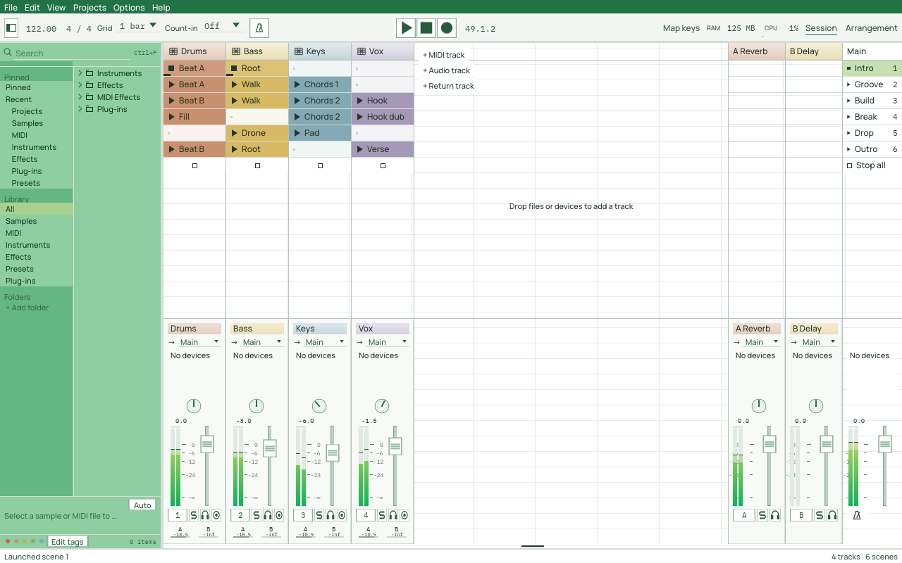
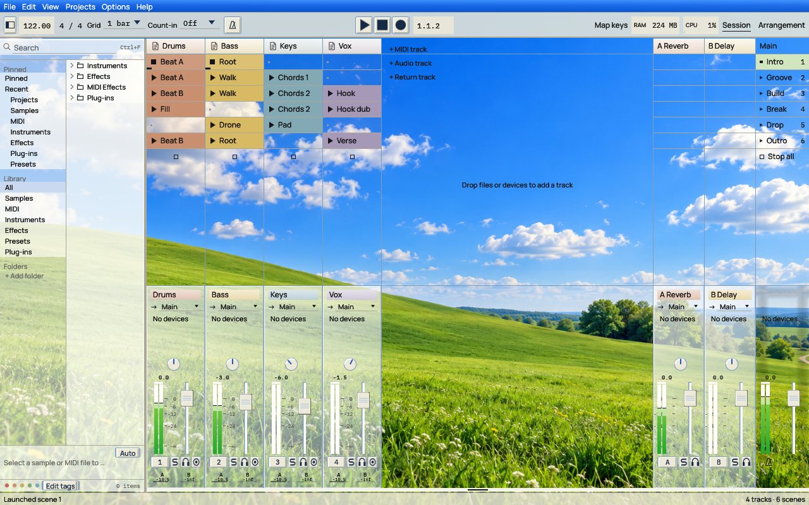
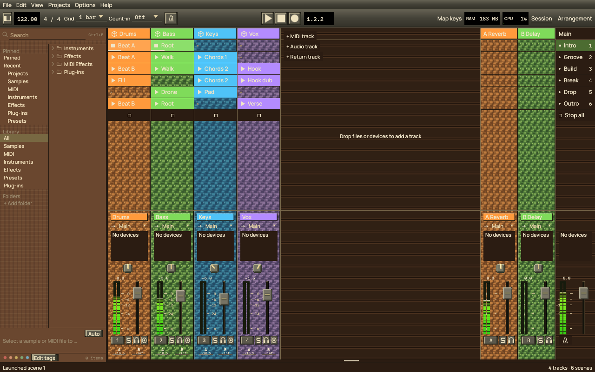

Toolbar editing keeps the real native controls and their layout visible. Entering or
leaving the editor without a change must not create a toolbar layout or change the
theme. An overlay outlines draggable modules over an 8-point snap grid; dragging
changes a horizontal offset from the existing native or CSS anchor. Native centre
and right anchors therefore keep responding to window resizing. Done commits the
draft to the theme; Cancel or Escape discards it. The controls cannot issue commands
while the overlay is active. `skin.toolbar-offsets` stores bounded integer offsets
by module id independently of the optional ordered toolbar layout.

The interaction reference requested by the user is World of Warcraft's Edit Mode:
edit the visible interface through selection outlines and alignment guides rather
than replacing it with abstract layout blocks. This is an independent Suhina
interaction specification based on the supplied screenshots and the public
[EditModeExpanded description](https://github.com/teelolws/EditModeExpanded/blob/main/README.md)
(read 2026-10-22), which describes moving visible frames and saving their positions.
That description is an add-on author's account, not official documentation of
Blizzard's grid implementation. No third-party source or artwork is reused.
A sheet of an earlier version mirrors offsets as `toolbar { offset-transport: 80px; }`; a current `theme.css` does not (see below).

SVG inheritance resolves each control role in this order: theme state artwork,
theme base artwork, shared default state artwork, shared default base artwork.
Suhina ships original default SVG files under `assets/themes/default/` and builds them into
the app, where the user-agent sheet names them (*The user-agent sheet*); there is no copy of them in the themes folder to edit (the `_defaults` folder of
earlier versions is no longer made or read). Themes store only their explicit artwork
overrides. Portable
exports include inherited artwork so they keep their appearance on another machine.
The colour of the element that draws the artwork supplies `currentColor`; inheritance does not
force the default theme's colours. Deleting an override restores inheritance.

Every theme package contains a generated `README.md` for human and AI-assisted
authors, shared with the template export. Multi-theme backups also carry it at
the archive root. The guide explains what/why/how/when, current possibilities,
file ownership, examples, SVG inheritance and recovery, supported CSS integration
and explicit limits. Its palette reference is generated from the token registry.

# Theme skins

## Launcher density and meter materials

The original **Suhina Sheet** built-in theme demonstrates a light spreadsheet-like
Launcher, green application chrome, compact cells and square controls. Its own
self-contained SVG artwork lives under `crates/ui/themes/suhina-sheet/assets/` and is embedded with
the palette and CSS, so duplication/export includes the effective artwork without
depending on installed files. It uses existing native controls, commands and views;
it does not add spreadsheet functions or bundle third-party application artwork.
The menu, toolbar and native Windows application bar enter their style scopes
before painting their backgrounds, so their solid colours and CSS materials agree
with the scoped foregrounds without changing layout or menu/transport actions.
Its only settings are *Accent* and *Accent, light* (the browser's panels): every colour of its
rules and artwork mixes those two with black and white, and its swatch is the accent. The white
paper, the track and clip colours, the meters and the recording red stay as they are.



This is an actual native Linux/OpenGL capture with the detail area hidden and demo
playback providing the meter levels. The empty-space worksheet grid is decorative;
clip launch, faders, pan, scenes and routing retain their native behavior.

**Suhina Meadow** adds classic blue chrome, cream beveled controls and paper-like
browser/device surfaces over a green-hill wallpaper. The landscape is an original
AI-generated image, not a bundled operating-system photograph. Its PNG is embedded
once and shared across theme instances; export writes it as editable `background.png`.
The theme leaves the empty workspace transparent over this private image, with
translucent blue/cream glass panels and theme-owned liquid strengths (panels 48,
tracks 24, clips 12). The liquid renderer requires GPU rendering, animations enabled
and encoded/linear texture-view support; older GL adapters retain ordinary alpha
materials without installing unsupported captures. Effective SVG roles include shared original Sheet
glyphs plus Meadow's own faders, knobs, button, paper icon and mixer body.
While a private background image is active, the workspace's separator backdrop
stays transparent. Panel surfaces and individual splitter controls still paint
their own fills; without an image the native separator backdrop remains unchanged.



This native Vulkan capture uses the original generated wallpaper, actual theme
liquid settings and measured demo levels. It was rendered with the software Vulkan
adapter in an isolated X11 session; it does not establish physical-GPU timing.

**Suhina Blocks** uses original brown plank/grain CSS, stone-like beveled controls
and colour-keyed pixel SVG textures. It has no landscape or background PNG. Native
`track-column { track-artwork: on; }` opts Launcher slot columns into the
existing `track.body` artwork (including raw colour/state variants). The body stays
behind clip cells; empty cells preserve it while hover/stop marks remain native.
`off` or omission retains the original slot fills. `track-artwork` is a property of the
style engine, inherited (a clip inside the column can turn it `off`), and it does not change
launch/drop geometry or commands.



This native Vulkan Launcher capture uses original SVG pixel textures and CSS brown
planks. No landscape wallpaper or game artwork is used. Native replacement-alpha
surfaces leave textured empty slots untouched; hover paints as an ordinary overlay
so it cannot erase the underlying artwork.

Launcher and Arrangement remain separate views. Theme customization does not introduce
a combined view or the separately planned mixer view.

Optional `skin.session` dimensions change the native Launcher layout: `track-width`
and `return-width` (64–512 points), `scene-width` (64–512), `slot-height` (16–64),
`header-height` (20–64). Omitted values use native
geometry/preferences. A theme sets them as properties of `session` (`session { track-width:
80px; }` and the other named properties); `auto` removes an override. Mixer height continues
to use its existing native preference and divider.
Column widths affect scrolling, rendering, file/clip drop targets and hit testing
together. Individual control placement remains relative to these native anchors.
`pan { appearance: knob; }` is a portable pan-face override for both Launcher and
Arrangement, read from the pan's own computed style. `field` forces a value field;
`native` or no override retains the existing global preference. The compact example
includes the knob override; themes do not need to change the user's preference.
The fader's dB labels/ticks expose `mixer-volume-scale` separately from the rail/cap
and readout, with `fader-scale` paint styling. Moving/hiding this scale does not
change the parameter or gesture. Horizontal faders retain a horizontal scale.

Meter material scopes include `meter-vertical` and `meter-horizontal`, containing
`meter-level`. An authored level gradient is anchored to the full meter range,
then clipped to each measured peak/RMS extent (and each segment). It must not stretch
or change its signal thresholds as the measured level changes. Peak/RMS opacity
remains native. Outset shadows form the glow around the lit extent, preserving
empty rails, segment gaps and native clip/reset handling.

Mixer bodies and strip-name surfaces consume their `mixer` and `track-name`
background fills, gradients and shadows above fallback/SVG artwork. A solid CSS
background replaces the native colour tint; an alpha gradient may retain underlying
track artwork. Missing rules preserve the ordinary native colours.
An original [metallic cap SVG](../../assets/themes/examples/metal-fader.svg) is supplied
as optional authoring artwork; it does not replace the protected default. Reference it
as `fader.cap` in a user theme to combine it with the gloss material example.

## Native acceptance captures

The [compact gloss follow-up](../design/reference/theme-dark-gloss-compact.png) uses
86-point track columns, 80-point returns, 18-point slots, the existing 320-point
mixer height, a centred narrow pan knob, a separately positioned dB scale and the
optional original metallic cap SVG. The meter sits left of the fader. It demonstrates
the Launcher view alone; neither a combined Arrangement view nor a standalone mixer
view is introduced. The screenshot is from actual demo playback on the same isolated
Linux OpenGL/virtual-ALSA setup described below.

Its additional placement overrides are:

```css
.control-mixer-meter { left: -48px; }
.control-mixer-volume { left: 18px; }
.control-mixer-volume-scale { left: -40px; }
.control-mixer-volume-readout { left: -24px; width: 30px; }
.control-mixer-pan { left: 25px; width: 24px; height: 24px; }
.control-mixer-color { width: 2px; }
```

Load the compact native CSS and dark-gloss advanced CSS examples separately, then
apply these placements and the cap override. The compact example carries its pan style.
The capture keeps the global preference at Field and verifies the theme-owned Knob
override, so that presentation does not depend on another user's settings.
The images below retain the earlier, wider geometry and colour-keyed texture example.

These are unretouched captures of the native Linux application (Mesa/OpenGL on an
isolated test display), using original dark-gloss CSS and a small original colour-keyed
name texture. The detail panel is hidden and the existing native mixer/track resizing
is used to expose controls. They demonstrate implemented adapters, not complete
browser CSS support or a finished appearance for every theme.

- [Launcher, tall mixer and live vertical meters](../design/reference/theme-dark-gloss.png).
- [Horizontal faders/meters, names at the bottom and top-only colour stripes](../design/reference/theme-dark-gloss-horizontal.png).
- [Edit interface (removed for now, issue #995): actual controls beneath outlines and an 8-point grid](../design/reference/theme-interface-editor.png).
- [Arrangement, large native track rows and replaceable note glyphs](../design/reference/theme-dark-gloss-arrangement.png).

The Launcher meter captures use actual demo playback through a paced virtual ALSA
sink. They do not verify physical audio latency or supported desktop transparency;
the native GPU transparency regression has separate automated coverage. Theme
changes were made through external JSON/CSS files while the app remained open.
Colour-dependent texture contrast is authored with named scopes, e.g.
`track-name[data-object=track-1] { color: #edf6e9; }`; arbitrary named track scopes
use `data-object`, while toolbar/workspace ids have their documented literal ids.

## Native element placement contract

The customization target includes every native control and text/name area, not just toolbar
modules. `skin.controls` is a bounded map (256 semantic names) whose entries specify native
anchor-relative `left`/`top` offsets, optional logical-point `width`/`height`, and a
`direction` (`vertical` or `horizontal`). `bottom` anchors to the containing panel's
bottom; `hidden` suppresses connected elements. `height: 100%` (editor **Full height**)
stretches between the panel's top plus `top` and bottom minus `bottom` (default zero).
In this mode `top` is a panel inset, not a native-anchor offset. Insets are clamped to
the panel; an exhausted height draws nothing. `height: auto` restores native height. Similarly `width: 100%` (**Full width**)
uses `left` and `right` insets; `right` can also anchor a fixed-width control.
`width: auto` restores native width.
Arrangement meter placement uses the whole track header, never its visible intersection;
scroll clipping affects painting and hit testing without changing the meter scale. The canonical CSS projection uses
`.control-NAME { left: 8px; top: 0px; width: 80px; height: 20px;
direction: horizontal; }`. Offsets are bounded to ±16384, sizes to 1–4096.
Each adapter must resolve the rectangle before interaction and paint, preserve the native
widget ID/command, and contain it in its panel. Removing an override restores native geometry.
These are explicit native relative offsets, not a claim of general CSS positioning support.
The visual placement editor (**Edit interface**) was removed for now: it saved placements in
a format of its own beside the CSS, and placing controls with it broke layouts in testing.
Placements are written by hand; a future editor will write plain CSS
([issue #995](https://github.com/suhina-daw/suhina-daw/issues/995)).
Fractional offsets survive CSS and JSON storage at 1/1024 logical pixel resolution.
A persistent anchor is explicit: `anchor-left|top|right|bottom:
<control> <edge> [<gap>px]` (JSON `anchors: { "bottom": "arrangement-volume top 4px" }`)
makes that edge follow the target's edge on the same axis. Opposite edges keep the gap
between the controls; matching edges inset by it. With one anchored edge a full-width or
full-height control keeps its other edge, otherwise it moves at its size; two anchored
edges set both. The target is resolved in the same container: drawn earlier in the frame,
or the previous frame's rectangle moved as far as the container moved (scrolling), with
one repaint when it has since changed. A hidden, absent or foreign target leaves the edge
at the control's own placement. Cycles, self-anchors and chains of more than eight links
are dropped with a warning when a theme loads. Gaps are whole
points within ±16384; the result stays inside the container. The toolkit-independent
parts (names, parsing, validation, axis arithmetic) are `suhina_style::anchor`.
Drag an outline or select a semantic element and edit offsets, size,
bottom anchoring and direction. Matching instances share that theme rule. Done merges only
edited entries into the latest theme; Cancel/Escape discards the draft. A theme switch cancels
it. Entering/leaving without edits never forks a default theme. An input shield keeps the
underlying transport/mixer commands idle while placing controls; the editor window remains
above the shield. Native widget IDs remain unchanged.
The direction property applies to controls with an axis; horizontal volume dragging increases
to the right, while vertical dragging increases upwards. Keyboard, wheel, reset and undo keep
their existing semantics. Layout entry support is incremental and documented per adapter.

Artwork can choose an exact raw track colour and interaction state before palette tinting:
`track.name.color-00ff00.hover` overrides the default `track.name`. The most specific own
colour/state variant wins, then own colour, own state, own default, then embedded fallback.
`track.body` covers the strip background. A contiguous sequence of `.frame-0` through
`.frame-31` asset keys animates that variant at `skin.artwork-fps` (1–30, default 12).
Native animation-off freezes it at frame zero without a repaint loop. Assets allow the
base roles plus 64 variants; SVG parse, cache and package budgets still apply. MIDI/audio type glyphs have
their own SVG roles (`track.midi` and `track.audio`); MIDI defaults to a note symbol.

Arrangement headers also expose `arrangement-fold`, `arrangement-enable`,
`arrangement-automation`, `arrangement-output`, `arrangement-input`,
`arrangement-send-1` (and subsequent return slots), and previous/next send buttons.
Launcher send controls expose `mixer-send-1` and subsequent slots within the movable
sends region. Slot numbers follow native return order, independent of project ids.

Connected placement adapters currently include native/custom toolbar modules (`toolbar-NAME`),
transport play/stop/record/metronome, Launcher strip name, output/input/monitor block, devices,
sends, pan, volume/readout, meter, compact volume and toggle row (`mixer-NAME`), solo/cue/arm,
track-type glyphs, and Arrangement name, colour band, volume/pan and meter. `mixer-color` can
hide the side band or make it a top stripe; `mixer-name { bottom: 0px; }` relocates the name.
Compact native height thresholds remain authoritative. Full raw-widget, clip/scene, browser
and floating-window geometry coverage remains necessary for the all-elements target.

SDK device controls use `device-<control-id>` placement names. Their drawing coordinates,
hit rectangles and parameter gestures move together. Explicit dimensions scale rectangles,
paths, curves and textures on both axes; text/strokes use the smaller scale and knobs retain
their circular shape. Invalid/long identifier characters get a bounded stable slug/hash name.
The native device panel remains the containing clip and each control keeps its existing ID,
parameter bindings and visibility condition. Disabled/hidden device controls do not dispatch
parameter actions. The native volume-direction property does not reinterpret SDK bindings.

SVG background roles blend over what is under them, as every background does: artwork never
clears the window's pixels, so round artwork on a see-through toolbar leaves the toolbar
showing at its corners. Scoped authored foregrounds also cover the independent `text.inverse`
role; selected fills use `control.selectedBackground`.

Artwork roles and frames also accept package-relative PNGs or embedded PNG data URLs.
PNG decoding is off the audio callback and bounded to 8 MiB per file, 4096 pixels per
dimension, four million pixels and 16 MiB of decoded allocation. The combined inline
artwork payload is bounded to 16 MiB, checked progressively as package resources resolve.
SVG remains strictly self-contained vector markup. Portable packages retain each image's
format; missing roles still inherit the original SVG. A revision/role source-hash cache
avoids hashing large PNG data on every repaint; rendered textures retain the existing
64-entry/1024-square budget and invalidate when a live resource changes.

A theme owns its control artwork, level-meter appearance and control-bar layout.
Changing a bundled theme creates an editable copy. Duplicating, renaming, resetting,
exporting and importing preserve the complete theme. Old colour-only themes retain
Suhina's existing layout and controls.

A theme's artwork is named in its `theme.css` (`play { image: url("assets/play.svg"); }`)
with relative `.svg`/`.png` paths inside the theme's folder. Portable ZIPs put each theme
and its artwork in a separate folder.
Artwork changes presentation only: command dispatch, keyboard access, value ranges,
gestures and undo remain owned by the application. Missing or invalid artwork uses
Suhina's normal drawing. Network resources, embedded SVG images and SVG scripts are not
loaded. SVGs are parsed and rasterized once per asset, scale and palette, never on
the audio thread; texture cache size and raster dimensions are bounded.

Typed SDK device-panel knobs/dials and buttons consume the same SVG roles. Their
labels, readouts, parameter angles and native response/command paths remain in the
SDK host. Named `device-panel` and `device-control` scopes expose semantic widget
classes and scoped palette/text styling; see [custom panels](sdk-custom-ui.md#host-theme-css-and-svg-controls).

Asset roles include fader cap and rail, knob body and pointer, button surface and
play/stop/record/solo/arm/cue icons. State suffixes `.hover`, `.active`, `.disabled`
optionally override a base role. `currentColor` uses the control's foreground.
The fader cap moves along the rail; the knob pointer rotates with its value.

Meter intensity is an integer percentage (`skin.meter-intensity`, default 100),
editable with the theme slider and canonical `meter { intensity: 65%; }` CSS.
It dims measured ink, hold marks, needles, frames and glow without changing audio,
geometry, native bar rails or clip warnings. Frame artwork dims as a whole, including
any background baked into the image. See [level meters](level-meters.md).

Meter styles are continuous, segmented, needle and frames. The `frames` style selects
contiguous `meter.frame-0` through `meter.frame-31` SVG/PNG artwork by the louder
channel's normalized dBFS peak, from silence to the top of the existing meter range.
It is signal-driven, independent of animation settings and artwork fps. Missing or
invalid frame sequences fall back to the continuous stereo meter. The native clip
indicator, click-to-reset command and accessible measurement remain intact. Exact
track-colour and interaction-state sequences follow normal artwork precedence.
Other styles use the existing stereo
peak/RMS monitor; presentation never changes measurement or sound. The clip light
and click-to-reset work with every style. Segment count is bounded. Needle displays
use peak for the thin pointer and RMS for the heavier pointer. These are dBFS level
displays, not calibrated analogue VU or loudness measurements.

Toolbar modules have stable names and a saved order/visibility. The built-in layout
is used when no toolbar is supplied. Editing exposes labelled drag handles rather
than stealing normal control gestures. Escape cancels a drag. Hidden modules can be
restored from the editor, and resetting the layout restores the default. Narrow
windows scroll the customized toolbar horizontally; controls do not overlap.

Theme ZIP import validates the entire input before writing. Paths must be relative,
remain within the theme folder, contain no parent traversal or symlinks, and name
supported assets. Reads, file counts, SVG sizes and total expanded data are bounded.
Imports choose unused theme ids rather than overwriting existing themes.

## The user-agent sheet

Suhina has a user-agent style sheet, as a browser does: `crates/theme-package/src/user-agent.css`
(`suhina_theme_package::USER_AGENT_SHEET`), built into the app. It is what every element looks
like before a theme styles it.

- **It selects elements by name, state and attribute only:** no classes (but the standard toolbar
  group classes, `group.transport` and `group.display`, once the toolbar has groups), no ids and no
  variables, no at-rules. A test in `suhina-theme-package` checks this, and that every element it
  names is in the registry.
- **The cascade** is: the user-agent sheet, the theme's `theme.css`, the chosen variant, device
  panel sheets (each inside its panel), and the user's `user.css` (`suhina_style::cascade::Layer`).
  Until the palette goes (#995 § 10), the palette's values (`:root { --accent: … }`), the text
  colour of `html, body` and the palette colours of the parts below sit beside the user-agent
  sheet in its tier; they are the host's, not the sheet's. A rule of this tier on an element
  replaces what the element inherited from a theme's rule on an element around it.
- **What it holds:** `overflow: hidden` on every region (the registry's `Region` kind); the default
  artwork; the sample map's colours; the theme swatch's rounded square.
- **Default artwork** belongs to it: `knob-body { image: url("suhina:knob.body.svg"); }`. A
  `suhina:` URL names an SVG built into Suhina (`assets/themes/default/`), and a theme may use one
  too. Every theme gets the defaults for the controls it does not replace. The defaults take their
  colour only from `currentColor`, the `color` of the element that draws them: there is no
  `data-suhina-ink` attribute any more, so a copy of the default artwork works in any theme. A
  control with two colours is two elements: `knob-body` and `knob-pointer`, `fader-cap` and
  `fader-rail`. Until a theme gives one of these elements a `color` of its own, each takes the
  palette colour the default artwork had: `--control-background` for a knob's body, the control
  colour darkened for a fader's rail, lit a little by the values' text for its cap
  (`--control-hoverBackground` instead while the pointer is on it or drags it), each a rule of the
  palette's tier on the part itself, so a `color` a theme gives an element around it (`knob`,
  `mixer`) does not reach it. A knob's pointer has no such rule: it takes the knob's colour. The
  parts are entered with their control's pointer states, so `knob-body:hover` and
  `fader-rail:active` apply.
- **The elements of the default artwork:**

  | Element | Role | File |
  |---|---|---|
  | `button` | every button's face | `button.svg` |
  | `icon[kind="play"]`, `stop`, `record`, `solo`, `arm`, `cue` | a button's symbol | `play.svg`, … |
  | `icon[kind="midi"]`, `icon[kind="audio"]` | a track header's type symbol | `track.midi.svg`, `track.audio.svg` |
  | `track-header`, `track-name` | a track header's and name's surface | `track.body.svg`, `track.name.svg` |
  | `knob-body`, `knob-pointer` | a knob | `knob.body.svg`, `knob.pointer.svg` |
  | `fader-cap`, `fader-rail` | a fader | `fader.cap.svg`, `fader.rail.svg` |
  | `meter` | a meter's frame | `meter.svg` |

  A state follows the element as a pseudo-class or an attribute: `knob-body:hover`,
  `fader-cap:active`, `button:disabled`, `button[checked]` (a toggle that is on). The earlier role
  form (`knob.body:hover`, `solo:on`) still reads; Suhina writes the element form. Roles without
  default artwork (`piano.draw`, `track.body.color-ff9a3c`, `meter.frame-3`) are written as roles.
- **Sample-map colours are not settings.** The user-agent sheet styles each sound by its kind,
  `sample-point[kind="kick"] { color: #D06E5E; }` and so on for `snare`, `clap`, `closedHat`,
  `openHat`, `hat`, `rim`, `tom`, `crash`, `ride`, `cymbal`, `percussion`, `bass`, `tonal`,
  `vocal`, `effect` and `other`. A theme restyles them with rules of its own and may offer its own
  quick controls for them. The `kind.*` palette tokens (`--kind-kick`, …) are gone.
- **`@media (prefers-color-scheme)` is not supported.** A theme with light and dark looks ships
  them as variants; a sheet that uses it gets a notice and the `@media` rule does not apply.
- **What changes for a theme of an earlier version** (breaking changes, #1019):
  - *Artwork of the theme's own that uses `currentColor` for a knob's body or a fader's rail or
    cap changes colour.* Without `data-suhina-ink`, `currentColor` was the knob's pointer colour
    (its `color`, else the accent) for `knob.body` and `--text-value` for `fader.rail` and
    `fader.cap`; it is now the `color` of `knob-body`, `fader-rail` or `fader-cap`, the palette
    colours above until the theme gives one. A theme keeps its look with a rule for the part
    (`knob-body { color: var(--accent); }`, `fader-cap, fader-rail { color: var(--text-value); }`).
    Other artwork keeps its colour, and `data-suhina-ink` in an SVG is no longer read (the default
    artwork's copies had it, and keep the colour it gave them). Nothing in a theme tells the two
    apart, so there is no notice.
  - *The `kind.*` palette tokens are not read.* A sheet's `--kind-kick` or a theme file's
    `"kind.kick"` gets a notice that names the rule to write instead,
    `sample-point[kind="kick"] { color: … }` (`theme::former_kind_token`); the sample map shows
    the user-agent sheet's colour for the kind until the theme has that rule.

**Including the default artwork.** *More › New theme…* and *More › Duplicate theme…* ask first,
with an **Include the default artwork** checkbox (off by default). With it, the new theme gets a
copy of every default SVG in its `assets/` (`assets/knob.body.svg`) and a rule for each in its
`theme.css` (`knob-body { image: url("assets/knob.body.svg"); }`): without the rules the copies
would do nothing, since the built-in images would still apply. *More › Add default artwork* does
the same for the theme in use, adding only the roles it has no artwork for in any state (a
built-in theme is copied first; with a variant of a theme of the user's in use, the artwork goes to
the theme and each of its variants, since artwork is the theme's); when nothing is missing it says
so and changes nothing. *New theme* starts from a
`theme.css` that holds only a comment, so the user-agent sheet styles everything; it is named
*New theme*, then *New theme 2* and so on, numbered as its id is.

## Native CSS: controls and the toolbar

The native centred toolbar exposes the same `toolbar-module` ids as the custom
layout, without opting into new geometry for colour/paint-only rules. Module
scopes are siblings rather than nested controls; their palette/style changes
must be restored before painting another module. Native hit rectangles, ids,
commands and default geometry remain unchanged.

**Control surfaces.** A control paints its own surface through its element
(`kit::element`, `Entered::paint`): `background-color`, `background-image`, `border-radius`,
`border-width` with `border-color` (no border without a width), `box-shadow` and
`opacity` from its element, the native values where the sheet sets none. A transparent
background paints nothing, never a see-through hole in the window. A button the sheet
shapes (background, radius or border width) is not covered by the artwork Suhina ships;
a theme's own `button` artwork still wins. The toolbar's tempo, position and RAM/CPU
fields paint the same way.

**Paint order.** Every element `Entered::paint` draws paints in CSS's order: its outer
`box-shadow`, its `background-color`, its `background-image` (or the artwork its caller draws),
then for a control (or a part, or a drawn item) its border and inset shadows before its
contents, and for a region or a container (the registry's kinds) its border and inset shadows
after its contents, when the element leaves scope; then its `outline` (`outline-width`,
`outline-style: solid`, `outline-color`, `outline-offset`, or the `outline` shorthand) outside
its border, last. `Boxed::content` is the box less its `padding`. The outer shadows and the
outline are clipped by the box of the nearest element with `overflow: hidden` (or `clip`)
around the element, not by the painter in use, so a toolbar control's glow passes its
section's edge and stops at the toolbar's; regions are `hidden` by the host's own sheet, other
elements `visible`. They pass the painter's clip only as far as they reach, and only on a side
where the element is whole inside that clip: a side that cuts the element is a viewport's edge (a
scroll area scrolled part of it out of view), which they do not pass. Without such an element
the painter's clip holds.

**One paint model (#1233).** Every background blends with what is under it. The window clears
once (to nothing in a see-through window), `window` paints its background once over the whole
window (its `background-color`, else `--window-background`), and each view, bar, panel and
control paints only its own background over that: a view without one of its own shows the
window's. Nothing paints over content to hide it: what scrolls is clipped to the area beside a
header that stays (the Launcher's track headers, scene column and returns, the Arrangement
view's rulers, header column and fixed rows, the piano roll's keys), never painted under it. So
a translucent panel composites over the window: a `window` at 50% under a `browser` at 50%
shows the desktop through 25%; a theme that wants a panel's own alpha at the desktop makes
`window` transparent, as Suhina Glass does.

**Views and controls.** A background on a view or bar (`window`, `toolbar`, `session`,
`arrangement`, `browser`, `mixer`, `detail` and the other regions and containers of the element
registry, `suhina_theme_package::elements`) is that view's own, painted once; it writes no
token. A part drawn in it that takes its region's colour (the launcher's stop buttons, the
Arrangement's ruler rows, the toolbar's fields) reads it with `style_class::surface_or`, and
the controls on it keep their own fill. The add-track buttons under the last track keep their
own fill.

**Level bars.** Volume and pan fields of the track headers and the mixer are one level
bar (`mixer_controls::level_bar`): the field's element is the track and `value-fill` the
lit part; `height` sets the thickness of either. `#arrangement-volume`,
`#arrangement-pan`, `#main-volume` (Main's row in the Arrangement view), `#mixer-volume` and
`#mixer-pan` select them, and `volume.track`,
`volume.fill`, `pan.track` and `pan.fill` are artwork roles. Without any of these the
volume field is the native capsule and the pan field the native flat field.

**Theme-given presentation.** `arrangement { track-headers: left | right; }` is
the side of the Arrangement view's track headers while the user's Track headers setting
is *Theme* (the default); Left and Right are the user's own and win.

**Host states and variables.** The host marks elements with states the sheet matches, on the
element's builder before it is entered (`kit::element`, `.attr(Checked, on)`): `[checked]` on a toggle that is on, `[playing]` and `[recording]` on the
transport's buttons, `[selected]` on the selected track's header, column, strip and name,
`[armed]` and `[muted]`. It gives elements custom properties below every rule
(`.variable("--track-colour", …)`): a track's header, column and strip `--track-colour`, its name
`--track-fill`. A track name's text takes the sheet's `color` when one applies. Artwork has an
`.on` state (`solo:on`), falling back to `.active`, and per-view track roles
(`track.name.mixer` and the others) over `track.name` and `track.body`.

**Elements for menus and popups.** An open menu of the menu bar is `menu`; the metronome's level
slider is `popup#metronome-level`, outside the toggle's scope.

**Bar lines.** The separator under a bar uses that bar's `border-color`, and the line above the
view `#workspace`'s; `--border` stays every other line.

**Header width.** `arrangement { header-min-width }` (160 to 520 points) is the least
width of the Arrangement header column, so the header's narrower layouts do not break a theme's
placements.

**Theme folders.** A folder is a theme when it holds `theme.css`; one without it is named in the
warnings. Renaming a theme keeps its folder (its id). Two themes with one name are named in the
warnings and show their folder names. Placement rules accept selector lists.

**Workspace overlays.** A browser or detail panel that the `#workspace` grid places in
the same cells as `#panel-main` is drawn on a layer above the view, so it shows and takes
the pointer there.

Connected native text helpers support computed CSS `text-shadow`, including lists,
inherited/currentColor colours and animated offsets/colours. Up to four layers
paint behind the original galley without changing its layout, wrapping, labels or
hit geometry. Offset shadows use one draw; blurred shadows use a fixed nine-tap
weighted approximation on the cached native glyphs, bounded to 32 points of blur
and offsets of ±256 points. This is not a full image convolution. Native clipping
still applies. Ordinary egui text that bypasses the shared/native helper is not
covered yet. The editor includes an original dark gloss CSS example demonstrating
gradients, rounded buttons and bounded text/box shadows without changing the native
toolbar/workspace layout.

Host rules the app reads itself, beside the engine: `meter` accepts `style`, `segments`
and `intensity`; `image` declarations name package-relative SVG/PNG artwork or Suhina's own
(`url("suhina:knob.body.svg")`), on the element that draws it with its state (*The user-agent
sheet*) or on a role; `window` accepts a relative PNG `background-image`, `background-opacity` and
`background-blur` (0–100). Placement offsets on `.control-NAME` rules (`left`, `top`, `right`,
`bottom`) are the app's too and give no notice. The toolbar's `order`, `hidden` and offsets are
read only from a sheet of an earlier version, when it is migrated (`order` and `hidden` as
comma-separated module lists), and Suhina writes them to `theme.json`. In a current `theme.css`
such a rule is ignored, with a warning.

### Theme folders: theme.json, theme.css, thumbnail and variants

A theme is a folder `<id>/` in the themes folder ([ADR 0031](../decisions/0031-style-sheets.md),
amendment *Theme settings and variants*):

```text
my-theme/
  theme.json      metadata
  theme.css       style and layout
  thumbnail.svg   optional
  assets/         artwork
  variants/       other variants, for example light.json
```

- `theme.json`: the theme's metadata (`crates/theme-package/src/meta.rs`):

  ```json
  {
    "format": 1,
    "name": "Night",
    "author": "Someone",
    "description": "Dark blue with an orange accent",
    "default-variant": "Dark",
    "swatch": "color-mix(in oklab, var(--panel-background), var(--accent) 35%)",
    "toolbar": { "items": ["browser", "tempo", "transport"], "hidden": [] }
  }
  ```

  `format`, `name` and `swatch` are required; a newer `format` is refused with a message to
  update Suhina, and keys it does not know are warnings. The theme's name comes only from
  here: a `theme { name }` rule in the sheet is no longer read. `default-variant` names the
  theme's own values (*Default* when it says none). `toolbar` is the suggested toolbar
  arrangement (#1021 defines it); Suhina's toolbar editor writes `items`, `hidden` and the
  `offsets` of items moved by hand, and leaves an arrangement with groups or spaces as written.
  Suhina writes `theme.json` when the theme is renamed or its toolbar changes, and only then.
- `theme.css`: the theme's style and layout, as its author wrote it (rules, variables,
  `@media`, gradients, artwork `image` rules, `.control-NAME` placements). There is no
  `layout.css`: a folder that still has one gets a warning on import and the file is not read.
  What Suhina's editors set beyond settings (moved controls, artwork chosen in the app) is written into `theme.css` through the source-preserving editor
  (`suhina_style::edit`): only the declarations that changed are edited or appended, and
  comments, `@media` rules and the rest of the author's text stay as they are.
- `thumbnail.svg` (optional): see *Swatches and thumbnails*.
- `variants/<variant>.json`: values for the theme's declared controls,
  `{ "name": "Frost", "values": { "--accent": "#88C0D0" } }`. The file's name is the variant's
  id; `name` is its label; values are CSS text checked against each property's syntax (`var()`
  may refer to the theme's own variables). A variant holds only values: a value for a property
  the theme does not register with `@property` (or that is not one of Suhina's core properties)
  is left out with a warning, and any key besides `name` and `values` (such as the `appearance`
  of earlier versions) is a warning. At most 64 variants of 64 KiB each, 256 values of 1 KiB
  each. The default variant is the theme's own values and is never a file.
- `assets/`, `background.png`, `README.md` and `examples/`.

A folder with a `theme.css` but no `theme.json` is not a theme; the status bar says so. Themes
written for the format before `theme.json` need adding one by hand: the format is experimental
and has no migration. Only a sheet of the much earlier form (below) is still migrated.

**Built-in themes** have exactly this structure, in `crates/ui/themes/<id>/`, built into the app
(`theme::built_in_themes`, which reads each folder as a folder on disk is read). They cannot be
edited, only duplicated; *Export theme…* writes a built-in theme's folder as it is, and the theme
template carries them all in `examples/`. A built-in folder may hold `variants/`, which come with
the theme as its swatches (`theme::built_in_variants`). Suhina Studio's sheet sets only colours and
settings, so it is set aside while the theme has its own values and the style engine stays off;
any variant of it brings the sheet back.

**Swatches and thumbnails.** The picker shows a swatch for each theme and variant, and a card for
each theme.

- The swatch is any CSS `<color>` value: a literal, `var(--accent)` or an expression. It is
  resolved for each variant without applying the sheet: each `var()` takes the theme's resolved
  `:root` value (the variant's where it sets one), from its `@property` rules and `:root`
  declarations and Suhina's core properties (`theme_vars::swatch`). `@media` rules that change
  `:root` are read at 1280 by 800. There is no element, so `currentColor`, `attr()` and units
  relative to an element are refused. Importing or validating a theme checks the swatch against
  the default variant and every file in `variants/`, from the theme's own sheet and the core
  properties (a copy of `theme_vars::core_sheet()` in `suhina-theme-package`, so
  `suhina-cli theme validate` agrees with the app), and refuses the theme with a message naming
  the variant when it does not resolve to a colour.
- The swatch is drawn as a `theme-swatch` element with a `color` attribute, styled by the
  theme in use, never by the theme it shows. The user-agent sheet's is
  `theme-swatch { background-color: attr(color type(<color>)); border-radius: 6px; }`; a theme
  may restyle it (`theme-swatch { border-radius: 50%; }`). Without a theme sheet it is a rounded
  square of the colour.
- `thumbnail.svg` is designed by the author, at 16:9 (its `viewBox`, or else its `width` and
  `height`; within 1%), on both the large and the small card. It may use the theme's properties
  through `var()`, resolved per variant as for the swatch; values that are colours go in as
  computed colours, since the SVG renderer has no `color-mix()`. The artwork checks apply: no
  scripts, embedded images, foreign objects or links. A theme without a thumbnail shows a blank
  card filled with its swatch colour. The built-in themes share one thumbnail, a small
  arrangement drawn from their palette properties.

**Colours are custom properties; settings are properties of their elements.** The core set
every theme has is each palette token (`--accent`, `--track-headerBackground`), registered with
`@property` and Suhina Studio's values (`crates/ui/src/kit/theme_vars.rs`); a theme sets them in
`:root`. Its settings are registered properties of the style engine (`suhina_style::property`),
set on the element they belong to and read from its computed style (`SETTINGS` in
`theme_vars.rs`): `meter { meter-style; meter-segments; meter-intensity; }`, `window {
artwork-fps; liquid; panel-gradient; track-gradient; clip-gradient; backdrop-image;
backdrop-opacity; backdrop-blur; }` (`liquid` is `auto` or three strengths, a gradient `none` or
`<angle>deg, <colour> <position>%, ...`, `backdrop-image` `none` or `url("<file>.png")`) and
`session { track-width; return-width; scene-width; slot-height; header-height; }` (`auto` or a
length). The custom properties that held them before (`--meter-style`, `--session-track-width`,
…) are not read; a sheet that sets one gets a notice naming the rule that replaces it. A theme
may declare properties of its own with `@property`
(`syntax`, `initial-value`, and Suhina's `label`, `group`, `range`, `step`); a declared property
with a label is one of the theme's **quick controls**, listed under *Theme settings* with a
control for its type. The variant editor (*Edit current theme…*) shows only those: the core
palette colours, liquid strengths and surface gradients are no longer listed there, and a theme
that declares none says so. The theme's values
are read at the root of a 1280 by 800 window (the settings on `window`, `session` and
`meter` under it). A variant holds values for declared properties and for settings
(`"meter-style": "needle"`, written as a rule of the setting's element); they apply in the Variant tier,
above the theme's rules, including its conditional ones.

**Editing.** A setting changed in Suhina is written to the variant in use; on a theme's own values
a variant named *Custom* is made first. A variant added to a built-in theme, or an edit of
one it comes with, is kept in a folder of its id holding only `variants/`, without a copy of its
CSS; a file there wins over the built-in variant of its id. Moving controls or changing artwork
edits the theme's `theme.css` in place; artwork the sheet names keeps its file. A built-in theme
is copied first. Renaming writes `theme.json`. *New variant* starts one from the values in use;
with a variant in use, the name field renames it. The picker shows one card per theme and a
swatch per variant, the default variant first.

Changes to any file of the folder are noticed within the one-second poll, and only files whose
bytes changed are written. A save over an edit of a variant file made outside Suhina since it was
last read is refused and leaves the file as it is; reading the themes again makes the edit the
variant. A malformed sheet or missing resource does not replace the loaded theme. Installed
package README files are not rewritten.

**Migration of earlier themes.** A theme of an earlier version, `<id>.json` beside
`<id>/style.css`, or a `theme.css` of the earlier form (rules such as `meter { style: ... }` and
an `@import "advanced.css";`), is read as before and migrated once. The new `theme.css` (the
comments at the top of the old sheet, the values as custom properties, then the free-form CSS it
carried, then what its editors set) and a `theme.json` are read back and must give the same
theme with no warnings; only then
are the old files kept in `<id>/legacy/` (never deleted; a later copy gets a numbered name). A
theme that does not read without warnings stays as it is, with a warning, so no rule is lost.
ZIP packages and dropped files from earlier versions are read the same way.
File operations and live-reload polling run on one background worker. While a save
is in flight, later samples of the same slider replace queued saves; rename,
reload, import and export retain their order. Preview changes remain immediate,
errors return to the status bar, and normal exit drains the final queued edits.
Native CSS caches depend on the palette variables the stylesheet references:
an unrelated opacity edit does not rebuild its computed contexts.
Referenced palette changes, including `text.primary`, restyle the retained scope
document instead of discarding it and rebuilding a fallback document per control.
Viewport changes also retain the scope tree while updating media conditions and
viewport-dependent values. The next repaint consumes the refreshed style snapshot.

A backup holds each theme folder as it is, `theme.json`, the thumbnail and variants included; a
package exported from a theme's values holds its `theme.json`, `theme.css`, thumbnail, SVG/PNG
artwork and background under its theme id. Import validates resources before writing any theme,
copies a theme folder's files as they are, and gives colliding ids a suffix. A style sheet
dropped on its own becomes a theme named after the file, with a `theme.json` whose swatch is the
colour it resolves to. The in-app *Native CSS* box accepts settings and layout in the earlier
form (they go to the variant and `theme.css`);
package-relative image URLs are resolved when importing or reloading theme files. The SVG editor
accepts vector markup.

## Advanced CSS adapter (experimental)

Advanced CSS runs on `suhina-style` alone ([ADR 0031](../decisions/0031-style-sheets.md));
the Stylo/Blitz compatibility engine and its generated HTML are gone. The native engine
implements what the bundled themes and the editor's examples use:

- **Syntax and cascade:** `@layer` (named, anonymous, nested, order statements; later
  layers win, unlayered rules win over layers, `!important` reverses), `@media` with
  `min-`/`max-` and range forms (`(400px <= width <= 800px)`), `orientation` and
  `prefers-reduced-motion` (not `prefers-color-scheme`: a theme's light and dark looks are variants), custom properties with fallbacks,
  `inherit`/`initial`/`unset`, specificity and source order.
- **Selectors:** type (the element's name, from the registry `suhina_theme_package::elements`;
  the host's elements have no classes), `#id`, `.class` (toolbar group classes), `*`, descendant, `>`, `+`, `~`, `:is()`, `:not()`,
  `:where()`, structural pseudo-classes, the pointer and focus states (`:hover`, `:active`,
  `:focus`, `:focus-visible`, `:disabled`), and attribute selectors on the attributes the host
  gives an element, among them the app's states `[checked]`, `[selected]`, `[playing]`,
  `[recording]`, `[armed]` and `[muted]` (as pseudo-classes they do not parse): `[name]`, `[name=value]`, `~=`, `|=`, `^=`, `$=`,
  `*=` and the `i` flag. `[data-object]` / `[data-object=name]` select named project objects.
- **Values:** hex, `rgb()`, `hsl()`, named colours, `color-mix()` in srgb, srgb-linear,
  oklab, hsl and oklch (shorter hue arc); `contrast-color()` (white or black, whichever
  contrasts more); `attr(name type(<color>), fallback)` reading the element's own attribute,
  which a custom property passes on to its children (`--track: attr(color type(<color>))`);
  `calc()`, `min()`, `max()`, `clamp()` of one
  unit; `px`, `em`, `%`, `fr` and viewport units (`vw`, `vh`, `vmin`, `vmax`).
- **Paint:** colours, opacity, radii (the top-left radius is drawn), the `background`
  shorthand, linear/radial/conic and repeating gradients in sRGB, up to 32 parsed and 4
  drawn box/text shadow layers.
- **Layout:** `display` (flex, grid, block, none), flex direction/wrap/grow/shrink/basis,
  justify/align, `grid-template-columns`/`-rows` with `minmax()` and `repeat()`,
  `grid-column`/`grid-row` lines and spans, sizes with min/max, margins (auto, negative),
  padding, gaps and `visibility`; `gap`, `padding`, `margin` and `flex` are shorthands.
- **At-rules:** `@group-class lcd { label: "LCD display"; }` declares a toolbar group class;
  a declared class that no `group.<class>` rule styles is reported.
- **Motion:** `transition` (colours, opacity, radius and font size; durations, easing
  keywords, `cubic-bezier()`, `steps()`, delays) and `@keyframes` with `animation`
  (count, direction, fill, play state), interpolating colours, numbers, lengths and
  shadow lists.

A declaration the engine does not know is skipped with a notice giving its line and
column, and the rest of the sheet applies, as in CSS. A variable that does not produce a
valid value makes the property unset. A sheet that does not parse at all (too large, too
deeply nested, unbalanced) keeps the last working styles. Not implemented: transforms,
filters, other gradient interpolation spaces and hints, font families and weights,
container queries and geometry animation.

**Tiers.** Every style resolves through five tiers: the user-agent sheet, the theme's sheet, the variant,
device panel sheets (`.sd` version 6 `style`, bounded to their panel; `#id` selects a control
by its id) and the user's own `user.css` in the themes folder. A higher tier wins even over
`!important` in a lower one. `user.css` is read like a theme file (watched, at most 128 KiB, a
sheet that does not parse is reported and the last working one stays) and stays when the theme
changes. The engine runs whenever any of these sheets exists, also for a theme without one.
See [sd-device-format.md](sd-device-format.md) › Panel style sheets.

Trace spans `style paint parse` and `style paint resolve` mark the engine's UI-thread
work; no audio callback is instrumented.

### Workspace layout contract

Panel elements are absent when closed. Fixed tracks still reserve their size for
absent elements; put sizes on the optional panels and use `auto` tracks instead:

```css
/* Wrong: leaves a browser-sized hole when the browser is closed. */
#workspace { display:grid; grid-template-columns:248px minmax(0,1fr);
             grid-template-rows:minmax(0,1fr) 200px; }
/* Right: absent browser/detail panels have no fixed-size track. */
#workspace { display:grid; grid-template-columns:auto minmax(0,1fr);
             grid-template-rows:minmax(0,1fr) auto; }
#panel-browser { grid-column:1; grid-row:1 / -1; width:248px; }
#panel-main { grid-column:2; grid-row:1; }
#panel-detail { grid-column:2; grid-row:2; height:200px; }
```

The native workspace exposes `workspace` / `#workspace`, with `workspace-panel`
children `#panel-browser`, `#panel-main`, `#panel-detail`. They contain the browser,
Launcher/Arrangement and detail scopes respectively. Authored layout declarations on
these containers opt into CSS Flex/Grid geometry. With none, native splitters and layout
remain in charge. Closed native panels do not become visible merely through CSS.
In CSS layout mode, placement comes from the stylesheet. A panel whose size the sheet sets has no
splitter; one whose size it leaves to the native grid (a layout with only gaps or margins) keeps
its splitter in the gap beside it, and dragging it still sets the saved size. Which panels follow
is found by laying the grid out again with their preferred sizes a point larger, not by a list of
properties (#1240). The splitters are `divider` elements, `#detail-splitter` and
`#browser-splitter`, with `:hover` and `:active`, in the native layout too, so a theme that owns
the layout owns the strips in its gaps (#1252). The strip takes `background-color` and the detail
splitter's grip `color`; without them the detail splitter keeps the control background and a
hint-coloured grip, and the browser's the border colour, stronger under the pointer. Drawing,
input clipping and drag/drop targets must use the same resolved rectangles. Removing those layout declarations restores the
native arrangement and its saved sizes. Bars and floating windows remain host-managed.

### Readable values

Check `text.value` and `text.inverse` against `control.selectedBackground`, aiming
for at least 4:1 contrast, as well as against unlit/panel backgrounds. Bright text
that reads on a dark panel can disappear on a bright volume/pan field fill:

```css
/* Wrong: value text and lit fill have the same colour. */
:root { --control-selectedBackground:#7CF0C4;
        --text-value:#7CF0C4; --text-inverse:#7CF0C4; }
/* Right: dark ink contrasts with the bright fill. */
:root { --control-selectedBackground:#7CF0C4;
        --text-value:#14212C; --text-inverse:#14212C; }
```

The theme's `theme.css` is kept as written, except for the declarations Suhina's editors change
in it; Suhina's own settings live in its variants. The same byte limit and package path restrictions apply to every
stylesheet. The *Theme style sheet* section of the editor lists the sheet's notices.

The native engine
computes variables, layers, inheritance, colours, value expressions and viewport
media conditions for class scopes. Taffy computes Flex/Grid rectangles for the actual
visible toolbar modules (`#tempo`, `#transport`, etc.); the same rectangles bound their
native input targets. The host still defines toolbar height. A stylesheet without
toolbar layout declarations leaves the ordinary toolbar arrangement intact; a customized
bar scrolls horizontally when it exceeds the window. The bounded retained scope tree
exposes actual ancestry and siblings. Launcher mixer and track-header scopes carry stable
`[data-object="track-N"]` identities. Clip, scene and slot roles also expose their native
project identities. Controls
connected through native responses expose hover, active, disabled and focus states.
Styles are computed after collecting a changed scope tree and repaint on the next pass.
Only authored values override native defaults. Scoped colour, font size and radius also
reach ordinary egui controls in connected panels; the style guard preserves widget ids
and restores the caller's style. Remaining raw controls still need integration.
Palette scopes track real theme revisions: a theme switch or live colour/opacity edit
made during rendering survives enclosing scope cleanup instead of restoring stale colours.

Connected native surfaces paint linear, radial and conic gradients, including repeating
forms, using the native computed stops, sRGB interpolation and premultiplied
transparency. Radial geometry resolves circle/ellipse radii, extent keywords and the
authored centre against the real surface; conic geometry resolves the authored centre
and start angle. Up to four layers with 64 items each use bounded cached 1024-pixel
colour ramps. Radial/conic images use cached 256-by-256 textures; at most 64 gradient
textures are retained per egui context. Connected surfaces paint up to four inset/outset
`box-shadow` layers with resolved `currentColor`, offsets, spread and blur. Native blur
uses a Gaussian distance-field approximation on cached textures capped at 256-by-256 (32 retained
per context), with blur capped at 256 px, offset at ±2048 px and spread at ±512 px.
Shadows respect the host's existing paint clipping and uniform corner radius.
Transforms and filters are not painted.

Box shadows retain a bounded distance-field template for their edge regions.
A nine-slice mesh stretches only the constant straight-edge centres, preserving
corners, spread, offsets, blur width and exclusion of the caster. Changing a live
meter's lit extent or resizing a long surface reuses that template rather than
rasterizing another 256-by-256 image for each new height/width. Short surfaces keep
their actual dimensions when opposite edge regions can interact. Their raster size follows
the template bounds at four samples per physical pixel, capped at 256 per axis,
rather than regenerating a full-size texture for every short meter level. Display
scale is part of the texture key; geometry and blur distances remain in logical points.

Computed targets persist while native scope structure stays unchanged. A native state
change that changes a transitioned property starts a transition from the value being
painted; keyframe animations run from when an element's animation list first applies.
Both advance with egui's monotonic frame clock. Connected paint properties (colours,
opacity, font sizes, radii, and shadow lists in keyframes) consume these samples. Active
motion schedules repainting at 16 ms; the final sample also triggers a repaint. Disabling
animations or selecting high contrast suppresses CSS motion and makes
`prefers-reduced-motion: reduce` match. Geometry animation is not connected to native
layout.

The editor
reports source-line notices for known unsupported effect/font declarations while
preserving them in the source. These notices are not a complete CSS validator.
Token-level validation bounds input to 128 KiB and 64 nested blocks/functions, without
treating quoted strings or comments as nesting. This integration is experimental, not
a claim of universal CSS conformance.

SVG symbol roles (`play`, `stop`, `record`, `solo`, `arm`, `cue`, `track.midi`,
`track.audio`, `knob.body`, `knob.pointer`) fit and centre their intrinsic aspect ratio
inside the destination rectangle. Surface artwork continues stretching to its rectangle.

## Theme packages

A theme package is one file, `<id>.theme.suhina`: a zip of the theme's folder with
`manifest.json` at its root. The manifest says `"format": "suhina-theme"`, `"version": 1`,
the theme's `id` and `name`, and under `files` every other entry's path and SHA-256 sum
(lowercase hex). `crates/theme-package` packs a folder and reads a package; the app's
**Export theme…** (Settings › Appearance › Themes › More), its import and `suhina-cli theme pack` and
`suhina-cli theme validate` all use it, so they accept and refuse the same packages.

**Seeing a theme without the app.** `suhina-cli theme render <theme-folder | built-in-theme-id> [--backdrop <image.png>]
[--out <folder>] [--scale <n>] [--scene <name>] [--budget]` (or `cargo run -p suhina-theme-render -- …` from the source) draws the theme in
a fixed set of scenes of the demo project: the Launcher and Arrangement views, the piano roll,
every device in a row and each expanded panel, a menu, Settings, a tooltip, and hover and
selected states. Each scene is `<scene>.raw.png`, the window's own pixels with their alpha, and
`<scene>.png`, those over the backdrop (bright bands by default), blurred where the system blurs
behind a see-through window. It renders as a window that composites alpha does, so a hole a see-through theme leaves
shows. `launcher-scrolled` and `arrangement-scrolled` draw both views scrolled down and along on
a project with more tracks and scenes than fit, so whatever shows through a header that stays
shows there. A scene wider than the GPU's textures allow is drawn at a smaller `--scale`, with a warning. A built-in theme's id works in place of a folder. It warns when the window would keep
repainting every frame in a scene. `--budget` prints the style engine's counts instead.

Reading refuses a package, before anything is written, when:

- it is not a zip, has no manifest, or its manifest is not a Suhina theme or names no id;
- its version is newer than this build reads (the message says to update Suhina);
- an entry's path is absolute, has `..`, a drive or a backslash, or is a link;
- an entry is missing from the manifest, a manifest entry is missing from the zip, or a sum
  differs;
- a file is larger than its kind allows (style sheets and SVGs 128 KiB, PNGs 8 MiB, others
  1 MiB; 512 files and 32 MiB together);
- `theme.css` is missing or does not parse, an SVG is not well-formed SVG or holds a script,
  an image, a foreign object or a link, a PNG lacks the PNG signature, or a `.json` is not
  JSON;
- `theme.json` is missing, of a newer format, or has no name or swatch; the swatch does not
  resolve to a colour for the default variant and every variant; or `thumbnail.svg` is not 16:9.

A style sheet's notices (an unknown property, a value that does not read), keys `theme.json`
does not know and a leftover `layout.css` are warnings, not refusals. The same checks run on every import of theme files, a zip of them included. A
package is not signed by Suhina; whoever shares one signs the file with a key of their own.
A dropped file or one Suhina is asked to open whose name ends in `.theme.suhina` is brought in
as a theme, never opened as a project, and the drop overlay draws above every window.

Theme backups (`suhina-themes-<local date and time>.zip`) leave Suhina's own folders (those
starting with `_`) and the template out. A package's name in its manifest, and the name
`suhina-cli theme pack` gives it, come from its `theme.json`.

## Artwork: variables, text, nine-slice and clearing

Before an SVG is rasterised, `var(--name)` and `var(--name, fallback)` are replaced by the
theme's resolved root variables (its `:root` with the chosen variant above it); an unknown
name without a fallback is left as written. A fallback may hold brackets and further `var()`
(`var(--x, rgb(0 0 0))`), and a value that is a colour (`color-mix()`, `contrast-color()`, a
name) goes in as its computed `#rrggbb` or `#rrggbbaa`, since the renderer reads plain colours.
A theme's swatch colour is resolved the same way for each variant, from the `:root` rules and
registered initial values (the core properties' too) alone, without applying the sheet; `currentColor` and `attr()` are
refused there. The texture cache keys on the substituted
source, so a variant switch redraws the artwork. `<text>` renders with the bundled typefaces:
Manrope for the default, sans-serif and serif families, IBM Plex Mono for monospace; system
fonts are never loaded.

`data-suhina-slice` on the root element (one, two or four non-negative numbers, in SVG user
units, which are logical points) makes artwork nine-sliced: it is rasterised once at its own
size and drawn as nine quads, corners at their size (scaled down evenly when the destination
is smaller than two insets), edges stretched along one axis, the centre along both. Insets
that leave no centre are ignored.

Button, fader and track artwork clears the area under it to transparent only when the
window, panel or track header colour has alpha below 255 (the desktop shows through); over an
opaque theme it is composited normally.

## Parts added for themes

These native parts take the sheet (the theme package README lists every selector):

- **Sends:** `send` in the mixer and the Arrangement header; `#mixer-send-N` by place from
  the left; `appearance: knob` draws mixer sends as knobs; artwork `send` and
  `send.fill`.
- **Add-track buttons:** `add-track`, `#add-midi-track`, `#add-audio-track`,
  `#add-return-track`, artwork `add-track`.
- **Ruler, loop region, play position:** `ruler` (background, `color`, `border-color`;
  artwork `ruler`), `loop-region` (`[checked]` while looping; `height`; artwork `loop-region`,
  `.on`), `playhead` (`color`, `width`; `width: 0` hides it).
- **Clips:** `--clip-colour`; `[selected]`, `[muted]`, `[playing]` (the play position inside the
  clip while the transport runs), `[recording]` (a recording span over it on its track);
  `clip-gain`, `clip-fade-handle` (artwork `clip.fade-handle`).
- **Level bars:** `font-size` for the value; `value-handle` with a `width` (or artwork
  `volume.handle`, `pan.handle`) draws a handle at the fill's moving end; a narrow field drops
  its inset before its value is cut.
- **Faders:** `fader-cap { width; height }` (4–64 by 4–96) and `fader-rail { width }`
  (1–32), in paint and in the strip's travel.
- **Mixer strips:** `mixer-divider` is a placeable control; the divider's drag area and its
  highlight follow it and stay inside the strip. A strip without an audio input resolves its
  input's caption, source and monitor rectangles without drawing them, so anchors to them line
  up across strips. After placement, an anchored part that overlaps another part (other than
  one containing the other, as the meter in the fader's column) or the toggles is not drawn.
- **Piano roll:** `piano-grid` (background; `border-color` for the lines), `piano-row`,
  `piano-row-black` (without a scale); the keys: `piano-key` and `piano-key-black` (background,
  a `background-image` gradient in place of the key style's shading, `color` for the names,
  `[selected]` and `[playing]`), `piano-key-c`, `piano-key-hover`, `piano-key-black-hover`,
  `piano-key-line` and `piano-scale-mark` (their backgrounds); `piano-scale-strip` (background,
  `border-color`, `color`) and `piano-range` (background, `border-color`: the range a drag on the
  keys is selecting), `piano-clip-strip` (the background of the strip that shows several picked clips), `piano-time-selection` (background over the rows, `border-color` for its edges
  and the bar on the ruler) and `piano-insert-mark` (background). What the sheet sets wins over the key style chosen in the piano roll; `piano-note` with
  `--clip-colour`, `[selected]` and `[muted]` (background, border, radius, `color` for its name),
  `velocity` (`color` of the stems), `ruler`; the tool buttons `piano-tool` with
  `#piano-<tool>` ids, `[checked]` and artwork `piano.<tool>`; `midi-tools`, `clip-info`,
  `editor-tab` (`#tab-clip`, `#tab-devices`, `[checked]`).
- **Device panels:** `device` with `#device-<id>` (a built-in device's registry id; `plugin`,
  `sd`, `unsupported` otherwise), `[selected]` and `[muted]` (off), and `device-header`.
- **Generic widgets:** inside any scope that maps the sheet onto egui (Settings, dialogs, the
  start page `start-page`, the browser, the sample map, the Plug-in manager
  `plugin-manager`, popups), `button`, `button:hover`, `button:active`, `button:disabled`
  set egui's widget fills, outlines (`border-width: 0` removes them), text and radius;
  `button[checked]` the selection; `text-input` text fields' background.
- **Pan field:** the native field takes `pan` and `#mixer-pan` colours.

**New clip colour** (Settings › Arrangement › Tracks): *Track colour* (default) gives a new
clip its track's colour; *Theme default* the theme's MIDI or audio clip default. Arming an
audio track while the audio device has no input says so in the status bar.


## Round 4 additions

- **Clips:** `border-radius` reaches the name bar's top corners and the leading edge, inset from
  corners rounder than it.
- **Text shadows:** a blurred shadow's nine taps stay within 12 % of the text's height of it
  (and half the blur), so small text keeps one soft shadow rather than visible copies.
- **Piano roll sizes:** `piano-tool { width; height }` (8–96 points), `midi-tools { width }`
  (80–400), `clip-info { width }` (120–480); the ×2 and ÷2 buttons share the column's width.
- **Loop row:** `loop-region { height }` plus 6 points sets the Arrangement's loop row height,
  between 14 and 40.
- **Nine-slice:** insets that do not fit shrink by one factor on both axes.
- **Settings' segmented choices** are `button` parts, the chosen one `[checked]`.
- **Export** adds the theme guide (`README.md`) to a package whose folder has none.
- **Opaque windows:** where the system does not composite the window's transparency, the window
  clears to the panel colour over black, opaque.
- **Variants:** a theme read again is read with the whole list; a variant in use whose file is
  gone gives way to its theme.
- **Background pictures:** a PNG of up to 64 MiB and 8192 pixels a side is read; one over 8 MiB
  or 4 megapixels is scaled down to fit 2560 by 1600 and written again as PNG.
- **Device panels:** `width` on `device` or `#device-<id>` (120–1600); a container's
  background (a device panel, Settings, a dialog, a view) is not mapped onto egui's widget
  fills. Parameter sliders draw from `slider-rail` (`height`), `slider-fill` and
  `slider-handle` (`width`) with artwork `slider.rail`, `slider.fill`, `slider.handle` once one
  part is themed; `slider { appearance: knob }` draws them as knobs.
- **Radius in percent:** a percentage is that share of 256 points, clamped to half the shorter
  side when painted (so 50 % is round); a shadow's radius is clamped the same way.
- **Header tint:** `arrangement { header-tint: 0–100 }` overrides the user's header
  colour strength for the track's tint.
- **Bars:** a bar with `border-width: 0` or a transparent border fills its separator line with
  its own background.
- **Lit toggles:** the inverse ink gives way to the readable one when its contrast with the lit
  fill is under 3:1.

Not built yet: a background attached to the desktop's wallpaper, one gradient across the stack
of bars, and a slider id per parameter.

## Round 5 additions

- **Window alpha:** the window clears to nothing only while the theme's `--window-background`
  has alpha below 255, and otherwise to an opaque colour; every background blends over it in
  either case (#1233). Only a menu's or dialog's blurred backdrop clears the pixels under it
  first (`kit::surface::clear`).
- **Themes folder:** Settings › Themes › Themes folder (`themes_folder`), `SUHINA_THEMES` over
  it, or `--data-dir` / `SUHINA_DATA` for the whole data folder. Changing the setting reads the
  new folder at once; a folder that does not exist is not read. A theme's own folder may be a
  link to a folder (a junction on Windows); links below it are refused.
- **Packages brought in again:** a package whose id names a theme here is not written; the app
  asks **Replace** (the theme's folder goes, the package is written under its id) or **Copy**
  (a new id, even when it looks the same).
- **Arrangement header:** `#control-track-on` (`[checked]`, `[muted]`, artwork `track-on`),
  `track-number` (placed as `arrangement-number` when `arrangement-enable` is hidden),
  `#control-automation` (artwork `automation`), `fold` (artwork `fold`), `#control-monitor`
  (artwork `monitor`, placed as `arrangement-monitor`).
- **Artwork variables:** before rasterising, the variables Suhina sets in scope
  (`--track-colour`, `--track-fill`, `--clip-colour`) are laid over the theme's root variables;
  the texture cache keys on them.
- **Knob values:** `value-position` (`right` by default, `left`, `top`, `bottom`,
  `inside`, `none`); `none` hides a level bar's value. Mixer sends default to `bottom`.
- **Sizes:** `send { width; height }` within the sends row; `track-height` (20–400
  points) on `arrangement` for tracks without a height of their own; `piano-tool { height }`
  grows the toolbar band to the height plus 6 points.
- **Device panels:** a themed panel's generated list keeps one column that follows its width and scrolls; `device value
  { width }`; the columns of `device { grid-template-columns }` (1–8) and the `height` of
  `device device-control` (16–160 points) lay parameters a device places nowhere itself in
  columns, as a CSS grid would. A plug-in's list is
  clipped below its header and buttons.
- **Browser:** `browser-place` and `browser-row` with their states.
- **Loop lines:** `loop-line` (`color`, `width` 0.5–6), from the top of the lanes to the bottom
  of the fixed rows, at the dragged brace while it moves. They stay in the timeline: a loop edge
  under the track headers, on either side, is hidden under them, as is the insert marker (#1197).
- **Nine-slice sampling:** the middle column and row sample half a texel inside their pixels.
- **File order:** there is one sheet, `theme.css`; the editors' rules are edited into it.

## Round 6 additions

- **Families** (`.value-control` and the others) were classes added to an element's own; they
  are gone with elements by name (ADR 0031 › Amendment: the element registry), and
  `:is(value, pan, fader, send, knob, slider, device-control, clip-gain)` does their job.
- **Shadows from artwork:** a surface drawn with artwork casts its outer shadows as tinted
  copies of the artwork's mesh (the centre and eight taps at half the blur), drawn under it; a
  surface with a transparent background and no authored radius casts them round.
- **Value text:** `value-decimals` (0–2) and `value-unit` (quoted, at most 8
  characters) format a level bar's and a knob's value.
- **Pointer while dragging:** `drag-pointer: hidden | visible | auto` on a value control (`value`,
  `pan`, `fader`, `send`, `knob`, `slider`), inherited: `hidden` hides the pointer while it is
  dragged, `visible` shows the arrow of the drag's direction, `auto` (the default) follows
  Settings › Appearance › Hide pointer while dragging. Read by the Arrangement's headers and
  Main, the mixer's faders, pans and sends, and device panels' knobs and sliders; other value
  controls follow the setting.
- **Device panels:** `height` on `device` or `#device-<id>` (60–1200, not with an embedded
  editor); `param-label` over each parameter's own; `knob { width | height }` within
  its cell.
- **Low tracks:** `compact-below` on `arrangement` (at most 200 points): a header
  lower than it resolves every placement natively (`control_layout::native_only`).
- **Ruler:** `ruler-number` (`color`, `font-size`, `display`) and `ruler-tick` (`color`, `width`
  0–4).
- **Browser:** `browser-play` (`[checked]` while playing), `browser-tag-dot` (`opacity`,
  border), `browser-preview-wave` (`color` played, `border-color` ahead), the search field
  `#browser-search`.
- **Dialogs:** `settings-nav` (`[checked]` for the page shown), `progress`, `progress-fill`.
- **MIDI tools:** `gap` (0–16) and `button { height }` inside `midi-tools`.
- **Duplicate:** a copy keeping placed controls returns a notice naming how many it keeps in its
  `theme.css`.
- **Host rules in layers:** placement and artwork rules inside `@layer` blocks are
  read like the rest (nested layers too, eight deep); rules in `@media` and `@supports` are left
  to the style engine.
- **Selected header:** `track-header[selected] { background-color }` paints the header in both
  views; the name's ink reads on it, and its buttons, sends and meter keep their own fill (track
  and device containers count as surfaces).
- **Mixer volume readout:** `#mixer-volume-readout` (a `value`): background, radius, `font-size`,
  `color` and the value formats.
- **Empty slots:** `slot { background-color }` replaces the track-tinted fill of an empty slot.
- **Hovered clips:** `clip:hover { background-color }` replaces the lighter mix of a clip under
  the pointer in a slot; the clip fades toward it and back as the pointer comes and goes.
- **Knob artwork per part:** `pan.knob.body|pointer` and `send.knob.body|pointer` for a pan's and
  a send's knob, in the Launcher and the Arrangement; without them they use `knob.*`. An
  Arrangement send is a knob with `send { appearance: knob }`, as in the mixer.
- **Mixer colour strip:** `.control-mixer-color` (`display: none` hides it; `top`, `height` and
  `width` move and size it).
- **`accent-color`** reaches every control in its scope, the built-in effects' parameter knobs too.

